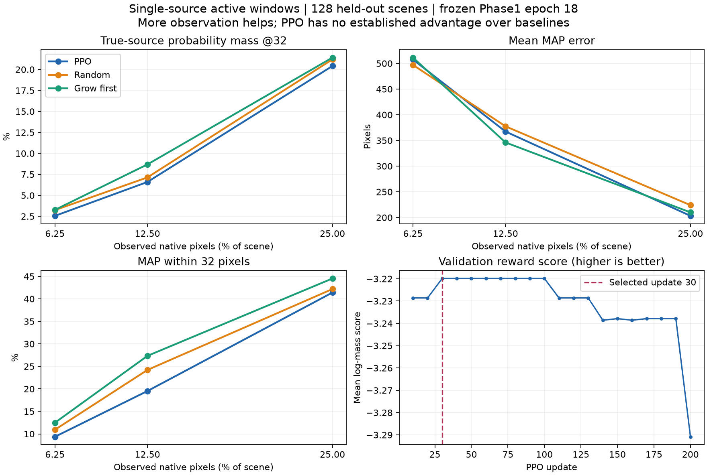

# 单源RL动态视窗：首轮服务器结果审核

审核日期：2026-11-05。数据来自 `G2-02/results/active_rl/single_source_rl_v1/`。

**结论：增加观测和融合单源位置场有效；本轮PPO尚未证明比随机选窗或固定扩窗更好。策略主要表现为扩大面积，对响应和概率场内容的利用不足。不能把这轮结果称为已经学会最佳观测路径。**

## 实验身份和检查

- 冻结定位器：100k Phase1，多尺度边界模型，最佳epoch18；训练时未更新定位器。
- RL训练/验证/测试：2,048 / 128 / 128个场景；测试包含128个独立障碍物几何组。
- 策略参数：209,890；200次PPO更新；最佳验证策略在update30。
- 本轮实际训练进程数为1，1,024 transitions/update，总计204,800条环境转移。自动GPU选择为什么最终只启动一个进程，现有下载结果不含启动日志，无法确认。
- 记录的update累计时间约4.66小时，包含周期验证；不是GPU核时间或独立冷缓存吞吐基准。
- 初始视窗128×128；按64×64块采集；候选spacing16，共4,096个全场候选点。不同原子块使用折扣log意见池融合，折扣0.5。
- 奖励为 `Δ[0.5 log(M16+1e-8)+0.5 log(M32+1e-8)]`，gamma=1；策略输入不含真源坐标。位置场熵没有进入奖励。
- 1,536条测试记录齐全：128场景×3预算×4策略；无重复/缺失，预算及累计奖励关系检查通过。
- 已核对下载的策略SHA和本地六个实现文件SHA，与结果元数据一致。
- 原Phase1训练曾追加Phase2层；外部追加数据与本次测试几何是否重叠尚未独立审计。当前主数据集的几何划分检查已完成。

## 同预算下的主要结果

M32是分配给真源32像素半径邻域的平均概率质量。Recall@32是最高概率候选点距真源不超过32像素的场景比例；两者不能互换。

| 新增像素并集预算（含初始窗） | 策略 | M32 | Recall@32 | 平均最高概率点距离 |
|---|---|---:|---:|---:|
| 65,536（全场6.25%） | PPO | 2.56% | 9.38%（12/128） | 507.5 px |
|  | 随机选窗 | 3.25% | 10.94%（14/128） | 497.1 px |
|  | 优先扩窗 | 3.28% | 12.50%（16/128） | 511.3 px |
| 131,072（12.5%） | PPO | 6.60% | 19.53%（25/128） | 367.4 px |
|  | 随机选窗 | 7.14% | 24.22%（31/128） | 377.6 px |
|  | 优先扩窗 | 8.69% | 27.34%（35/128） | 346.2 px |
| 262,144（25%） | PPO | 20.42% | 41.41%（53/128） | 203.2 px |
|  | 随机选窗 | 21.20% | 42.19%（54/128） | 224.0 px |
|  | 优先扩窗 | 21.41% | 44.53%（57/128） | 210.0 px |



PPO在最大预算下平均距离略小，但真源质量和32像素命中率没有领先。按独立几何组配对bootstrap（1,000次）：

- PPO−随机的M32：−0.78个百分点，95%区间[−4.26, +2.50]个百分点。
- PPO−随机的平均距离：−20.8 px，区间[−64.9, +23.4] px。
- PPO−优先扩窗的M32：−1.00个百分点，区间[−3.94, +1.91]个百分点。
- PPO−优先扩窗的平均距离：−6.8 px，区间[−47.0, +33.1] px。

这些区间不支持宣称PPO优于基线，也不构成三者严格等效的证明。中预算PPO的M32比优先扩窗低2.09个百分点，单项95%区间为[−4.09, −0.33]个百分点；未做多重比较校正。

训练前策略在所有场景立即停止，只用了16,384像素。因此相对它的提升混合了额外观测量和策略变化，不能独立证明RL选路有效。随机基线平均实际支出约65,472 / 129,184 / 260,864像素，略低于三档上限；不是严格逐场景像素数完全相同的比较。

## 已经成立的进展

同一128个场景上，从初始观测到PPO最大预算最终结果：

- 真源邻域质量M32：0.70% → 20.42%。
- Recall@32：2/128 → 53/128。
- 概率加权平均源距离：483.8 → 217.4 px。
- 平均90%高概率区域面积：840,954 → 154,024像素，约占全场14.69%。
- 90%区域仍覆盖真源的场景为119/128（92.97%）；这表示候选范围保留真源，不能解释为93%精确定位成功。

初始72/128个场景的位置场熵接近均匀分布（与log4096相差小于1e-5）；均匀分布的最高概率点由argmax平局规则落到第一个网格点。因此初始平均MAP距离615.9 px含有任意平局影响，不能把其全部下降都归因于定位能力；真源质量及概率加权距离更适合支持信息增加的结论。

最大预算下，PPO距离中位数38.8 px；74/128在64 px内，35/128仍超过256 px，21/128超过512 px。均值203.2 px来自明显长尾，尚未实现稳定坐标恢复。M32中位数仅12.03%，仅12/128个场景的M32超过50%。

118/128最终奖励为正，5个下降，5个基本不变。下降的5个场景同时出现熵下降，证明本次也存在错误集中。不能只奖励位置场变尖。

## 路径与内容敏感性诊断

真实测试日志显示：

- 小预算下，全部128个PPO场景一步用完预算。
- 中预算下，全部128个场景三步用完预算。
- 最大预算下，全部128个场景两步用完预算。结合动作成本，这两步只能是128→256→512的连续扩窗；没有空间留给移动。

使用下载的最佳策略做额外敏感性探测：保留相同起点、覆盖状态、预算和合法动作，分别提供均匀位置场、左上尖峰、右下尖峰，以及已观测区全亮/棋盘响应。每次只改变公开输入；不读取真实源或未来响应。五种探测在三档预算的全部128个起点上均产生相同的逐场景动作与窗口序列。最大预算下均匀探测的第一步98/128选择grow_sw（向左、向下扩展），其余主要由边界合法性和位置决定。

最大预算仅保存了3个完整真实路径；去掉内容后的探测与这3条真实路径逐项完全相同。其余125条不能做直接完整路径比对，因为episodes.json不保存完整动作历史。

**解释限度：这些是合成公开输入上的敏感性探测，不是新的真实传感器实验；相同贪心动作不等于动作概率完全相同。现有证据强烈支持内容利用不足，但不能据此证明网络对任意输入都完全不使用内容。**

验证分数update10为−3.22860，update30最佳−3.21986，update200为−3.29083；20次验证只有5个不同分数。增加训练没有持续改善贪心路径。不能仅凭这条曲线确认过拟合、优化不足或唯一架构原因，也没有依据直接继续堆更新次数。

## 真源进入视窗的影响

最大预算下PPO有37个场景实际观察到了真源所在块：其中27个命中32 px（73.0%）。另外91个未观察到真源的场景，26个命中（28.6%），平均距离261.7 px，M32为16.37%。所以部分成功来自扩窗直接覆盖真源，但也存在从外部响应反演成功的案例。

不同策略会选出不同“真源是否被观察”的子集，这些条件结果只用于诊断，不能直接当作无偏的策略优劣比较。若目标坚持源始终在观测外，应另建立公开可定义的任务约束/测试协议，不能让推断策略读取真源来屏蔽动作。

## 代表案例

- scene92061：PPO连续扩窗，M32从2.37%升至88.52%，MAP误差8.0 px；真源最终在观测区内。
- scene15285：PPO最终M32只有3.10%，MAP误差485.2 px；相同预算优先扩窗为17.18%及29.7 px，两者真源均在观测区外。说明选路确实可能影响结果，而当前策略没有稳定选好。
- scene99873：PPO最终M32为4.03%，MAP误差216.1 px；概率缩小但仍保留较长可行区域，不能称为坐标收敛。

对应图片和逐步数组在原下载目录figures中。本轮仅有3个代表场景，不能用它们替代128场景的总体统计。

## 下一轮应解决的具体问题（尚未实施）

1. **先检验策略是否使用内容。** 对真实已观测状态保存完整路径，做固定覆盖下的响应/概率场遮蔽与置换，并记录动作变化率及动作分布变化。当前合成探测只能作为第一步证据。
2. **让每个候选动作读取对应空间区域的公开特征。** 当前全图编码压缩成共享向量，再与动作几何坐标拼接。可增加动作ROI对当前概率场、已有边界与覆盖状态的读取；不能提前读取候选动作尚未观察的响应。是否有效需要新实验验证。
3. **避免任务只剩两次扩窗。** 预先在开发集定义更细的扩张动作或单步新增像素上限、训练时混合预算，保留移动/局部扩展的选择空间。新旧策略及所有基线必须使用同一动作和成本规则。gamma=1时原奖励没有直接偏好少步骤；问题是大扩窗可以轻易消耗预算并带来普遍信息增益。
4. **把定位/融合与选路分开诊断。** 当前固定64块丢掉跨块结构，均匀块被当作中性证据；共享未知几何下的乘积近似也未校准。先保留现有融合做策略对照，再独立比较融合改进，避免同时换多个部分后无法归因。
5. **继续以真源邻域质量作训练奖励。** 熵下降和错误集中已经共存，不应改成只追求集中度。使用开发/验证场景定参数，新一轮架构选择不要反复利用这128个已审阅测试场景；增加随机策略重复、策略训练种子及未见测试场景，报告配对区间。

本次只新增审核脚本和研究记录，未修改训练、奖励或已有权重。

## 复核命令

在Phase1目录执行：

```bash
PYTHONPATH=src:vendor .venv/bin/python tools/audit_active_rl_results.py \
  ../results/active_rl/single_source_rl_v1 \
  --output docs/results/rl_single_source_v1_audit.json
```

原始结果在下载目录中；本报告补充计数及敏感性诊断在`rl_single_source_v1_audit.json`中。
