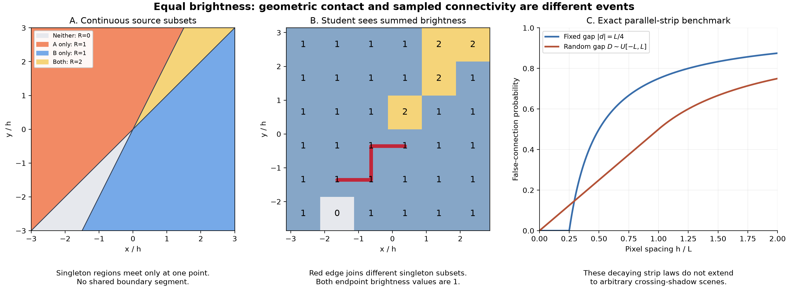

# Spatial ambiguity and conditional recovery in multisource peeling

**Result.** For independent continuously positioned sources and rectangular blockers, two different equal-brightness source regions share a positive-length free-space boundary with probability zero. For a randomly shifted pixel grid, however, the probability that such regions are falsely connected need not tend to zero with pixel spacing. A parallel-strip model has an exact decaying probability; a crossing-shadow model has ambiguity at every sufficiently fine resolution. Source peeling therefore requires geometric and identifiability assumptions in addition to the absence of exact boundary coincidences.

This note studies **unit source strengths**. Equal brightness from different subsets is common in this model: `{1}` and `{2}` both have brightness 1. It is the spatial connection between these regions, rather than equality of their brightness, that is the probability-zero event in the first theorem.

## 1. Model, probability spaces, and events

Let the observation window be a bounded open rectangle

\[
\Omega=(a_x,b_x)\times(a_y,b_y).
\]

There are two fixed closed axis-aligned rectangular blockers

\[
B_j=[\ell_j,r_j]\times[b_j,t_j],\quad \ell_j<r_j,\quad b_j<t_j,\quad j=1,2,
\]

with disjoint closures. The coordinates are parameters. Write \(F=\Omega\setminus(B_1\cup B_2)\) for free space. For the random-scene model, independently draw source \(s_i\) uniformly from a positive-area rectangular domain \(D_i\) outside the closed observation window and blockers. Independence and an absolutely continuous joint position law are sufficient for the contact theorem; the uniform law makes the scene integral explicit. Sources and blockers remain continuous rather than being snapped to pixels.

For a free point \(x\), let

\[
V_i(x)=\mathbf 1\{[s_i,x]\cap(B_1\cup B_2)=\varnothing\},\qquad
A(x)=\{i:V_i(x)=1\},\qquad R(x)=|A(x)|.
\]

Segment tangencies count as blocked. This convention affects shadow boundaries, but not the almost-everywhere probabilities below. There is no decay, noise, intensity quantization, or pixel-area averaging. Obstacle pixels are excluded from region connectivity. The same definitions extend to a fixed finite number \(n\) of sources.

**Continuous event \(E_0\).** Consider the open constant-subset regions in free space, away from shadow boundaries. The closures of two regions with different subsets and the same cardinality share a nonzero-length straight boundary segment inside free space. There is no intervening open strip of a different response. Mere contact at an isolated point does not count. This is a statement about adjoining open regions; it does not assert that the intensity assigned on the boundary itself equals their intensity.

**Sampled event \(E_h\).** Independently choose \(U_h\sim\operatorname{Unif}([0,h)^2)\) and sample

\[
\Lambda_{h,U}=U_h+h\mathbb Z^2.
\]

Retain points in \(F\). Two retained points are adjacent when their displacement is \(he_1\) or \(he_2\), up to sign, and their connecting segment is obstacle-free. Form connected components using only edges whose endpoints have the same response. Event \(E_h\) means that at least one such component contains two different source subsets. Equivalently, at least one retained edge has equal endpoint brightness but different endpoint subsets: along any mixed component path, some consecutive labels must change.

The implementation's fixed pixel centers correspond to one particular phase of a grid with \(h=1\). Random grid phase is an analytical experiment, not a claim about the dataset generator.

For a fixed scene \(S=(s_1,s_2;B_1,B_2,\Omega)\), set

\[
p_h(S)=\Pr_U(E_h\mid S).
\]

For independently uniform sources, the random-scene probability is exactly

\[
P_h=\mathbb E_S p_h(S)
=\frac{1}{|D_1||D_2|h^2}
\int_{D_1}\int_{D_2}\int_{[0,h)^2}
\mathbf 1_{E_h(s_1,s_2,u)}\,du\,ds_2\,ds_1.
\tag{1}
\]

This integral is a probability specification, not a closed-form evaluation for arbitrary rectangle parameters. Later sections give explicit evaluations and bounds in stated geometric settings.

## 2. Exact shared segments have probability zero

**Theorem 1 (polygonal contact).** In the rectangular-blocker model above, \(\Pr_S(E_0)=0\). The conclusion also holds for finitely many fixed polygonal blockers and finitely many independently absolutely continuously positioned sources.

**Proof.** Away from obstacle boundaries and the source itself, a visibility discontinuity for a polygonal blocker lies on a ray from the source through an obstacle vertex. To see this, sweep the direction of the source-to-point segment. Its intersection status can change only at a tangent direction; for a polygon such directions pass through vertices. A boundary can also end at the blocker, another boundary, or the window. Those endpoints do not create an open free-space boundary segment. Occlusion by multiple blockers can remove pieces of these rays but introduces no new supporting lines.

There are finitely many possible source-vertex supporting lines. Along a positive-length segment where equal-count regions change subsets, at least one source must leave and another enter. Both visibility boundaries must therefore contain a common subsegment. After discarding finitely many endpoints and intersections, their supporting lines coincide.

Take vertices \(v,w\) and two different sources \(s_i,s_j\). If \(v\ne w\), coincidence of lines \(s_iv\) and \(s_jw\) forces \(s_i\) onto the fixed line through \(v,w\), a set of planar Lebesgue measure zero. If \(v=w\), condition on \(s_i\ne v\); coincidence forces \(s_j\) onto the line through \(s_i,v\), again a null set by independence and absolute continuity. The excluded event \(s_i=v\) is also null. A finite union over source pairs and vertex pairs remains null. This covers \(E_0\). ∎

The proof does **not** say that distinct source subsets have different brightness, that source masks are identifiable, or that all shadow boundaries are disjoint. Transverse intersections of two shadow boundaries are entirely compatible with the theorem. Singular source laws, such as deliberately aligning sources and vertices, can give positive contact probability and are outside its hypotheses.

For smooth blockers, the finite-vertex argument is unavailable. An extension requires an explicit regularity/transversality assumption ensuring that shared free-space shadow arcs arise only on a null set of source parameters. This note does not claim the polygonal proof covers arbitrary mixed shapes automatically.

## 3. Exact finite-resolution strip probability

This is a separate, explicitly simplified boundary-gap model. It is not an assertion that the distribution of shadow gaps induced by arbitrary rectangles is uniform.

On a line normal to two parallel boundaries, take

\[
V_1(x)=\mathbf 1\{x<0\},\qquad
V_2(x)=\mathbf 1\{x>d\}.
\]

For \(d>0\), the intermediate interval is dark. For \(d<0\), it has brightness 2. On either side the brightness is 1, from different sources. Use the shifted lattice \(u+h\mathbb Z\), \(u\sim\operatorname{Unif}([0,h))\). The observation interval includes both boundaries and margins larger than \(h\). In two dimensions the same result applies to vertical boundaries and a rectangular patch containing a grid row, with horizontal grid edges crossing the strip.

**Proposition 2 (fixed separation).** Apart from null phases placing a sample on a boundary,

\[
\Pr_U(\text{a false connection}\mid d)
=q_h(d)=\left(1-\frac{|d|}{h}\right)_+.
\tag{2}
\]

**Proof.** A strip of width \(w=|d|<h\) contains a lattice point for a set of phases of length \(w\) in the phase interval of length \(h\). If it contains none, the consecutive samples straddling it both have brightness 1 and different source labels. If it contains a point, that point's response 0 or 2 separates the two brightness-1 runs. Every interval of width at least \(h\) contains a point except possibly at null endpoint phases. ∎

In particular, \(d=0\) gives probability 1; a fixed nonzero \(d\) gives probability 0 whenever \(h\le |d|\). Exact contact and unresolved near-contact are different events.

**Corollary 3 (random signed separation).** Let \(D\) be independent of grid phase, with a density \(f\) continuous at zero. Then

\[
\Pr(E_h)=\int_{-h}^{h}\left(1-\frac{|d|}{h}\right)f(d)\,dd
=h f(0)+o(h).
\tag{3}
\]

Indeed, substitute \(d=ht\) and use continuity; \(\int_{-1}^1(1-|t|)dt=1\). If \(f\le M\) on \([-h,h]\), the probability is at most \(Mh\). For example, for \(D\sim\operatorname{Unif}[-L,L]\), \(L>0\), the exact expression is

\[
\Pr(E_h)=
\begin{cases}
h/(2L),&0<h\le L,\\
1-L/(2h),&h\ge L.
\end{cases}
\tag{4}
\]

Both branches follow by integrating the triangular kernel over its intersection with \([-L,L]\). They agree at \(h=L\). For an unsigned width \(W\ge0\) with continuous one-sided density \(g\), the corresponding asymptotic is \(h g(0)/2+o(h)\), so the signed and unsigned constants must not be confused.

If the separation law has an atom of mass \(a\) at zero, the limit is \(a\), not zero. More generally, this follows directly from bounded convergence applied to \(q_h(D)\). No linear rate follows merely from having a continuous source-position distribution: the induced gap density must itself be controlled.

## 4. General two-dimensional bounds

For \(e\in\{e_1,e_2\}\), define the set of bad edge origins

\[
\mathcal B_{h,e}(S)=\{z:z,z+he\in F,\ [z,z+he]\subset F,
\ R(z)=R(z+he),\ A(z)\ne A(z+he)\}.
\]

Let \(N_h(S,U)\) count these oriented positive-direction grid edges, each physical edge counted once.

**Proposition 4 (random-shift identity).**

\[
\mathbb E_U N_h(S,U)
=\frac1{h^2}\sum_{e=e_1,e_2}|\mathcal B_{h,e}(S)|,
\qquad
p_h(S)\le\min\left(1,\frac1{h^2}\sum_e|\mathcal B_{h,e}(S)|\right).
\tag{5}
\]

**Proof.** Integrate \(\sum_{k\in\mathbb Z^2}\mathbf1_{\mathcal B}(u+hk)\) over \([0,h)^2\). The translates of this square tile the plane, giving \(|\mathcal B|/h^2\). Sum over the two edge directions. Then use \(E_h=\{N_h\ge1\}\) and the union/first-moment bound. No independence between edges is assumed. ∎

If \(N_h\le M_0\), the complementary lower bound \(p_h(S)\ge \mathbb E_U N_h/M_0\) follows from \(N_h\le M_0\mathbf1_{E_h}\). Thus a bad-origin area of order \(h^2\) can yield a **nonvanishing probability of at least one bad edge**, despite occupying a shrinking fraction of the image.

**Proposition 5 (a sufficient separation condition).** Let \(\Gamma_i\) be the free-space visibility boundaries of source \(i\), and define

\[
\delta(S)=\inf_{i\ne j}\inf_{x\in\Gamma_i,y\in\Gamma_j}\|x-y\|,
\]

with distance to an empty set interpreted as infinity. Then, apart from null boundary-sampling phases,

\[
p_h(S)\le\mathbf1\{\delta(S)\le h\},\qquad
P_h\le\Pr_S(\delta(S)\le h).
\tag{6}
\]

**Proof.** An equal-count subset change along an obstacle-free edge entails at least two different sources changing visibility. That edge crosses both boundaries. Their crossing points are separated by at most the edge length \(h\). ∎

Consequently, if \(\delta>0\) almost surely, then \(P_h\to0\). If additionally \(\Pr(\delta\le t)\le Ct^\alpha\) for \(0<t<t_0\), then \(P_h\le Ch^\alpha\) for \(h<t_0\). These are sufficient conditions, not consequences of Theorem 1. Crossings have \(\delta=0\); shared endpoints near blockers can also make this conservative bound uninformative. A localized version can be applied on an interior patch when its relevant boundary pieces are separated.

For multiple sources, (5) and (6) still hold. Alternatively, bound the event by a union over pairs of sources undergoing a count-preserving swap. A pairwise bound must be summed over pairs and over possible locations before making an image-wide claim; neither a linear dependence on source count nor independence of local failures is automatic.

## 5. A physically realizable crossing counterexample

### 5.1 Fixed scene: probability one at every fine resolution

Let \(r=1/8\), \(\Omega=(-r,r)^2\), and choose

\[
\begin{aligned}
s_1&=(-3,-3), & B_1&=[-2,-7/4]\times[-9/4,-2],\\
s_2&=(-3,-6), & B_2&=[-2,-7/4]\times[-7/2,-13/4].
\end{aligned}
\tag{7}
\]

These are disjoint blockers outside the window. The relevant tangent vertices are \((-2,-2)\) and \((-7/4,-7/2)\). In the entire window, away from the tangent lines,

\[
V_1(x,y)=\mathbf1\{y>x\},\qquad
V_2(x,y)=\mathbf1\{y<2x\}.
\tag{8}
\]

To verify the geometry: the angular shadow of \(B_1\) from \(s_1\) lies between slopes \(3/5\) and 1; target slopes in the window lie in \([23/25,25/23]\). The shadow of \(B_2\) from \(s_2\) lies between slopes 2 and \(11/4\); target slopes lie in \([47/25,49/23]\). The other blocker does not intersect either near-window ray bundle. Thus each source has exactly the stated local visibility boundary.

The singleton regions touch only at the origin in their closures. On either side of the origin, an open brightness-0 or brightness-2 wedge separates them. There is no shared boundary segment, so \(E_0\) is false.

**Theorem 6.** For this scene and every \(0<h<r/3\), \(p_h(S)=1\).

**Proof.** Scale coordinates by \(h\). Write the two nearest grid columns on opposite sides of the crossing as \(x=u\) and \(x=u-1\), where \(0<u<1\), and let the common vertical phase be \(v\in[0,1)\). In the positive column, the intermediate brightness-2 interval is \((u,2u)\), of length \(u\). In the negative column, the intermediate brightness-0 interval is \((2u-2,u-1)\), of length \(1-u\).

Modulo 1, the sets of vertical phases hitting these two open intervals partition the unit circle except for endpoints: the second interval is congruent to the oriented interval from \(2u\) to \(u+1\), complementary to the first from \(u\) to \(2u\). Hence, for almost every \((u,v)\), exactly one intermediate interval has no grid sample. In that column consecutive samples jump directly between the two different singleton subsets, giving a bad vertical edge.

Those edge endpoints have \(|x|<h\), \(|y|<3h\); both lie in \(\Omega\) when \(h<r/3\). There are no blockers in the window. The exceptional phases have measure zero. ∎

This result concerns randomized phase at each spacing. It does not require independent phases across resolutions. It also defeats any universal claim that the conditional probability tends to zero for every scene lacking exact shared segments.

### 5.2 The obstruction survives continuously randomized sources

The fixed source positions in (7) alone do not refute a statement about almost every random scene. The following extension does.

Keep the window and blockers in (7), and independently draw sources uniformly from squares of half-width \(\eta=10^{-4}\) centered at the two source positions in (7). The active tangent vertices remain the same. Their lines become

\[
y=m_1x+b_1,\quad y=m_2x+b_2,\qquad
b_1=2(m_1-1),\quad b_2=\tfrac74(m_2-2).
\]

Directly from the source squares,

\[
|m_1-1|\le\frac{2\eta}{1-\eta}<0.000201,
\quad
|m_2-2|\le\frac{3\eta}{5/4-\eta}<0.000241.
\tag{9}
\]

The two lines intersect at \(x_*=(b_2-b_1)/(m_1-m_2)\), \(y_*=m_1x_*+b_1\), with \(|x_*|<0.001\), \(|y_*|<0.002<r/4\). To check visibility uniformly over these source squares, bound each target slope by taking the extreme numerator and denominator coordinates. Source 1's target slopes lie in \((0.919,1.088)\), while its other tangent slope is below 0.601. Source 2's target slopes lie in \((1.879,2.132)\), while its other tangent slope exceeds 2.749. The cross-blocker slopes are negative for source 1 and exceed 2.999 for source 2. Thus the other tangent rays and the other blocker remain irrelevant throughout the window; the same corner rays remain active and the visibility inequalities retain the same directions.

For a vertical edge, the bad-origin set near this intersection is the parallelogram

\[
-h<y-m_1x-b_1<0,\qquad
0<m_2x+b_2-y<h.
\tag{10}
\]

Its area is \(h^2/(m_2-m_1)\): the affine map to these two expressions has determinant of absolute value \(m_2-m_1\). From (9), this gap lies between \(0.9\) and \(1.1\), in particular below 2. Every origin in (10) lies within \(3h\) of the intersection in each coordinate. If \(h<r/10\), the parallelogram and its vertical edge endpoints are in the window.

A square of side \(6h\) contains at most 49 points of any shifted \(h\)-lattice (64 is a convenient looser bound). If \(N^{\rm loc}_h\) counts bad vertical edges originating in (10), then

\[
\mathbb E_U N^{\rm loc}_h=\frac1{m_2-m_1}\ge\tfrac12,
\qquad N^{\rm loc}_h\le64,
\quad\Longrightarrow\quad
p_h(S)\ge\frac1{128}.
\tag{11}
\]

This holds for every source pair in the stated squares and every \(h<r/10\). Averaging gives \(P_h\ge1/128\), even though Theorem 1 gives \(\Pr_S(E_0)=0\). The lower bound is deliberately conservative, not a prediction for the real dataset.

The negative coordinates in (7) are only a coordinate convention. To embed the construction inside the repository's 1024-square world, apply \(T(x,y)=(800+128x,800+128y)\). The sources become \((416,416)\) and \((416,32)\); all blockers and source squares remain inside the world and outside the 64-square observation window \((768,832)^2\). The image of our proof patch is \((784,816)^2\), inside that observation. The random-source bound applies at physical spacing \(h_{\rm physical}<128r/10=1.6\), including spacing 1, when grid phase is randomized. A bad edge inside the patch is also a bad edge in the full observation. This embeds the obstruction in admissible geometry; it still does not identify the real dataset's scene or grid-phase distribution.

More generally, at an isolated crossing with affine visibility tests \(f_1>0,f_2>0\), a direction \(e\) permits a direct source swap if \((\nabla f_1\cdot e)(\nabla f_2\cdot e)<0\). Its local bad-origin area is

\[
h^2\frac{|(\nabla f_1\cdot e)(\nabla f_2\cdot e)|}{|\det(\nabla f_1,\nabla f_2)|}.
\]

This explains why transverse crossings can contribute a constant expected number of bad grid edges. Some orientations do not permit a swap along either grid axis; the counterexample is a sufficient obstruction, not a claim that every crossing merges regions.

## 6. What can be proved about peeling

Let \(P\) be a finite set of free sampled pixels and \(\mathcal D\subset\{0,1\}^P\setminus\{0\}\) a finite dictionary of physically admissible **full-window** unit-source masks. Different positions with the same mask are equivalent for this theorem. Suppose

\[
r_0=\sum_{i=1}^{m}M_i,\qquad M_i\in\mathcal D.
\]

The objective is to output admissible source masks whose sum equals \(r_0\). Matching only these samples is not a guarantee of matching the unsampled continuous field. Invisible sources cannot be counted from this observation; they are omitted from the target.

At each step, form the obstacle-safe equal-response components, choose the first component at the lowest positive response, identify one full admissible mask, subtract it everywhere, and recompute. Under the assumptions below the lowest positive response is 1, so a layer has the prescribed unit strength, not an estimated intensity larger than 1.

**Theorem 7 (conditional exact peeling).** The procedure recovers a compatible decomposition in \(m\) rounds if:

1. **Coverage:** the dictionary contains the masks in the displayed representation.
2. **Peelability:** every nonempty subfamily of those masks has a singleton witness pixel, meaning its sum at that pixel is 1.
3. **Pure anchors:** at every stage of the procedure, the chosen response-1 component is illuminated by the same single remaining source at all of its pixels. Spatial false connections must not mix source identities in this component.
4. **Mask identifiability:** among dictionary masks \(M\) with \(M\le r\) pointwise and \(M=1\) on the entire chosen anchor, exactly one distinct full mask is feasible.
5. The procedure finds that mask and subtracts its entire contribution exactly.

**Proof.** By peelability, the positive integer residual has minimum 1. Anchor purity supplies one remaining true mask that is 1 on the anchor; it is feasible because it is one summand of the residual. Uniqueness therefore identifies that full mask. Subtracting it removes one source and leaves exactly the sum of the remaining masks, preserving nonnegativity and coverage. The remaining subfamily retains condition 2. Conditions 3–5 apply at the next stage. Induction removes one mask per round, ending after \(m\) rounds with zero residual. The output is physically admissible and has sum \(r_0\). ∎

The theorem's assumptions are deliberately explicit; the note does not infer them from Theorem 1. A singleton **pixel** and a pure singleton **connected region** are different requirements. For example, the crossing scene has singleton pixels but a mixed singleton component on the grid. Even a perfectly pure anchor need not determine the rest of its source mask. These are separate obstructions.

Conditions 2–4 are sufficient rather than necessary for finding some compatible decomposition. If several masks are feasible, complete branching can sometimes find a compatible completion; local feasibility \(M\le r\) alone does not guarantee completion. Any recovery claim for such branching needs an additional completeness argument and budget analysis.

### Necessary distinctions and counterexamples

- **No singleton:** two unit sources with identical nonzero masks produce response 2 wherever lit. There is a compatible two-source explanation, but the singleton-first rule cannot start. Informative windows alone do not fix this: response values 0 and 2 are already informative.
- **Nonidentifiable masks/positions:** two different source positions can have identical masks at every observed pixel. Both are compatible. No observation-only rule can choose the generating position without extra information. The upstream unit-strength release explicitly supplies alternative sampled-equivalent source positions.
- **Mixed anchor:** masks `(1,0)` and `(0,1)` on two adjacent pixels produce one brightness-1 component. If that is the full dictionary, no single source covers its anchor. A third admissible mask `(1,1)`, if available, instead gives a different compatible explanation; two generating sources are still not identifiable.
- **Locally feasible is insufficient:** with masks `(1,1,0)`, `(0,1,1)`, and `(1,0,0)`, residual `(1,1,1)` has the compatible decomposition given by the last two masks. Subtracting the first is nonnegative but leaves `(0,0,1)`, which has no decomposition in this dictionary.
- **Local subtraction:** on a path of five constant-subset regions let source A cover regions 0 through 3, and B cover regions 1 through 4. Response is `(1,2,2,2,1)`, whose middle three entries form one response-2 region. From the left singleton, one-hop subtraction removes A from 0 through 3, which happens to be its full support. This is a successful local case. In contrast, let A cover all five regions and B cover only region 1. Response is `(1,2,1,1,1)`, giving three response regions. From region 0, one-hop subtraction omits A's contribution in regions 2 through 4. The residual after the local step is `(0,1,1,1,1)` rather than B's mask `(0,1,0,0,0)`. These are abstract admissible-mask examples illustrating the algebraic issue, not claims about a particular two-rectangle scene.

With \(G=|\mathcal D|\) cached masks and \(P\) pixels, naive per-round feasibility scans cost \(O(GP)\); graph processing adds its own cost. With a precomputed obstacle-safe pixel graph, regrouping costs \(O(P)\) on a grid, so \(m\) rounds cost \(O(mGP+mP)\), in addition to building/rendering the dictionary and graph. Complete branching can be exponential. Neither \(G\) nor rendering cost is constant when spatial resolution or source-location coverage is refined. The theorem justifies a linear number of **removal rounds** under its hypotheses, not a universal exponential-to-linear end-to-end complexity reduction.

## 7. Connection to the current repository

The comparison was checked against GitHub on October 27, 2026 (America/New_York). The unit-strength branch remained at `77c03a031b923953197184ba16cf6dd6e55c5e48`, and main at `1591783558e04e1188e97ee008932b11421db52b`.

| Implementation behavior | Mathematical implication |
|---|---|
| [Unit-strength random-window data](https://github.com/yiyuqian0912/G2-02/blob/77c03a031b923953197184ba16cf6dd6e55c5e48/Phase2_Multi_Source/docs/dataset-unit-random-100k.md): 1–4 sources, strength 1, pixel-center sampling; constant free-pixel responses excluded | Matches the unit-count field here. Informative does not mean singleton-bearing or identifiable. No law for every source/obstacle generation parameter was established from the inspected repository. |
| [Region graph](https://github.com/yiyuqian0912/G2-02/blob/77c03a031b923953197184ba16cf6dd6e55c5e48/Phase2_Multi_Source/src/rind_phase2/regions.py): four-neighbor graph, segment/obstacle checks, response tolerance `1e-12`; disconnected equal-valued areas retain distinct IDs | Matches the event at zero tolerance. For exact integer unit responses, the documented tiny tolerance does not merge different counts. Obstacle-safe edges do not detect an unsampled shadow wedge in obstacle-free space. |
| [Layered teacher](https://github.com/yiyuqian0912/G2-02/blob/77c03a031b923953197184ba16cf6dd6e55c5e48/Phase2_Multi_Source/src/rind_phase2/layered_teacher.py): minimum-positive anchor, single-source candidates, anchor plus selected one-hop-neighbor subtraction | Theorem 7 applies only when that local subtraction equals the candidate's entire contribution and the other assumptions hold. Otherwise the residual need not be the remaining physical sources. This teacher rejects an inferred source intensity above 1. |
| Same teacher: finite position grid, samples per neighbor pattern, bounded beam, final full-response MAE check | A missing grid mask, unselected candidate, or pruned branch can remove the compatible solution. An accepted finite-MAE candidate is approximately compatible on the observation; this is not a completeness or exact-identifiability guarantee. |
| Separate [research residual path](https://github.com/yiyuqian0912/G2-02/blob/77c03a031b923953197184ba16cf6dd6e55c5e48/Phase2_Multi_Source/research/layered_residual/layered_residual.py): BFS infers positive support from response transitions, subtracts this effective layer, and later scores it against single-source candidates | This is **not** the one-hop teacher. Equal/increasing response does not by itself prove that a particular source persists. The code reports decomposition correctness as unproved, allows effective layers above the physical single-source limit, and does not make these layers physical masks merely by naming a field `full_mask`. |

Theorems here concern visibility masks and a geometry-assisted candidate dictionary. They do not prove that a student with local response/window inputs can recover unavailable exterior geometry or satisfy the mask-identification oracle. A smaller training loss cannot remove a failure of observational identifiability.

## 8. Verification and interpretation

Run `python3 -m unittest -v` and `python3 verify.py --output results.json` in this directory. All checks use the Python standard library. The companion script records deterministic seeds and sample sizes, and tests:

1. The strip formula for both gap signs, exact contact, resolved strips, and the two branches of the uniform-gap average.
2. Four-connected false bridges in the affine crossing at successively smaller spacings.
3. Direct source-to-point segment/rectangle visibility for the physical crossing scene, including perturbed sources from the specified uniform boxes.
4. The pure-anchor finite-dictionary theorem's successful case, ambiguous anchors, missing singleton witnesses, and a locally feasible dead end.
5. Full-window versus one-hop subtraction, keeping equal-response components distinct from individual pixels.

The scripts do not estimate the real dataset's ambiguity frequency. They do not vary the spatial step by changing brightness precision. The fixed-scene phase experiment, random-source experiment, exact strip calculation, and proof-derived bounds remain separately labelled in the output.

**What is established:** zero probability for positive-length shared polygonal shadow boundaries under the stated continuous source law; an exact strip ambiguity probability; image-wide random-shift bounds; a nonvanishing crossing obstruction even for continuously randomized sources; and a conditional peeling theorem. A dataset-wide numerical rate or unconditional recovery guarantee would require additional geometric-distribution and identifiability assumptions.
