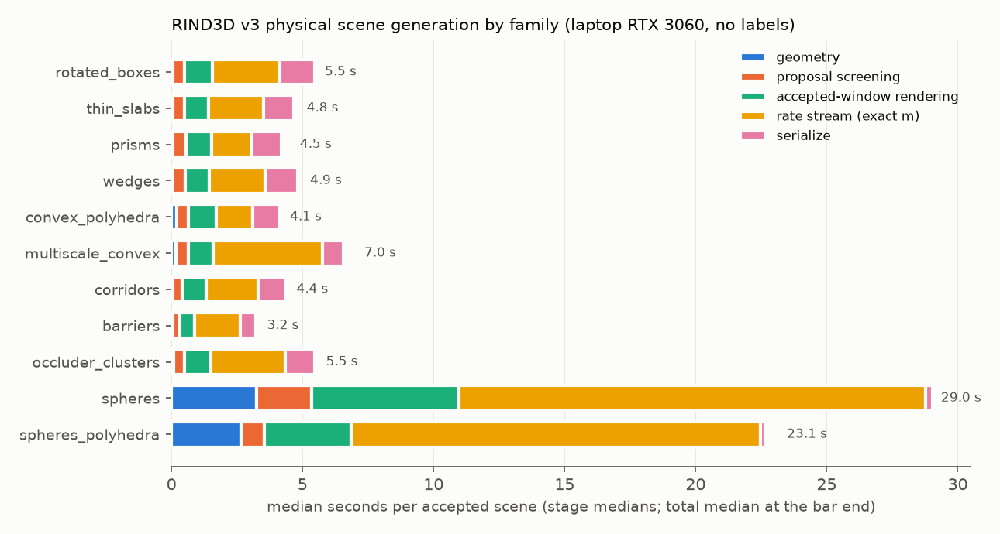
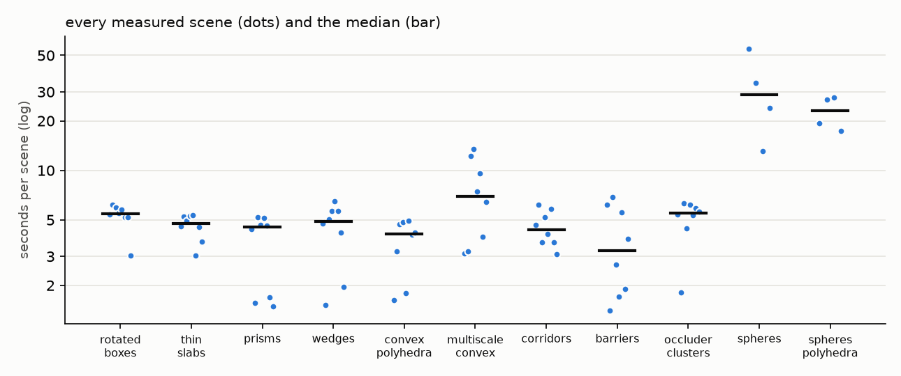

# Physical scene generation by family (contract v3, laptop)

**What is measured.** Physical scene generation only: geometry, driver sources, window proposals and eligibility,
accepted-window rendering, the exact-m rate stream, and serialization. Posterior labelling is separate (see
`RIND3D_Posterior/docs/LOCALFIRST_COMPARISON.md`).

**Hardware and software.** These are measurements on one laptop, not H20 measurements, and they are not extrapolated.
* NVIDIA GeForce RTX 3060 Laptop GPU, 6 GB, driver 620.70.06.
* AMD Ryzen 7 5800H, 16 hardware threads.
* Python 3.12.14, OMP_NUM_THREADS = NUMBA_NUM_THREADS = 1.
* Recorded in `env_*.json` of the run.

**Method** (`scripts/bench_families.py`).
* Each family runs in a fresh process, so peak RSS (VmHWM) belongs to that family.
* One warm-up scene per process is discarded (NVRTC, numba, caches).
* The scenes have fixed seeds: slots f, f + F, … of the contract's round robin.
* Scenes run sequentially on one GPU that nothing else uses.
* Peak GPU memory of the process is sampled with nvidia-smi after every scene.
* Polytope families use contract v3 (seed 20261118, T_min = 2), 8 scenes each.
* Curved families use the research contract `rind3d-100k-curved-research-v0`, 4 scenes each.

**Reproduce.**

    source RIND3D_HANDOFF/env.sh
    $RIND3D_LABEL_PY RIND3D_Dataset100K/scripts/bench_families.py run --out DIR --n 8 --contract v3
    $RIND3D_LABEL_PY RIND3D_Dataset100K/scripts/bench_families.py run --out DIR --n 4 --contract curved
    $RIND3D_LABEL_PY RIND3D_Dataset100K/scripts/bench_families.py report --out DIR

## Results (seconds per accepted scene: median / p95 / max)

| family | scenes accepted | rejected attempts | total | geometry | proposal screening | accepted-window rendering | rate stream (exact m) | natural + coverage proposals / scene | peak RSS MB | peak GPU MB |
|---|---|---|---|---|---|---|---|---|---|---|
| rotated_boxes | 8/8 | 0 | 5.45 / 6.10 / 6.18 | 0.04 / 0.05 / 0.06 | 0.47 / 0.50 / 0.50 | 1.04 / 1.31 / 1.34 | 2.60 / 2.90 / 2.93 | 23.5 / 50.9 / 60 | 1279 | 124 |
| thin_slabs | 8/8 | 0 | 4.76 / 5.31 / 5.34 | 0.06 / 0.09 / 0.09 | 0.45 / 0.55 / 0.59 | 0.91 / 1.11 / 1.18 | 2.09 / 2.59 / 2.69 | 24.5 / 31.3 / 32 | 1315 | 124 |
| prisms | 8/8 | 0 | 4.50 / 5.18 / 5.21 | 0.06 / 0.08 / 0.08 | 0.50 / 0.61 / 0.65 | 0.97 / 1.13 / 1.15 | 1.53 / 2.18 / 2.26 | 59.5 / 84.9 / 88 | 1291 | 124 |
| wedges | 8/8 | 0 | 4.89 / 6.22 / 6.51 | 0.02 / 0.04 / 0.05 | 0.51 / 0.69 / 0.70 | 0.92 / 1.22 / 1.29 | 2.12 / 2.57 / 2.75 | 41 / 76.0 / 77 | 1274 | 124 |
| convex_polyhedra | 8/8 | 0 | 4.12 / 4.89 / 4.93 | 0.19 / 0.31 / 0.34 | 0.47 / 0.66 / 0.69 | 1.04 / 1.30 / 1.33 | 1.40 / 1.54 / 1.56 | 47 / 159.8 / 172 | 1262 | 124 |
| multiscale_convex | 8/8 | 0 | 6.96 / 13.03 / 13.47 | 0.17 / 0.64 / 0.70 | 0.48 / 0.88 / 0.94 | 0.94 / 1.67 / 1.75 | 4.16 / 9.29 / 10.14 | 32.5 / 50.6 / 53 | 1291 | 124 |
| corridors | 8/8 | 0 | 4.37 / 6.05 / 6.16 | 0.04 / 0.05 / 0.05 | 0.38 / 0.50 / 0.53 | 0.90 / 1.03 / 1.05 | 1.99 / 3.21 / 3.26 | 19 / 27.3 / 29 | 1281 | 124 |
| barriers | 8/8 | 0 | 3.25 / 6.62 / 6.86 | 0.06 / 0.07 / 0.07 | 0.25 / 0.48 / 0.52 | 0.58 / 1.21 / 1.23 | 1.74 / 3.88 / 4.25 | 31 / 40.6 / 42 | 1268 | 124 |
| occluder_clusters | 8/8 | 0 | 5.50 / 6.26 / 6.31 | 0.08 / 0.09 / 0.09 | 0.41 / 0.47 / 0.47 | 1.02 / 1.26 / 1.31 | 2.83 / 3.44 / 3.51 | 27.5 / 45.0 / 46 | 1318 | 124 |
| **spheres** (research) | 4/4 | 0 | 28.96 / 51.57 / 54.67 | 3.26 / 3.29 / 3.30 | 2.09 / 2.26 / 2.29 | 5.61 / 8.47 / 8.84 | 17.82 / 37.43 / 40.21 | 68 / 82.8 / 85 | 941 | 122 |
| **spheres_polyhedra** (research) | 4/4 | 0 | 23.08 / 27.60 / 27.72 | 2.66 / 4.09 / 4.33 | 0.89 / 1.06 / 1.08 | 3.32 / 5.41 / 5.68 | 15.61 / 18.09 / 18.21 | 30 / 46.5 / 49 | 1094 | 244 |

**Notes on the columns.**
* **Geometry** covers generation, the geometry context, the thin-slab or ball checks and the geometry acceptance gate.
* **Driver-source sampling** took under 0.005 s in every family.
* **Proposal screening** is the natural and coverage streams, without the rendering of accepted windows.
* **Rate stream** is 256/128/64 natural proposals per side, with exact v3 m.
* **Proposals** counts natural plus coverage proposals, excluding the rate stream. Window acceptance rates (P_A per
  side) are in docs/SAMPLING_IMPACT_V3.md.
* **No failures or timeouts.** There were no rejected scene attempts, no timeouts and no failures in these runs.
* **Stage medians** are medians of each stage separately, so they do not sum to the total median.

## Readings

* **Polytope families.** They cost 3.2–7.0 s per scene (median) on this laptop, with p95 ≤ 13 s.
  - The **rate stream dominates** (30–60% of a scene), because exact v3 m needs an interface proof or a full scan for
    each of 448 proposals.
  - `multiscale_convex` has the heaviest tail: up to 24 small bodies make more channels mixed and fewer certifiable as
    all-active.
* **Family mix at the declared round robin.** Every family has the same share regardless of speed: the contract's
  `slot % 9` rule does not adapt to cost. The slowest polytope family costs about 2× the fastest. A cost-aware mix would
  change T*, and is deliberately not adopted.
* **Curved families** are 5–9× slower than polytope families. The cause is the research implementation's ball layer:
  - about 6 ms of host work per 64³ tile (transfer and bit combination);
  - the exact ball connectivity check (about 3 s per scene, Python rational re-checks);
  - a more conservative all-active certificate (polytope rows plus one separating plane per ball); how often it
    certifies was not recorded in this run.

  None of these is a property of the geometry. The ball predicates themselves run on the GPU and decided every voxel
  without the exact fallback (0 UNKNOWN). Packing bits on the GPU and a vectorized connectivity check are the obvious
  next optimizations.
* **Memory.** About 1.3 GB peak RSS per process, which includes the numba, CUDA and NVRTC runtimes. GPU memory is
  small: 124 MB, and 244 MB with CuPy for balls.

**What this does not tell.**
* H20 throughput, multi-GPU scaling and I/O. See H20_CANARY_RUNBOOK.md.
* The cost of the rate stream at the proposed 100K rate_n under other hardware.
* Label cost, which is measured separately.
