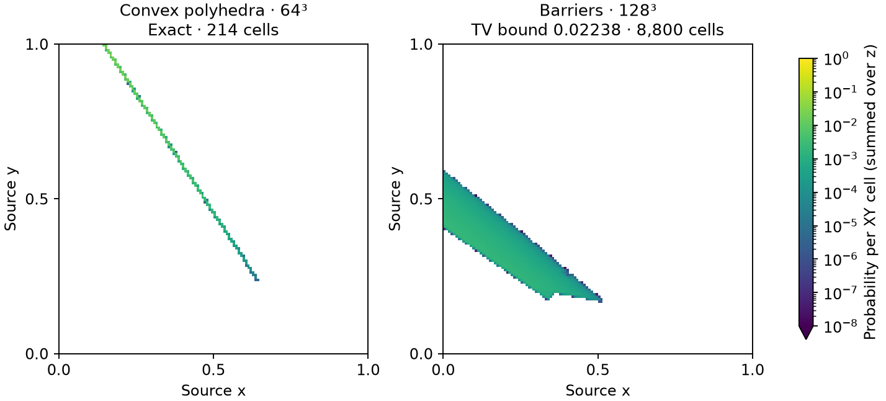

# Global posterior certificates from local response interfaces

18 November 2026. Research branch `astra/3d-v3-receiver-certificates`.

Starting with the entire world, a CPU prototype reconstructed the exact feasible **volume** and its complete 128³ probability distribution for 11 of 27 windows on the first test geometries. One distribution occupies 214 grid cells. On a second set of nine previously unused geometries, three windows had exact solutions. All nine had provably positive feasible volume. The three exact distributions on this second set each occupy a single cell. At the required TV tolerance of 0.05, the strongest variant finished four of the nine. The existing CPU Tau-pencil path finished all nine in less total time than trying the prototype followed by fallback. The prototype contributes exact fixtures, an alternative way to represent the physics, and a means of measuring errors in existing solvers. The evidence supports retaining the existing production path. [Per-window comparisons](../experiments/global_inverse/records/comparison.json)

## What can be recovered

A channel specifies the finite sets of FREE active and inactive receiver centers in one observed window. For a fixed complete geometry, the target is the uniform volume measure on the sources that reproduce every one of these labels, pushed forward onto the global grid. Source positions belong to the open unit cube, outside the closed window, with Euclidean distance strictly greater than 2⁻²⁶ from every obstacle. All ray segments and obstacles are closed. A uniform-volume label requires positive feasible volume. A complete teacher can use the hidden geometry, while a student receiving the local window still faces uncertainty over which world produced it. The result concerns the declared label conditional on that world. [Contract audit](../experiments/fastlabel/CERTIFICATE_AUDIT.md)

The earlier mixed-interface experiment examined particular source cells selected using reference labels. This experiment begins with the whole unit cube. Discovery reads the canonical geometry, window origin and observed classes. A public channel index selects the crop and a task key seeds receiver ordering. Source coordinates, fitted planes, reference cell indices and posterior labels play no role in discovery. All 90 inputs have geometry and crop fingerprints. SOLID centers supply no visibility constraints. [Input identities](../experiments/global_inverse/records/inputs.json) · [Earlier study and numerical counterexamples](ASTRA_MIXED_INTERFACE.md)

## Two ways to use convexity

For a FREE receiver $r$ and a convex body $K$, write $C_K(r)$ for the set of sources whose segment to $r$ hits $K$. With facet functions $f_i(x)\le 0$, this inverse shadow has a finite half-space description. Require $f_i(s)\le0$ whenever $f_i(r)\ge0$. For each pair with $f_i(r)>0>f_j(r)$, require

$$
 f_i(r) f_j(s)- f_j(r) f_i(s)\le0.
$$

These inequalities follow by intersecting the facet inequalities in the segment parameter from $r$ to $s$. A front facet supplies a lower bound on the entry time, a back facet supplies a possible upper bound, and every lower bound must meet every upper bound before the segment ends. Tangencies satisfy the weak inequalities. For a neighboring inactive–active pair $(d,a)$, the exact feasible constraint is

$$
 \left(\bigcup_j C_{K_j}(d)\right)\setminus\left(\bigcup_j C_{K_j}(a)\right).
$$

Each real blocker may explain the inactive sample. Every blocker must miss the active sample. The intervening edge can cross a solid. Multiple pairs can have different explanations. The implementation clips convex pieces, assigning overlap to the first covering body in a fixed enumeration. This ownership partitions volume and makes no claim about physical first-hit order. Twenty-four spread-out pairs initialize the source pieces. Binary space partitioning for polyhedral set operations is established computational geometry. The experimental question is how to discharge the remaining observation on the resulting pieces. [Inverse constraints](../experiments/global_inverse/solver.py) · [Naylor, Amanatides and Thibault, 1990](https://www.cs.utexas.edu/~fussell/courses/cs384g-fall2010/old/bsp_treemerge.pdf)

**Common blocker.** If a single body blocks all vertices of a convex set of receivers from one source, it blocks every receiver in their convex hull. The shadow from that source is convex. The same argument applies with sources and receivers interchanged. For a finite set of points the intersection of all their shadows can be encoded with up to quadratic-in-facet-count inequalities per body. Each front/back facet pair needs only its tightest ratio $f_j(r)/f_i(r)$ on points satisfying the sign conditions. The front gate ensures $f_i(s)\le0$, so the maximum ratio imposes the tightest inequality. This compresses thousands of same-blocker observations exactly. Different blockers can jointly cover the observation without any individual blocker covering it. The sufficient common-blocker test then needs subdivision or additional cuts.

**Possible blocker.** Visible endpoints alone cannot establish visibility throughout their convex hull. A thin obstacle can block a middle ray and miss both outer rays. For a compact convex source polytope $P$ disjoint from $K$, there is also an exact description of all receivers possibly blocked from some point of $P$,

$$
 O_K(P)=K+\operatorname{cone}(K-P).
$$

Indeed every such receiver is $(1+t)k-tp$ with $t\ge0$. Conversely write a point of the right side as $k_0+\sum_i t_i(k_i-p_i)$. For $t=\sum_i t_i>0$, take $p=\sum_i t_ip_i/t$ and $k=(k_0+\sum_i t_ik_i)/(1+t)$. Convexity puts both inside their original sets. The case $t=0$ lies in the obstacle. Consequently a direction $n$ for which $\max_K n\cdot k\le\min_P n\cdot p$ gives a valid supporting plane with offset $\max_K n\cdot k$. The prototype uses a conservative outer envelope for legal sources and optionally adds verified directions. Enumerating the entire penumbra is unnecessary for a sound decision. If $P$ overlaps an obstacle, legal-source checks still apply, and the source-endpoint case precludes interpreting the disjoint-set theorem as an exact region for all points of that piece. [Envelopes](../experiments/global_inverse/envelopes.py) · [Optional supporting planes](../experiments/global_inverse/penumbra.py)

## How a whole window is certified

The first implementation groups receivers of each class and intersects their constraints in source space. The more successful implementation reverses that computation. For each current source polytope it constructs a guaranteed and a possible shadow for each obstacle **in receiver space**. Each convex receiver shadow intersects an x scanline in at most one interval. Unions of the intervals produce two masks on the exact observation lattice. If every inactive receiver is guaranteed blocked and every active receiver falls outside the possible shadows, the source region passes the entire observation. A guaranteed contradiction excludes it. Unresolved receivers supply actual half-space constraints that split the source polytope. A candidate source at its interior helps order these cuts. Its labels cannot certify the region. This procedure still reads the receiver bits. It saves repeated geometric decisions when one set of planes describes many of those bits. [Reciprocal scan and refinement](../experiments/global_inverse/raster.py)

Clipping and volumes use integer homogeneous coordinates and rational arithmetic. The scan kernel converts each inequality to directed fixed-point bounds. Receiver numerators and their homogeneous denominator are nonnegative and at most 2,048. Rounding each normalized coefficient up strengthens its test, rounding down weakens it, and a four-term dot product has magnitude at most 2⁵⁸ for this lattice. Signed integer divisions determine inclusive scanline endpoints. Float hull routines propose generators or support directions. Integer barycentric witnesses or exact support tests validate their use. Source clearance has a polyhedral outer cover for the forbidden region and a contained union of rational translates. The rounded-edge gap remains unresolved wherever these proofs cannot decide it. [Convex volume integration](../experiments/global_inverse/poly.py) · [Tests](../experiments/global_inverse/test_global.py)

For positive-volume inner pieces $I$ and outer cover $U$, the invariant is $I\subseteq F\subseteq U$ up to volume-zero boundaries. The grid distribution from the inner set satisfies $\mathrm{TV}(q_I,q_F)\le1-|I|/|U|$. Interrupting a split retains the parent in the outer cover. An incomplete inner proof earns zero additional volume. Global decisions use integer comparisons with directed mass bounds at scale 2⁻¹⁶⁰. The complete sparse grid exporter additionally charges each downward rounding. Exact solved meshes carry rational cell probabilities or permit exact per-cell integration. The closed meshes encode volume. Membership on a particular boundary point is a different question, decided by the original Boolean formula and an independent rational segment and clearance predicate. The study does not enumerate all lower-dimensional components. [Membership including contact](../experiments/global_inverse/membership.py) · [Grid exporter](../experiments/global_inverse/materialize.py)

## Evidence and costs

Single-thread CPU on a Ryzen 7 5800H. The archive has 54 tasks on 31 geometries previously used in research. The first held-out set has three sizes on each of nine new geometries. It became a development comparison for the reciprocal method after the receiver-grouping method failed there. The final nine use another nine disjoint geometries, one per family. Each size occurs three times. This last set is the cleanest test of generalization. A two-second check between operations limits each of discovery, finishing and optional inner recovery. A cap of 128 pieces per checked frontier and a 192-receiver threshold per lineage also limit effort. A final batch of cuts can cross the latter threshold. Timings include decoding, failed attempts, and explicit grid export for successful cases when the initial run returned only a mesh. A failed case spends this time without delivering the requested tolerance. [Frozen design](../experiments/global_inverse/PROTOCOL.md)

| Set and method | Positive inner volume | TV ≤ 0.05 | Exact feasible volume | Median / P95 / max seconds | Total seconds |
|---|---:|---:|---:|---:|---:|
| Archive 54, receiver grouping | 11 | 4 | 0 | 0.97 / 5.40 / 6.60 | 128.49 |
| First 27, receiver grouping | 3 | 2 | 0 | 0.66 / 5.49 / 5.50 | 64.45 |
| First 27, reciprocal scan | 26 | 15 | 11 | 1.26 / 2.83 / 5.73 | 34.71 |
| Fresh 9, receiver grouping | 2 | 1 | 0 | 2.25 / 5.32 / 5.36 | 22.78 |
| Fresh 9, reciprocal scan | 9 | 3 | 3 | 1.69 / 3.67 / 3.90 | 18.22 |
| Fresh 9, reciprocal scan with support planes | 9 | 4 | 3 | 3.10 / 4.18 / 4.23 | 22.51 |
| Fresh 9, existing random-subset + Tau-pencil | — | 9 | — | 2.17 / 8.22 / 10.95 | 27.10 |

The first 27 reciprocal runs passed **3/9, 4/9 and 8/9** at sides 64, 128 and 256. Their exact-volume counts were 1, 2 and 8. The larger windows sometimes constrain sources enough to make a whole-volume proof easier. There is one geometry per family in that comparison. It cannot separate scene effects from a population-wide size effect. The randomized-class receiver-grouping ablation passed 1/9 first-set 64³ cases, versus 2/9 using adjacent interfaces. One pair of successful interface runs produced complete distributions on 8,726 and 6,789 cells. This small comparison cannot establish the best initialization.

| Fresh geometry | Side | Reciprocal seconds | Existing CPU seconds | Reciprocal continuous-volume result |
|---|---:|---:|---:|---|
| Barriers | 64 | 0.57 | 1.47 | Exact, one cell |
| Convex polyhedra | 128 | 3.90 | 2.66 | TV bound 0.400 |
| Corridors | 256 | 3.33 | 10.95 | 0.945 |
| Multiscale union | 64 | 3.25 | 2.17 | 0.972 |
| Occluder clusters | 128 | 3.19 | 4.12 | 0.99990 |
| Prisms | 256 | 1.69 | 0.90 | Exact, one cell |
| Rotated boxes | 64 | 0.38 | 1.03 | 0.984 |
| Thin slabs | 128 | 0.59 | 3.05 | 0.984 |
| Wedges | 256 | 1.32 | 0.75 | Exact, one cell |

The barriers, prism and wedge feasible volumes are about 1.167×10⁻¹⁵, 6.899×10⁻¹⁹ and 1.467×10⁻¹⁵ of the world. Each was derived from an exact rational mesh. A second process reproduced all three meshes and their normalized grids exactly. The existing solver also returned their single cell. The test population includes more demanding multicell labels. On the first set, the exact 214-, 31-, 4- and 2-cell distributions differed from the CPU estimates by at most 3.08×10⁻¹² TV. An 8,800-cell approximation had measured TV 0.02106 and certified bound 0.02238. Including grid export took 5.73 s, compared with 2.68 s for the existing CPU computation. The optional support planes certified another fresh rotated-box case on 4,263 cells at measured TV 0.00881 and certified bound 0.01168. Its end-to-end cost was 3.47 s against 1.03 s. Reference comparisons check implementation agreement. The mathematical enclosure supplies the certificate. [Per-grid weights and timings](../experiments/global_inverse/records/) · [Replay digests](../experiments/global_inverse/records/replay.txt)

The two panels sum probability over z. White denotes zero reported mass. In the bounded approximation, a white cell can still have true mass within the global error budget. The logarithmic color scale saturates below 10⁻⁸.

A separately implemented native parametric segment clipper rerendered one publicly constructed interior witness on **every reciprocal case with positive inner volume** in the first and fresh sets. All 35 passed canonical source clearance and full-window response and solid checks. There were zero differing bits of either kind across **229,376,000 voxel locations**. This checks existence at those points. Completeness requires the global cover proof. The previous numerical audit remains relevant: two of 54 archive labels contain lower masses above exact cell capacity. The largest excess was 2.84×10⁻¹⁴ of a cell. This is a literal rounding issue even where distributions agree closely. The independent comparisons do not transfer a rational certificate to the legacy engine. [Forward checks](../experiments/global_inverse/check_witnesses.py) · [Prior capacity audit](ASTRA_MIXED_INTERFACE.md)

## Where the method fails and what to carry forward

All 24 interface pairs finished on every reciprocal case. On four fresh failures the subsequent time budget expired with unresolved pieces. On the remaining two, rotated boxes and thin slabs, roughly 200 individual cuts along a lineage still left a large gap between the proved inner and outer volumes. Many receivers can graze a possible shadow, and distinct blockers can cover different parts of a shadowed group. The one-blocker guaranteed shadow and the coarse possible shadow both lose strength here. Dense scanlines, repeated polytope clipping and exact grid integration then dominate. Adding extra support directions helped one case but increased aggregate time. The piece and time limits preserve correctness on abstention. They supply no population-wide latency or coverage guarantee.

A retrospective replay also bounded the TV of a point mass in one *output cell*. If that cell contains at least $l$ feasible volume and all other cells together contain at most $u$, its error is at most $u/(l+u)$. This can solve a discrete label despite unresolved internal shape. On the nine fresh cases it added **zero** successes beyond the three exact singletons. The other six bounds exceeded 0.999. Each bound cost less than 0.02 s in this run. This negative control separates discretion over output resolution from the harder task of resolving competing source regions. [Replay records](../experiments/global_inverse/records/atom_replay_v2.jsonl.gz)

The existing random-subset + Tau-pencil CPU path reported certification on all 36 first-set and fresh windows. On the nine fresh cases, summing measured times for reciprocal first and reference fallback gives **42.2 s** against **27.1 s** for reference alone. The first 27 give 96.1 s against 81.1 s, including a 27.45 s cold reference initialization on the first 64³ task. These sums model a serial fallback and include failed work. They are not directly timed hybrid services. The archive benchmark puts FastLabel at 1.6 s median with a statistical certificate and full Tau-pencil at 12.4 s. Those measurements used a different execution context. Claude’s independently committed E2 experiment (`d1929c6`) found a median 1.54× exact-stage speedup from polytope root clipping, and 0.95× end to end once construction was charged. The findings are compatible. [Historical benchmark](LOCALFIRST_COMPARISON.md)

**Recommendation.** Keep the rational global solutions as reference fixtures. The next useful comparison is to retain the already discharged receiver constraints on a source fragment and pass only its unresolved receivers to an exact continuation. Benchmark against the same continuation starting cold, on new geometry identities, charging conversion, failed screening and grid output. A low average source volume alone gives no amortization guarantee. A general compact exact representation with predictable tails, complete lower-dimensional boundary enumeration, curved-geometry support and efficient population-scale labeling remain open.
