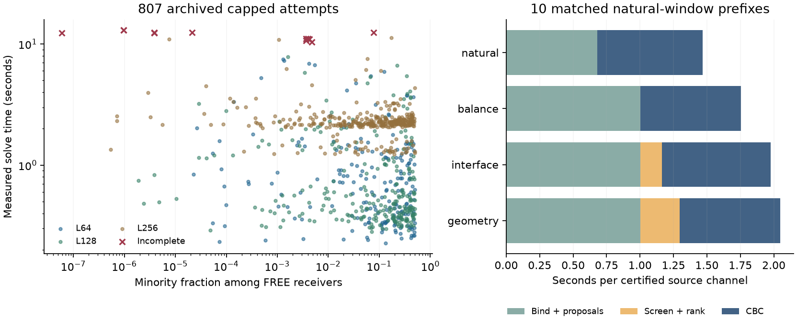

# Observation selection and deterministic label cost

**Decision. Keep v3 natural selection and its existing coverage slot. Pilot the broad-posterior accounting change.** Spending extra proposals to improve response balance increased the measured cost on ordinary windows. A targeted replacement policy helped a small subset of rare windows, including by changing which other sources were eligible. That is a different training population. No dataset or production branch was changed.

## Population and sampler

The sampling-impact archive contains 72 accepted scenes, eight per certified polyhedral family, 864 windows and 1,586 eligible source channels. All 72 recorded scene slots completed on attempt zero. The separate historical label canary covers 36 of these scenes and 807 channels. Each timing was joined on canonical geometry hash, channel, window origin, side and the decoded XYZ class hash. These are two overlapping workloads. Historical statuses and supports are measurements of the archived implementation. New certificates below use the hardened research solver.

The v3 generator cycles through nine geometry families, samples the family's world from its keyed seed, checks geometry and regenerates invalid proposals. Its thin-slab law enforces a two-voxel thickness floor and a nonempty, connected sampled solid. A per-slot draw assigns 1, 2, 3 or 4 sources with probabilities .15, .15, .15 and .55. Source positions come from uniform cube proposals with the generator's geometric legality, clearance and near-duplicate checks. No source position is used in a ranking feature. The generator needs the sources for physical rendering and for rejecting windows containing any source in the closed window box.

There are four accepted windows per side. Each natural proposal draws integer coordinates on the inclusive legal origin range, rejects duplicates and uses the *exact* existence of a 6-adjacent pair of FREE receivers with opposite responses. At least one eligible channel suffices. The natural stream takes the first eligible windows. There is no count, fraction, component, orientation or volume threshold. In L64 four-source scenes the third natural accept is followed by a separate coverage slot, with thinning probabilities .125/.25/.5/1 by eligible-channel count and natural fallback. A separate rate stream estimates the declared sampling law. The code paths are [select_side_v2](../../RIND3D_Dataset100K/rind3d_100k/physical.py), [source and window rules](../../RIND3D_Dataset1K/rind3d_1k/physical.py) and [v3 contract](../../RIND3D_Dataset100K/contract/RIND3D_100K_CONTRACT_v3.json).

| Side | Real quota proposals | Accepted windows | Natural rate-stream eligibility | Range across families | Eligible channels | Minority ≤10 |
|---|---:|---:|---:|---:|---:|---:|
| 64 | 1,498 | 288 | 34.1% | 13.4–45.9% | 381 | 6 |
| 128 | 756 | 288 | 55.3% | 22.8–69.3% | 494 | 6 |
| 256 | 465 | 288 | 75.7% | 41.4–88.9% | 711 | 4 |

The 1,855 rejected quota proposals include the coverage policy. The independent rate column measures natural eligibility. Frozen geometry, binding, proposal screening (including the rate stream) and serialization took 462.1 seconds across the 72 original generation attempts on the archived GPU configuration. Research CPU replays below have a different scope and hardware path.

The thin-slab window `000001_w02` was the third natural proposal and the third accept. All four channels qualify. Channels 0 and 3 have identical decoded crops, each with 261,124 active, one inactive and 1,019 solid receivers and two interface edges. There were only **three one-minority channels** across all 1,586, in two windows. Sixteen channels had at most ten minority voxels. A channel-level failure rate counts correlated channels sharing a scene, and sometimes literally the same inverse problem.

## Predicting cost and uncertainty

The archived 10-second soft-budget runs had 795 successes and 12 abstentions. The median/P95/maximum measured inner times including capped attempts were 1.44/3.87/12.99 seconds. Incomplete timings are censored for *time to successful certification*. We analyze observed expenditure and completion separately. Resolved-only supports omit some of the widest posteriors.

| Minority fraction among FREE receivers | Archived channels | Incomplete | Median observed seconds |
|---|---:|---:|---:|
| <0.0001 | 38 | 6 | 1.80 |
| 0.0001–0.001 | 35 | 0 | 1.59 |
| 0.001–0.01 | 93 | 5 | 2.07 |
| 0.01–0.1 | 225 | 1 | 1.66 |
| 0.1–0.5 | 416 | 0 | 1.23 |

Spearman correlation between minority fraction and time was −.158 overall and −.220/−.181/−.014 at L64/128/256. Edge count had correlations of −.306/−.262/−.136 *within* those sizes, but +.265 when pooled. Physical scale confounds raw counts. Among completed cases, `000005_w09_s2` had a minority fraction of .00579 and a one-cell label. `000024_w06_s3` was relatively balanced (.354) with 29,247 occupied cells and 18,448 effective cells (exponential Shannon entropy). Class balance alone cannot separate decisive interfaces from genuine ambiguity.

Size and body count already predict much of the measured cost. We fitted fixed-penalty ridge models to log time on the first 18 geometry slots and evaluated once on the next 18, 392 training and 415 test channels, all families in both partitions. Digital features add axial edge-count entropy, edge density, occupied 8×8×8 spatial bins and the number of 26-connected components of occupied bins. These descriptors measure digital spread. They give no continuous surface count or rank certificate.

| Available pre-label features | Held-out time rank correlation | Mean absolute log-time error | Slow-tail AUC | Incomplete AUC |
|---|---:|---:|---:|---:|
| Side and obstacle count | .650 | .527 | .682 | .637 |
| Plus minority fraction | .648 | .525 | .704 | .863 |
| Plus digital interface features | .648 | .544 | .744 | .861 |

The slow-tail threshold came from the training 90th percentile. Abstentions are rare and the AUC is exploratory. At most a scheduling hint is warranted.

We also intersected the world cube with the exact disjunctive inverse-shadow constraints of two spatially spread adjacent opposite-response pairs. Every feasible source survives, up to volume-null boundaries. Only these two observations are imposed. The reported world volumes are rounded summaries of exact rational piece volumes. The first edge's explanation count counts individual possible blockers with a positive-volume explanation. The second-to-first volume ratio measures incremental restriction. Neither statistic certifies independence of continuous planes. All 127 measured channel diagnostics completed. In the balanced 108-task subset (first eligible channel in the first window per scene and size), second-edge outer volume had median 1.93×10⁻⁵; second/first median .026 and maximum .995. Median surviving piece count was 7, and the first edge had a median 4.5 possible blockers. Median/P95 end-to-end screening cost was .121/.447 seconds. The correlation of two-edge volume with measured solver time was .234, with output support .415 and with proved feasible volume .513. Possible-blocker count alone had time correlation .053. In matched 54/54 train/test tasks, adding the geometric features raised time-ranking correlation from .679 to .714 and reduced log-time error from .488 to .452. Slow-tail AUC fell from .815 to .725. None of those 54 test tasks abstained. The evidence supports a geometric diagnostic, with limited evidence for a cost predictor.

## Matched candidate experiments

**Ordinary prefixes.** Keep the frozen world, sources, side and all eligible source channels fixed. Measure first eligible natural window versus a choice between the first two. Ranking is allowed to change the choice only when their source eligibility masks agree. CPU replay used the original certified forward backend, the original sequence of origins and thinning draws, and an independent fixed probe seed. Every accepted/rejected decision, accepted origin, count, mask and axial edge count agreed. The benchmark includes rejected proposals, geometry binding, exact crop construction, ranking and all attempted CBC labels including verification of written research bytes. Common pre-existing world generation, rate-estimation and post-selection packaging are outside these *incremental* times. Times are single-worker and warm, with warm-up recorded separately. Ten scene/size groups include nine held-out families and one sentinel geometry. The first two windows of the sentinel do not include its pathological third natural window. Twenty distinct candidates produced 29 attempted labels; each policy selected 13 channels, all certified.

| Rule | Changed windows / 10 | Candidate generation seconds | Feature seconds | CBC seconds | Seconds per certified channel |
|---|---:|---:|---:|---:|---:|
| First eligible | 0 | 8.68 | 0 | 10.22 | 1.47 |
| Maximize worst-channel balance | 1 | 12.85 | <.01 | 9.78 | 1.75 |
| Edge density, direction and spread | 2 | 12.85 | 2.08 | 10.57 | 1.98 |
| Smaller two-edge outer volume | 1 | 12.85 | 3.80 | 9.78 | 2.05 |
| Minimize predicted time using balance | 1 | 12.85 | <.01 | 9.78 | 1.75 |
| Hash-gated 50% natural control, otherwise cost | 0 | 11.20 | <.01 | 10.22 | 1.66 |

On the separate 54 held-out historical baskets the first-eligible and balance rules both retained 104/104 completed channels. Balance changed 11 choices and increased total label time from 165.8 to 181.8 seconds even with candidate acquisition treated as free. It changed the number of chosen channels with minority fraction ≤.001 from 8 to 5, and the number with ≥10,000 occupied cells from 3 to 9. Aggregate family coverage or class balance would conceal this distribution shift. The fresh nine-geometry cluster bootstrap gave a balance/natural cost ratio interval of 1.07–1.47 (2.5th–97.5th percentiles). There is only one fresh confirmation group per family and size is rotated across families. This interval describes resampling these groups, not a production confidence guarantee.

**Rare-event replacement with the real four-window quota.** The trigger was the training first percentile of minority fraction, 3.82958×10⁻⁶ (computed including ties). Test every triggered natural slot on the held-out 18 worlds, plus the original sentinel separately. Keep all other slots including coverage fixed. In a fresh deterministic stream, try at most 16 legal integer proposals, excluding existing origins, and fully render the first eligible candidate. Strict same-mask matching produced **zero replacements** on all eight slots while spending 15.53 extra seconds. The focal variant preserves the original rarest eligible source channel (break ties by channel index), improves its fraction and labels *every* eligible source in the chosen window. Other sources can enter or leave. This is an explicit research variant of the population contract. A source coordinate enters only the original forward evaluator. Each alternative crop was loaded through the canonical input reader.

| Held-out triggered slots only | Swaps / 7 | Focal channels certified | All channels certified / attempted | Selection increment + labeling seconds |
|---|---:|---:|---:|---:|
| Original natural | 0 | 6/7 | 8/10 | 36.62 |
| Always attempt one alternative | 5 | 7/7 | 15/15 | 30.60 |
| 50% natural reserve, slot-only hash | 2 | 7/7 | 10/10 | 17.75 |
| Original diagnostic 50% reserve, scene-identity hash | 4 | 6/7 | 14/16 | 44.68 |

These are seven slots in six worlds. Original generation is common. The trial charges complete alternative generation, scoring inputs, binding, all chosen channels, failed labels and file verification. A larger denominator can make per-label cost look better while per-window cost worsens, as in the original reserve arm. We changed the holdback key to slot/window because the archived scene identity incorporates the sources. Both results are disclosed. The new key was assessed after collecting both potential outcomes. Enumerating all 128 independent fair holdback assignments on these seven slots gives 33.61 s mean cost versus 36.62 s natural; only 50.8% of assignments strictly reduced total time. Its expected focal success count is 6.5/7. The two keyed examples illustrate how a single difficult geometry can reverse the conclusion. The strict and focal trials used identical alternative origins and crop statistics. Always trying the focal swap on all eight flagged slots, *including the known sentinel*, gave 17/17 versus 10/14. Both difficult duplicated crops were replaced in this variant. That is evidence of a real scientific cost. It changes the observations offered to the Student and hides the original ambiguity if the natural arm is discarded. This is not a matched comparison of neural learnability.

## Deterministic broad-posterior accounting

The pre-existing 120-second-budget thin-slab run here spent 32.88 s integrating, 30.13 s committing volume increments and 32.57 s constructing snapshots. Total wall was 125.43 s including finalization. Two changes leave the feasibility predicates intact.

1. A convex source piece is integrated over the 128³ output lattice by bounding each facet's affine form on an aligned grid block with exact integer extrema. A block with one cutting facet has an analytic volume in each cell. Reflect the negatively oriented coordinates and remove zero coefficients. For the remaining positive widths (a_i), cell threshold (h) and (n) nonzero axes, the volume fraction is

$$
   \frac{\sum_{J\subseteq[n]}(-1)^{|J|}(h-\sum_{j\in J}a_j)_+^n}{n!\prod_i a_i}.
$$

   This follows by subtracting the translated upper-coordinate violations from the positive orthant simplex. At either cut endpoint the empty/full volume is exact. Multiprecision integer division gives lower and upper mass ticks, and each integrated polytope still passes volume conservation. Multi-facet cells retain exact clipping. Counter copies now update only the credited keys. The dyadic wire bound processes the decoded tick values directly, validating exact normalization, order, range and the wire lattice.
2. Cache the total lower ticks, updated atomically with the credit maps. For diffuse outputs defer an intermediate snapshot when the current overlap formula cannot meet tolerance. Let (L) be total lower ticks, (U) the sum of upward-rounded live volumes, (K) cell capacity and (n) live pieces. Whole single-cell live pieces disjoint in volume contribute at most (K+n) ticks in any one cell. Thus the denominator of each cell's overlap lower bound is at least $L+\max(0,U-K-n)$. Summing its numerators gives at most (L). The check can only defer work. The trusted kernel always takes its final snapshot and verifies the actual payload's bound before release. This argument concerns the bound attainable by this checkpoint, not a lower bound on the true TV error.

| Frozen input and setting | Observed wall | TV upper bound | Outcome |
|---|---:|---:|---|
| Thin slab, old kernel, 45 s | 47.81 s | .193699 | Incomplete |
| Thin slab, new integration and wire, 45 s | 47.14 s | .105876 | Incomplete |
| Thin slab, old kernel, 120 s, 4,096 pieces | 125.43 s | .095834 | Incomplete |
| Thin slab, new integration and wire, same time/cap | 92.78 s | .093753 | Incomplete |
| Thin slab, plus scheduling, same time/cap | 33.75 s | .093753 | Fragment cap |
| Thin slab, 180 s, 16,384 pieces | 185.31 s | .052924 | Time budget |
| Thin slab, 360 s protection, 32,768 pieces | **230.01 s** | **.04998755** | **Certified, 404,212 output cells** |
| Multiscale convex `000023_w07_s0`, old kernel, 45 s | 50.11 s | .126246 | Incomplete |
| Same multiscale input, new integration and wire, 45 s | 47.30 s | .077572 | Incomplete |
| Same multiscale input, plus scheduling, **same 45 s and cap** | **44.59 s** | **.049206** | **Certified, 829,044 output cells** |

The thin-slab extended run used 229.97 CPU seconds, peaked at 1.70 GiB RSS and 14,964 live pieces, and saved the actual wire. Its proven lower world volume exceeded .179, which alone requires more than 375,000 output cells to carry true feasible volume. A fresh process checked the original crop, build fingerprints, artifact binding, wire hash and exact decoded sum of one. The recorded bound is 990105501625378363027656785 / 19807040628566084398385987584. This is an integrity and arithmetic recheck of the actual release; no independent exact solution of this large geometry was available. The archived FastLabel time on this same input was 5.61 s, so this 230 s result exceeds the earlier 10× speed objective. It proves feasibility at a larger budget.

At the equal-budget thin-slab frontier limit, scheduling reduced 17 snapshots to one. Finalizing and independently decoding a large wire is real work and may overrun the search budget. The multiscale run's peak process RSS was 2.25 GiB. Two small matched control cases retained identical wire hashes and bounds across the original and first optimized kernels. Fourteen completed rational reference fields independently agreed within their certified bounds after each change. These references share some geometry primitives. Tests of individual half-cell volumes also compare against the legacy exact polytope clipping route. With the independent GMP reference built, 633 kernel and research tests passed. A separate 128 tests passed for exact inverse geometry, assurance, direct-interface eligibility, sampling and thin slabs. The scoped tests and archived evidence are available in the reproduction directory. Timings are single runs on a shared laptop and P95s of these tail cases would have little meaning.

## Selection and the scientific target

For a fixed world, window and focal channel, publish the normalized volume of all legal continuous sources reproducing the observation, projected onto the output lattice. Integral accounting, scheduling, and an explicit sampling-policy choice do not alter this mathematical function of the observed problem. The distribution of *problems presented to the Student* does change. In a generative interpretation, the probability that a source produced an observation at the selected position also includes the selection likelihood under that source and the nuisance sources. Even a score using only rendered classes can compare several unseen candidates. The normalization over those alternatives can depend on the source.

For example, suppose two equally likely feasible source regions give the same observed crop A. The sampler assigns weight 1 to A under either source. A hidden competitor has weight 3 under the first and 1 under the second. Observing selection of A gives relative selection likelihoods 1/4 and 1/2, hence posterior masses 1/3 and 2/3. The fixed-feasibility target remains 1/2 and 1/2. Conditioning on the observed crop does not eliminate this effect. Closed source exclusion, competitors, multi-channel masks, acceptance caps, and scene acceptance also enter the original sampling law. V3's rate stream and natural-target weights cannot be carried over to a changed selection law without rederivation.

## Production recommendation

Preserve four eligible windows per size, the declared natural/coverage design, every eligible source channel and all nine families. Add no new balance rejection threshold. Separate the *compute queue* from the *sample population*. Record every sampled observation including abstentions; use minority fraction and cheaply available edge counts as risk indicators to allocate bounded expensive retries. Retain a natural evaluation arm with known selection provenance. Broad high-entropy cases, single-voxel events, multiple-possible-blocker interfaces and thin structures are particularly informative calibration tests. Prioritize coverage of these regimes, uncertainty calibration and transfer across families over minimizing conditional entropy. Downstream uncertainty calibration or transfer was not tested here.

A controlled CPU pilot of the improved deterministic accounting on fixed windows is justified. Monitor peak RSS per worker and tail failure rather than multiplying throughput by core count. Focal-source replacement merits a separately versioned research arm with all original controls retained; report source multiplicity and uncertainty distribution as well as cost. There is no demonstrated representative 100K saving from replacing the sampler. The frozen population, selection comparisons and broad-tail experiments measure different quantities. No mass generation or Student training was run.

[Reproduction, source and machine-readable measurements](../experiments/credit_solver/sampling_cost/README.md)
