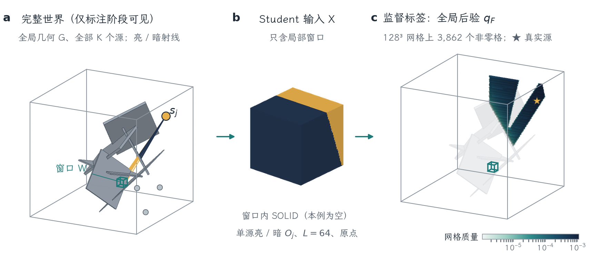
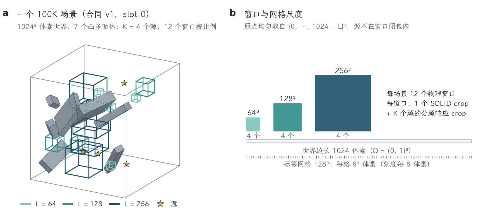
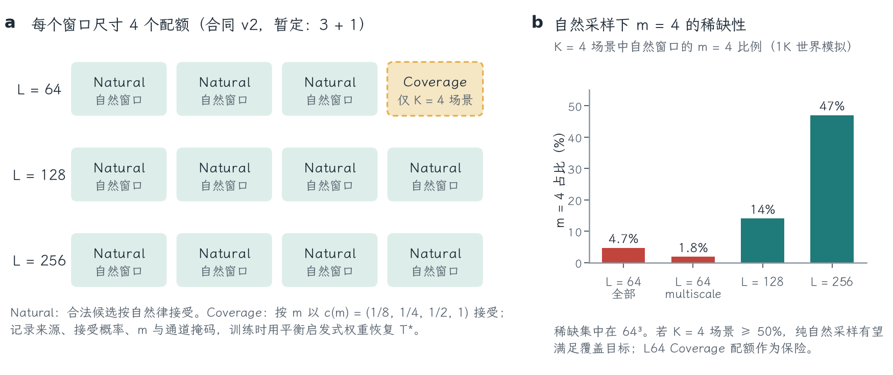
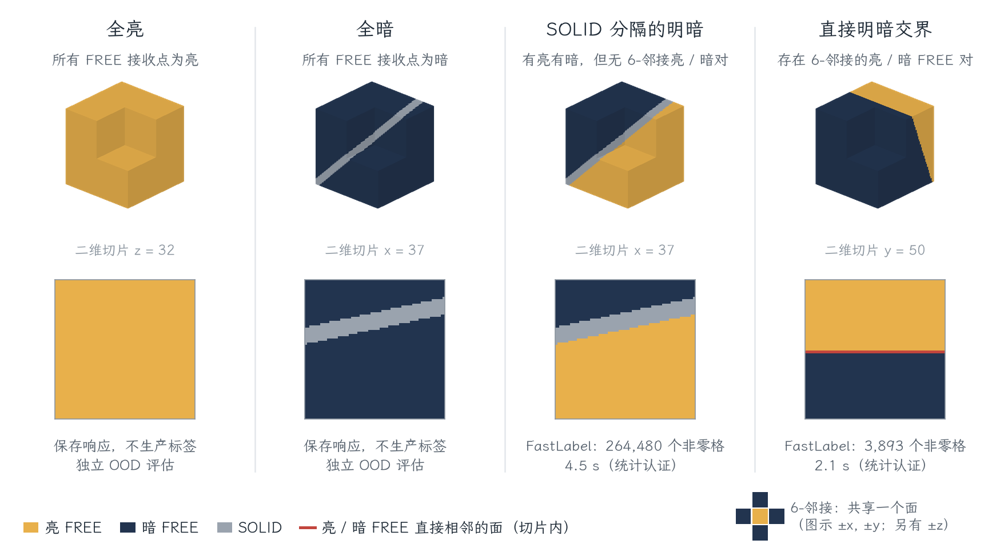
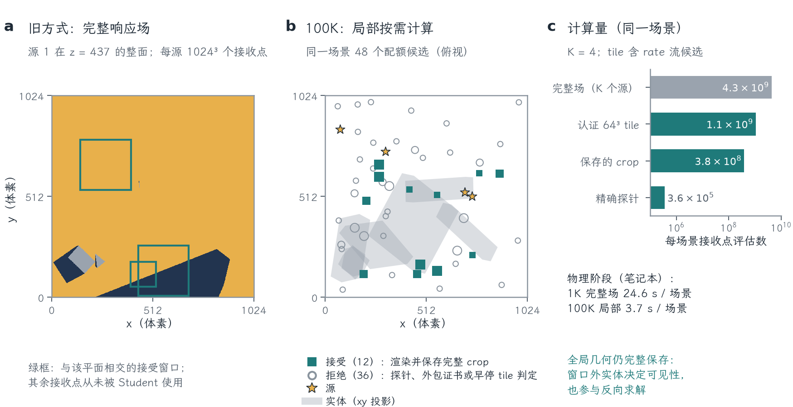
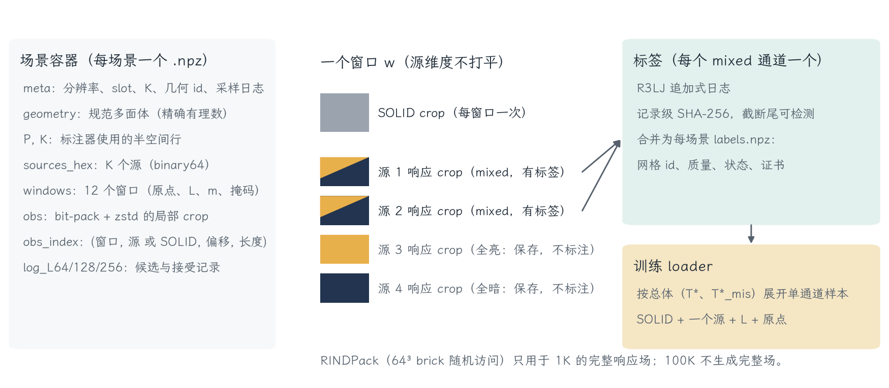
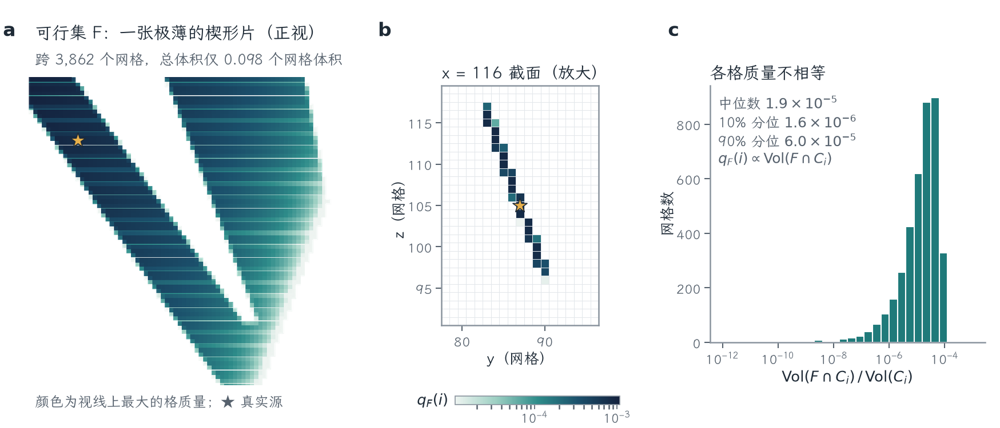
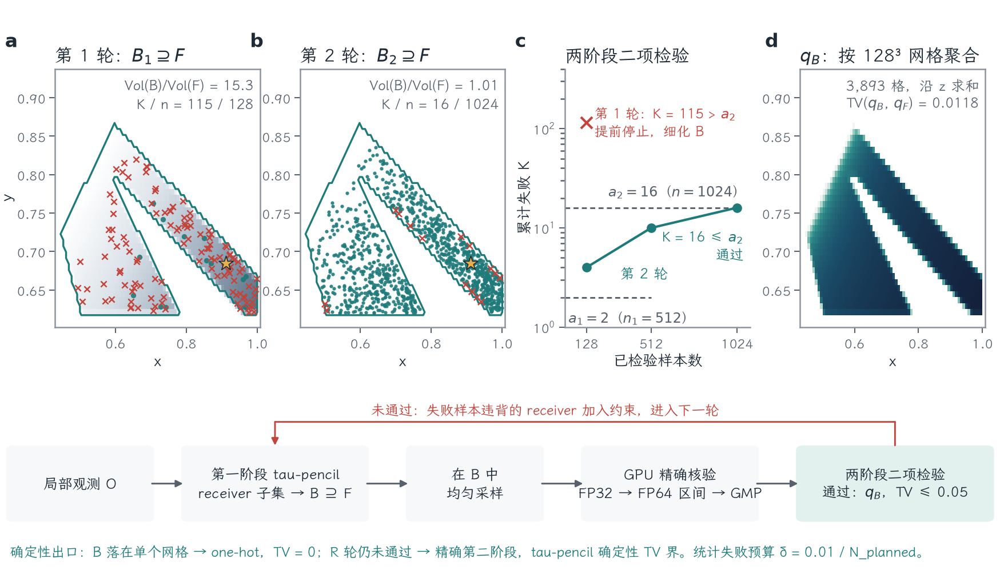
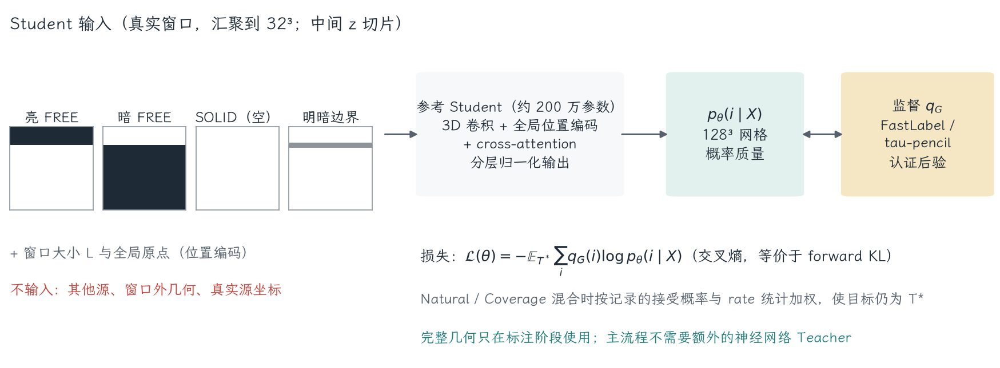

# RIND3D 数据集设计与技术说明

## 1. 研究目标

RIND3D 研究三维空间中的**局部观测与非局部源定位**。一个完整世界由若干闭合实体和 1–4 个驱动源组成。从源到接收点的线段若不碰到任何实体，接收点为亮（1），否则为暗（0）。模型只看到一小块局部窗口的几何和其中一个源的亮暗响应，却要判断这个源可能位于整个世界的哪些位置。

这是一个非局部逆问题：局部响应取决于窗口外的源和障碍物，而这些决定性因素在局部观察中看不到；反过来，相同的局部阴影又可能由多个源位置产生。直接回归一个坐标会掩盖这种多解性，因此 RIND3D 的目标是输出**全局源位置概率场**，用概率质量表达所有候选位置及其不确定性。

多源是物理场景本身的属性。数据文件始终保留每个源的独立响应；主要学习任务则是**单通道推断**：输入一个局部窗口的 SOLID 几何、一个源的亮暗响应、窗口大小与全局原点，预测该源在全局 128³ 网格上的条件概率分布。其他源的位置和响应、窗口外的几何都不提供给 Student。

完整几何只在标注阶段使用。它让我们精确计算哪些源位置能够解释局部观测，再用这份有物理依据的概率监督训练只看得到局部的模型。Student 应当学到的不是某个世界的隐藏答案，而是对所有与局部观察相容的隐藏世界做边缘化之后的后验。

## 2. 数据集规格与物理定义

| 项目 | 100K 目标 |
|---|---|
| 场景数量 | 100,000 个独立三维场景 |
| 全局物理空间 | 每轴 1024 体素，归一化坐标 $\Omega=(0,1)^3$ |
| 局部窗口 | 每场景 12 个；$64^3$、$128^3$、$256^3$ 各 4 个 |
| 物理源 | 每场景 $K\in\{1,2,3,4\}$，各源响应分别存储 |
| 场景几何 | 九类凸多面体家族组成的闭实体并集 |
| 响应 | FREE 接收点上的二值可见 / 遮挡结果 |
| 全局标签 | 源位置在 $128^3$ 网格上的离散概率质量 |
| 物理窗口总量 | 1,200,000 个；有效单源通道数随窗口复杂度变化 |
| 计算部署目标 | 16× NVIDIA H20，需在目标硬件上完成生产验证 |

几何由有限个**有界、闭合、满维的凸多面体**组成。九类生成家族为 `rotated_boxes`、`thin_slabs`、`prisms`、`wedges`、`convex_polyhedra`、`multiscale_convex`、`corridors`、`barriers` 和 `occluder_clusters`，覆盖旋转盒、薄片、楔体、走廊、屏障和遮挡物簇等遮挡结构。多面体参数以 binary64 存储，几何判定按对应的精确二进制有理数进行。

接收点位于体素中心 $x_i=(i+\tfrac12)/1024$。若闭线段 $[s,x]$ 不接触任何闭合实体，则 $V_G(s,x)=1$；穿过、接触和相切都算遮挡。位于实体内部的接收点由单独的 SOLID 掩码表示，不参与亮 / 暗 FREE 分类。

源位置在世界的合法域 $D(G)$ 中均匀采样：位于开立方体内、实体之外，并且到实体的认证 clearance 大于 $2^{-26}$。源之间只有 $\|\cdot\|_\infty\ge 2^{-20}$ 的防重复约束，没有人为的最小间距。源数量 $K$ 的分布记为 $\kappa$。1K 中 $K$ 由自适应控制器决定（每个 $k$ 至少 15%，实现比例为 15.4% / 13.5% / 15.8% / 55.3%）。100K 合同 v2 改为声明的固定 $\kappa$，暂定为 $(0.15,0.15,0.15,0.55)$，按场景编号从独立随机流抽取，与几何和源无关。**多源是确定要求，$\kappa$ 的最终比例待 canary 确认**：覆盖研究倾向于让至少一半场景具有四个源，以保证小窗口的最高复杂度有足够样本。

1024³ 是物理几何和接收点的分辨率，128³ 是训练和评估用的源位置概率网格。两者不是同一份张量，也不需要先生成完整的 1024³ 响应场。

## 3. 场景生成与窗口选择

生成顺序为：按几何家族生成实体并做几何有效性检查；采样 $K$ 个合法源；按窗口尺寸提出随机原点；计算候选窗口内各源的局部响应；筛选窗口；保存几何、窗口和分源响应；最后做全局后验标注。

边长为 $L$ 的窗口，原点在 $\{0,\ldots,1024-L\}^3$ 中均匀采样。候选窗口**合法**当且仅当：所有源都不在窗口闭包内，窗口内至少有一个 FREE 接收点，并且至少有一个源的响应同时含亮、暗 FREE 点。这样窗口不会直接暴露源位置，同时至少提供一个有效的单通道样本。

一个源通道称为 *mixed*，当且仅当它至少有一个亮 FREE 点和一个暗 FREE 点。窗口的**有效层数** $m$ 是其中 mixed 通道的数量，$1\le m\le K\le4$。例如四个源中两个 mixed、一个全亮、一个全暗时 $m=2$；窗口只存一次，训练时展开为两个 mixed 单通道样本。

1K 和 100K 合同 v1 对合法候选还按 $m$ 做稀释接受：自适应控制器给出 $m$ 平衡的接受概率表 $c(m,L,k)$，这会改变 Student 看到的总体。100K 合同 v2 已改为主体窗口自然接受（$c\equiv1$），只用单独的 Coverage 流补充稀缺复杂度。

RIND3D 不要求 $m=1,2,3,4$ 各占 25%，更重要的是每种复杂度、窗口尺寸和几何家族都有足够多的**独立场景**。纯自然采样模拟显示，四源场景中 $L=64$ 的 $m=4$ 窗口只占约 4.7%，`multiscale_convex` 家族约 1.8%；$L=128$ 约 14%，$L=256$ 约 47%。稀缺主要集中在 $64^3$ 的最高复杂度。

若固定的 $\kappa$ 使四源场景不少于约 50%，模拟显示纯自然窗口有望满足现有覆盖目标。合同 v2 暂定启用一个轻量保险：只在 $K=4$ 场景中把四个 $64^3$ 配额之一设为 Coverage 窗口，对 $m=1,2,3,4$ 的接受概率分别为 $(1/8,1/4,1/2,1)$；其余三个 $64^3$ 窗口和全部 $128^3$、$256^3$ 窗口保持自然采样。该方案约增加 1% 的标签任务和 14% 的候选窗口计算，训练时用平衡启发式权重恢复自然目标。不推荐 2+2 方案（有效样本量约 0.6，权重最高 2 倍）。

自然目标总体记为 $T^*$：**从约定的多源世界分布采样，取自然接受的合法窗口，每个 mixed 源通道作为一个单通道样本。** Coverage 流只用于补足稀缺样本，不能改变 Student 要学习的目标后验。每个窗口须记录来源流（Natural / Coverage）、提议序号、均匀数 $U$ 与接受概率行、$m$ 和通道掩码；每个场景每种尺寸须记录 rate 流的完整 $m$ 计数，用于重建权重。

**待确定：** $\kappa$ 的最终数值、是否启用 $L=64$ 的 Coverage 配额以及各复杂度的最低覆盖量，需用 100K canary 的实测统计确认；现有模拟基于 1,000 个世界外推。

## 4. 四类局部响应及其计算困难

每个源通道在物理上可能是全亮、全暗或明暗混合。混合响应又分两种：存在 6-邻接（共享一个面）的亮 / 暗 FREE 接收点对，或者亮暗区域被 SOLID 隔开、不存在这样的相邻对。四种观察都合法，但信息量和标注成本不同。

| 类型 | 物理含义及后验特点 | 处理方式 |
|---|---|---|
| 全亮 | 所有 FREE 点都看得到源；开阔空间中接近先验，有遮挡物时仍能排除部分源位置 | 保存响应，不生产标签；作独立泛化测试 |
| 全暗 | 所有 FREE 点都被遮挡；可行源取决于实体背后的空间结构 | 保存响应，暂不作主要训练标签 |
| SOLID 分隔的明暗 | 有亮有暗，但不存在 6-邻接的亮 / 暗 FREE 对；仍有真实的几何约束 | 属于 mixed，保留并标注；FastLabel 耗时长尾 |
| 直接明暗交界 | 存在 6-邻接的亮 / 暗 FREE 对，明暗边界给出很强的约束 | 主要的高效标注类型 |

**全亮不意味着均匀分布，全暗也不意味着源更可能在远处。** 完整世界已知时，概率质量分配给所有严格满足响应的合法源位置；Student 只知道局部几何，还需要对隐藏的世界结构做边缘化。没有观察到阴影时信息往往较少，但不能把“全亮”硬编码成均匀概率。

只用 mixed 通道训练的参考 Student 在未见过的响应上的表现是：对全暗窗口有小幅正信息增益（+0.20 至 +0.26 nats），对全亮基本输出先验，对 SOLID 分隔的 mixed 窗口明显超越先验（+0.7 至 +1.0 nats）。几何规律有一定迁移能力，但全亮中的强约束特例还没有学好。

全亮和全暗的标注成本是主要限制。FastLabel v3.4 能认证全亮参考窗口，但耗时约为普通 mixed 标签的 25 倍。全暗在 v3.4 中常常失败：源位于实体内部同样与“全暗”相容，外近似保留了实体内部，采样无法认证。研究原型 S6 从外近似中精确剔除实体内部，已能认证全部测试样本，但成本约为普通 mixed 的 80–100 倍。因此目前只保存这两类响应、以独立 OOD 评估为主，不把它们的标注列入 100K 必做任务。

**SOLID 分隔的 mixed 窗口值得单独关注。** 它们并不缺少决定性信息，完整几何后验仍能大幅排除源位置。困难在于这类窗口没有 6-邻接的亮暗 receiver，FastLabel 第一阶段只能从 128 个内部 receiver 出发，外近似 $B$ 非常宽（数十万个 BSP 区域、数十万个网格），72–78% 的时间花在第一阶段的划分和逐格输出上。实测这类标签平均约 13.4 秒，只占 mixed 标签的约 2.5%，却消耗约 23% 的标注计算。

**待研究：** 如何利用邻近 SOLID 的接收点、实体拓扑或更直接的源方向约束，让无直接明暗交界的窗口更早缩小外近似，同时不改变严格可行域和认证误差界；全暗 S6 也尚需生产级代码审查。

## 5. 局部响应的高效计算与数据存储

正向计算的核心问题是规模。为每个源渲染整个 $1024^3$ 世界，会计算大量 Student 从未看到的接收点。**100K 方案只做局部按需计算，不生成也不存储完整的全局响应场。** 全局几何仍需完整保存：窗口外的实体决定可见性，也参与反向概率计算。

物理引擎把场景表示为规范凸多面体集合，用闭线段与实体的精确相交关系计算可见性。生产后端 `cuda_certified` 先用区域级遮挡证书减少逐体素查询，再在 GPU 上做向外舍入的 FP64 区间测试，仍不能确定的情况交给 CPU 原生区间 / GMP 判定。因此二值响应不依赖浮点阈值，接触和相切也有一致的语义。

100K 的 `local_eval.py` 分级计算：先查询少量精确探针；能用外包证书证明全亮的通道提前结束；需要时渲染认证的 $64^3$ tile，候选一旦确定不合格就停止；只有最终接受的窗口才计算并保存全部局部 crop。完整响应场只存在于 1K 参考数据和少量等价性验证中，不是 100K 生产的中间产物。

存储遵循**共享几何、分源响应、分源概率标签**：一个物理窗口只存一份 SOLID crop，每个物理源各有独立的二值响应；标注完成后，每个 mixed 源通道有自己的概率场和认证元数据。源维度只在训练 loader 中展开，不在 canonical 存储中打平。

100K 的具体格式是**每场景一个 `.npz` 容器**，包含几何、窗口、bit-pack + zstd 编码的局部响应和采样日志；概率标签写入追加式 `R3LJ` 日志，带记录级 SHA-256 和截断尾检测，再按场景合并。`RINDPack` 是已验证的 $64^3$ brick 随机访问格式，用于 1K 的完整响应场和参考读取，不是 100K 场景容器的名称。

笔记本实测 100K 局部物理阶段约 **3.7 秒/场景**（1K 的完整场方式为 24.6 秒/场景），场景容器约 **0.36 MB**。旧 TPE 标签约 **47 KB/任务**，据此预测的总存储约 0.2 TB；改用 FastLabel、自然采样和新的稀疏分布后需要重新统计。100K 的持久化已补齐：manifest 与日志的追加都做 fsync，重命名后同步目录，读取时容忍崩溃留下的半行，合并后的标签文件记录整体 SHA-256 并由校验工具核对。

## 6. 全局源位置概率场的反向求解

给定完整几何 $G$、局部窗口 $W$ 和其中一个源的二值响应 $O$，我们要找出所有能产生该响应的合法源位置：

$$
F(G,W,O)=\{s\in D(G)\setminus\overline W:V_G(s,x)=O(x),\ \forall x\in W_{\mathrm{FREE}}\}.
$$

在合法源位置上取体积均匀先验时，严格的几何后验是 $F$ 上的均匀**密度**，而不是给每个非零网格分配相同的概率。128³ 网格单元 $C_i$ 的概率质量为

$$
q_G(i)=\frac{\operatorname{Vol}(F\cap C_i)}{\operatorname{Vol}(F)}.
$$

这个定义保留了多解性，也保留了微小但决定性的阴影约束：一个候选源只要让一个 FREE 接收点的亮暗结果不一致，就不属于可行集合。这样的 hard posterior 是当前任务的主要监督；soft Hamming 相似度可以作为带噪声任务另行研究，但不替代这里的确定性几何后验。

**Tau-pencil** 是基础几何求解器。它把射线与多面体的遮挡约束转化为源空间中的半空间与分区约束，通过粗八叉树剪枝、凸多面体 BSP 划分和体积分配，给出每个网格质量的上下界与确定性 TV 界。它既是精确参考求解器，也是 FastLabel 第一阶段的外近似构造器；在 100K 中保留作精确参考与回归。

**FastLabel v3.4** 在其基础上进一步降低计算量。它先用部分有代表性的 receiver 构造严格包含可行集的外近似 $B\supseteq F$；若 $B$ 落在单个网格内，标签直接确定（one-hot，TV = 0）。否则在 $B$ 中按体积均匀采样候选源，在 GPU 上对**完整局部响应**逐点做精确验证，把失败样本违背的 receiver 加入下一轮约束。

在同一合法均匀先验下，

$$
\operatorname{TV}(q_B,q_F)\le 1-\frac{\operatorname{Vol}(F)}{\operatorname{Vol}(B)}
=\Pr_{s\sim\operatorname{Uniform}(B)}[s\notin F].
$$

左边是网格聚合后的 TV，右边是连续分布之间的 TV，聚合只会使它变小。因此只要外近似确实包含 $F$，就可以用独立的候选点验证和精确的二项分布尾概率认证 $q_B$ 与真实后验的距离。认证采用两阶段检验（先 512、再 1024 个样本，第 $r$ 轮预算 $\delta_r=\delta\,2^{-r}$），单标签目标为 **TV ≤ 0.05**，失败预算按计划标签总数分配为 $\delta=0.01/N_{\mathrm{planned}}$，用联合界控制整批出现错误证书的概率。统计标签保存的就是 $q_B$，状态记为 `certified_stat`，证书写在元数据中。这个保证针对**标签的近似误差**，不直接约束 Student 的预测误差。

GPU 验证器依次使用带误差界的 FP32 过滤、FP64 定向舍入区间，必要时交给 CPU 上的 GMP 精确判定。外近似对源位置的排除必须始终 sound，随机认证不能代替这一前提。换 GPU 型号或驱动时必须重新运行 Gate A：验证器给出的每个 FREE 接收点的结果，须与认证渲染器在全部 tile 上逐位一致。

1K 规模的技术验证已经完成：全部 **159,802** 个 mixed 标签通过认证，其中 52,523 个为单格确定性结果、107,279 个为统计认证；整批补标耗时 **4.33 小时**、零失败，整机约 **10.2 标签/秒**；与 447 个精确参考比较，最大实测 TV 为 0.0164。这些结果来自一台 RTX 3060 笔记本，不能直接当作 16×H20 的吞吐。

FastLabel 现在是 `RIND3D_Posterior` 中与场景格式无关的核心包，通过适配器读取 1K 场景目录或 100K 场景容器；迁移前后在相同任务上的输出逐字节一致。在 100K 合同 v2 中 FastLabel 是默认标注器（每 GPU 一个信号量，`certified_stat` 状态与证书完整保存并校验），tau-pencil 保留作精确参考与回归。

**待解决：** FastLabel 在 H20 上的 Gate A、跨设备逐位回归、对精确参考的精度与吞吐尚未验证；SOLID 分隔 mixed 窗口的第一阶段长尾仍是重点优化对象。

## 7. Student 训练目标与监督方案

Student 的输入为 $X=(\mathrm{SOLID}\cap W,\ O_j,\ L,\ \mathrm{origin})$，输出 128³ 全局网格上的概率 $p_\theta(i\mid X)$。其他源通道、窗口外几何和真实源坐标都不能作为输入。窗口外的信息不可见，因此 Student 在理论上应学习

$$
p^*(S\mid X)=\mathbb E_{G\mid X}[q_G(S\mid X,G)],
$$

即对隐藏世界求平均后的条件分布，而不是强行拟合每个世界各自的完整几何后验。相同的局部观察可能对应不同的 $q_G$，这部分不可消除的不确定性正是概率场任务要表达的内容。

主要监督采用 FastLabel 或 tau-pencil 给出的认证后验，损失是稀疏概率场上的交叉熵（与 forward KL 只差一个标签熵常数）：

$$
\mathcal L(\theta)=-\mathbb E_{(X,q_G)\sim T^*}\left[\sum_i q_G(i)\log p_\theta(i\mid X)\right].
$$

训练样本若混合了 Natural 与 Coverage 两种采样流，需要用记录的接受概率和 rate 流统计重建平衡启发式权重，使学习目标仍是声明的 $T^*$。真实源 one-hot 监督可作对照实验或明确标记的 fallback，但不能冒充认证的全局后验。

目前有一个规模较小的参考 Student：输入为四个 $32^3$ 汇聚特征，使用三维卷积、全局位置编码和 cross-attention，输出严格归一化的分层 128³ 概率质量，约 **200 万参数**，用于验证监督方法而非最终架构。在相同模型与训练预算下，FastLabel 概率监督相对 one-hot 获得约 **2.2–2.6 nats** 的 held-out 信息增益优势，校准也更好（覆盖率 MAE 0.03 对 0.24–0.28）。实验还显示，增加独立场景比在同一场景中增加更多相关通道更有效。

原方案包含一个额外的神经网络 Teacher。现在认证后验可以直接计算，**主流程不再需要神经网络 Teacher**：完整几何通过求解器产生标签，Student 直接学习。若将来希望用 Teacher 摊薄特定标注成本或处理难以认证的窗口，可作为独立研究方向重新评估，但它不是 100K 的必需组件。

**待研究：** 最终 Student 的输入分辨率、结构与规模、充分收敛所需的训练步数、合法几何对称性增强，以及对全亮 / 全暗等未见响应的稳定泛化，都需要更大规模的实验；当前小模型的表现不能直接外推到 100K。

## 8. 完整数据流程、性能与质量验证

完整流水线为：**规范几何生成 → 合法多源采样 → 候选窗口局部渲染与筛选 → 保存分源局部响应 → tau-pencil / FastLabel 后验标注 → 认证与完整性校验 → 按目标总体加载 → Student 训练。** 源和全局几何是标注阶段的 privileged 信息，不能进入单通道 Student 的输入。

| 代码位置 | 主要职责 | 状态 |
|---|---|---|
| `RIND3D_Generator/` | 几何生成、精确可见性、CUDA / CPU 后端、RINDPack | 已验证的共享基础组件 |
| `RIND3D_Posterior/` | tau-pencil 精确求解与 TV 界；FastLabel v3.4 核心（`rind3d_posterior.fastlabel`：1K / 100K 适配器、GPU 精确验证器、Gate A） | 已验证；FastLabel 为 100K 默认标注器，tau-pencil 为精确参考 |
| `RIND3D_Dataset1K/rind3d_1k/` | 1K 物理阶段、标注编排、FastLabel 的 1K 入口、loader | 1K 参考实现，保留作回归与复现 |
| `RIND3D_Dataset100K/rind3d_100k/` | 100K 生产入口：合同 v2 采样、局部按需渲染、容器与持久化、FastLabel 标注、分布式生产、校验、loader（目标总体、平衡启发式权重、单通道展开） | 笔记本验证通过；待 H20 canary（`RIND3D_Dataset100K/docs/H20_CANARY_RUNBOOK.md`） |
| `RIND3D_StudentResearch/pilot/` | Student 参考实现与概率监督训练 | 小规模验证实现 |
| `RIND3D_HANDOFF/` | 环境、统一入口、测试、实现事实、100K 接入计划、文档插图源码 | 交接入口 |

本地开发环境为 Linux x86_64、Python 3.12、C++20、GMP/MPFR、zstd 和 CUDA/NVRTC，Student 另需 CUDA PyTorch。`source RIND3D_HANDOFF/env.sh` 设置仓库、数据和解释器路径。核心测试包括 Generator 的几何与物理回归、Posterior 的 tau-pencil 回归与 FastLabel 核心测试、Dataset1K 的 loader / FastLabel / supervisor 测试、Dataset100K 的采样 / 权重 / 存储 / loader / GPU 夹具测试，以及 `RIND3D_HANDOFF/smoke_checks.py` 与 100K 的 `smoke_test.py`。完整命令见 `RIND3D_HANDOFF/README.md`；历史实验保留在 Git tag `archive/rind3d-research-2026-11-13`。

质量检查覆盖几何证明、逐位响应一致性、真实源是否在后验支持内、标签认证信息、逐文件校验和、断点续算与日志恢复。参考数据的 159,802 个标签全部认证、无失败；重渲染检查中约 1.91 亿个局部响应 bit 与保存内容完全一致。生产中要保留这些检查，而不是只凭神经网络的损失判断数据是否正确。

100K 的目标硬件是 **16×H20**。笔记本上测得局部物理阶段约 3.7 秒/场景，FastLabel 整机约 10.2 标签/秒。100K 的实际并行效率取决于 H20 的 FP64 定向舍入性能、GPU 验证器吞吐、worker 内存、I/O 和难窗口长尾，都还没有在目标服务器上实测。正式生产前需要完成 GPU Gate A（默认构建及强制 FP64、强制 GMP 两个验证构建）、跨设备逐位回归、FastLabel 在 100K 混合上对精确参考的精度检查、认证与权重重建检查，并用不少于 256 个场景的 canary 观察各 $(L,m,\mathrm{family})$ 层的覆盖、超时率和真实吞吐。

**待完成：** 在 H20 上按 `RIND3D_Dataset100K/docs/H20_CANARY_RUNBOOK.md` 完成环境与 FP64 检查、三种 Gate A 构建、跨设备逐位回归、FastLabel 对精确参考的精度、不少于 256 个场景的 canary 与崩溃恢复检查，并据 canary 统计冻结 $\kappa$ 与 Coverage 策略。完成这些之后，100K 才具备按最终合同大规模运行的条件。
