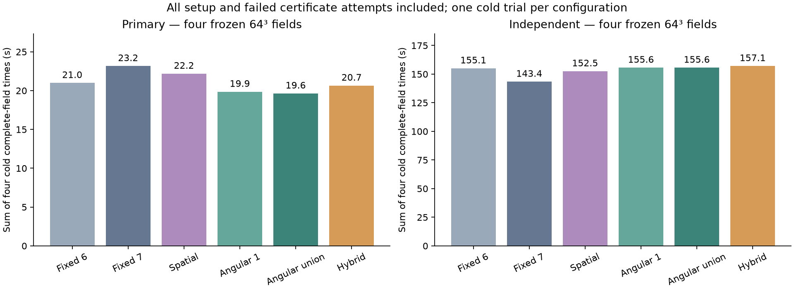
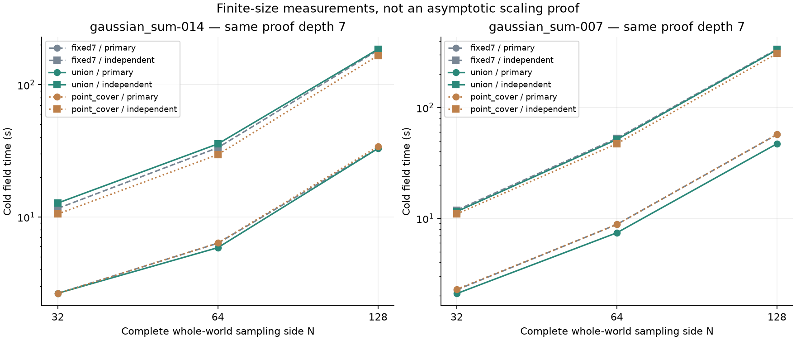
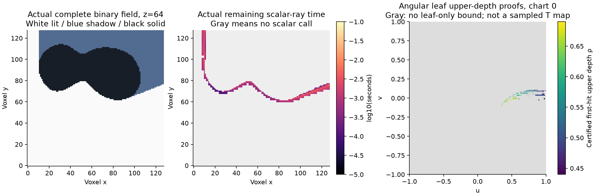
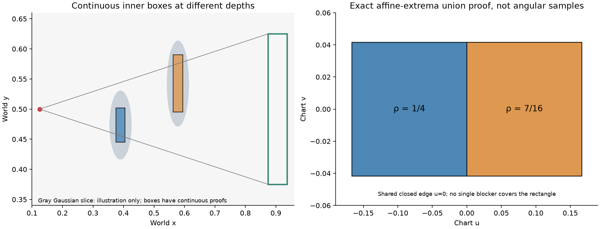

# RIND3D B2: fixed-source angular/depth visibility study

Measured 2026-11-06, based on `9bbd13dc9b46b25940afcba7c36826bc18b131e3`.
This is isolated continuous positive Gaussian-sum research. N³ below means a
complete sampling of the **whole unit world**, not an observation window in
the 1024³ public dataset. RIND3D v0.1 and its 1,000 certified scenes are unchanged.

The new certificate is sound and strictly more expressive than a same-body
test: independently certified inner SOLID boxes at different depths can jointly
shadow a receiver region even when no box, original certificate or common
Gaussian-sum cross-section proves it alone. The controlled example verifies
that distinction. It does **not** imply a large performance improvement.

The complete 64³ comparison is mostly a negative result for independent
verification. Angular union reduces primary cold time by 6.4% in aggregate,
but independent time is essentially unchanged. Much of the difficult work is
MISS, which an inner-shadow structure cannot eliminate. The simpler control
that rechecks the old outer cover at individual receivers deserves separate
attention; it must not be credited to angular fusion.

Read the [proofs, literature mapping and audit](GAUSSIAN_B2_ANGULAR.md),
[runnable guide](../experiments/gaussian_geometry/b2_angular/README.md),
[machine-readable evidence](../experiments/gaussian_geometry/results/b2-angular-measured-v1.json)
and [acceptance record](../experiments/gaussian_geometry/results/b2-angular-acceptance-v1.json).

## Protocol and complete-field measurements

All comparisons use the same frozen cases 0, 7, 14, 21, exact saved sources,
canonical binary64 geometry, numerical policy and AMD Ryzen 7 5800H laptop.
Both original backends recheck the unchanged source-clearance policy. Geometry
generation is not optimized toward easy cases. The earlier dense-target 2/6
retention limitation remains. No private RIND3D production oracle was opened.

CPU execution is serial and single-threaded. Each field runs in a fresh child
process. Cold field totals include geometry setup, continuous cover creation,
all failed/successful refinement and angular work, residual scalar evaluation,
array assembly and diagnostic NPZ writing. Source-clearance setup and complete
process lifetime are additionally recorded. `CPU_seconds` covers engine setup
and field evaluation before diagnostic compression; NPZ output wall time is
separate. It is not claimed to be total child CPU including imports/writing.
GCC 16.2.1 uses C++20,
`-fno-fast-math` and `-ffp-contract=off`; the existing floating-point environment
guards remain. This is measured Linux x86-64/Python 3.12 support, not a universal
platform or formal program-verification claim.

The main 32³/64³ sweeps retain measured source v1. Optional prefix experiments
retain v2. Final v3 adds explicit causal controls and diagnostic metadata;
default angular predicates preserve the same mathematical path. Original
sources, libraries and raw outputs remain versioned locally. Compact reverse
patches reconstruct measured v1/v2 source from the final tree, with hash checks.
No library was replaced inside a running process. Each configuration has one
cold trial; small percentage differences are not confidence intervals.

Sum over all four complete fields, seconds:

| Method | Primary 32³ | Reference 32³ | Primary 64³ | Reference 64³ |
|---|---:|---:|---:|---:|
| A: old fixed cover 6 | 4.04 | 26.26 | 20.99 | 155.06 |
| A: old fixed cover 7 | 7.54 | 35.24 | 23.17 | 143.36 |
| B: adaptive spatial | 4.32 | 27.30 | 22.19 | 152.51 |
| C: single-body angular reuse | 3.86 | 25.98 | 19.85 | 155.63 |
| D: multi-body angular union | 3.86 | 25.93 | 19.64 | 155.63 |
| E: hybrid | 4.17 | 28.01 | 20.65 | 157.06 |

A separate matched depth-7 sweep includes setup, writing and both unchanged baseline paths. Every 128³ row has all 2,097,152 voxels valid.

| Case | Method | Primary 128³ (s) | Independent 128³ (s) |
|---|---|---:|---:|
| 14 | A_fixed7 | 32.98 | 182.50 |
| 14 | D_union | 32.95 | 185.64 |
| 14 | R_point_cover | 34.08 | 166.33 |
| 7 | A_fixed7 | 57.18 | 337.14 |
| 7 | D_union | 47.17 | 332.40 |
| 7 | R_point_cover | 57.30 | 308.04 |

With identical depth 7 across resolutions, effective cold-time doubling exponents `log2(t(2N)/t(N))` are:

| Case / backend | A7: 32→64 / 64→128 | D: 32→64 / 64→128 | R: 32→64 / 64→128 |
|---|---:|---:|---:|
| 14 / primary | 1.26 / 2.38 | 1.15 / 2.49 | 1.27 / 2.42 |
| 14 / independent | 1.52 / 2.45 | 1.49 / 2.38 | 1.49 / 2.49 |
| 7 / primary | 1.96 / 2.70 | 1.82 / 2.67 | 1.95 / 2.70 |
| 7 / independent | 2.16 / 2.67 | 2.16 / 2.69 | 2.11 / 2.70 |

These are finite-size measurements, strongly affected by fixed setup costs and different receiver grids, not an asymptotic exponent. D does not fundamentally change reference scaling. Primary gains are case-dependent; case 14 has essentially no 128³ gain, while case 7 gains about 17.5%.

## What original residual cost is removed?

For the four 64³ fields, D changes primary scalar rays from 123,366 to 99,157
and reference rays from 98,248 to 95,304. Exp endpoints change from 19,771,972
to 18,169,502 primary, and 46,524,720 to 46,081,124 reference. These include
construction arithmetic, not just leaf ray calls.

Using the original trace on the exact receiver coordinates subsequently
avoided by D, 1.63 s of original primary scalar work is removed from a 17.21 s
original scalar population. Reference removes only 1.37 s from 140.68 s,
about 1%. This matched receiver-set statistic is not a counterfactual runtime
guarantee. Actual cold totals above determine whether an optimization wins.

E avoids 12,050 original reference scalar receivers, representing 8.72 s of
their original recorded work. Actual ray time falls from 140.68 to 132.79 s,
but angular work plus adaptive construction costs about 9.88 s. Its total
therefore becomes worse. Fewer rays alone is not success.

The old 128³ depth-7 reference traces already explain this limitation:

| Frozen case | Remaining MISS rays / time | Remaining HIT rays / time |
|---|---:|---:|
| 14 | 61,070 / 150.99 s | 22,101 / 14.71 s |
| 7 | 73,136 / 277.18 s | 36,680 / 40.66 s |

Even perfect removal of those HITs would not remove most residual work. The
expensive population is predominantly certified unblocked rays. Both sampled
transition neighborhoods and other FREE receivers contribute; conservative
outer-cover false positives remain important. This is not a proof of distance
to the true continuous boundary.

Causal controls on the same case-14 32³ field, seconds (separate cold trials):

| Control | Primary | Independent |
|---|---:|---:|
| A fixed-6 | 1.154 | 6.587 |
| C angular / 256 boxes | 1.165 | 6.577 |
| D union / 256 boxes | 1.156 | 6.659 |
| C angular / all boxes | 1.090 | 6.739 |
| D union / all boxes | 1.085 | 6.723 |
| Old engine / all boxes | 1.503 | 7.137 |
| Point outer-cover control | 1.199 | 5.897 |
| Angular empty prefix | 1.131 | 6.861 |

C/D gains therefore cannot all be attributed to union: the larger inner set and its directional index matter. Merely passing all boxes to the old engine is slower. Prefix P certifies 145 extra FREE queries in the reference run, but costs more than it saves and exhausts its declared 512-construction budget; this is an efficiency limitation, not a physical rejection.

In all 20 matched C/D comparisons, the actual scalar receiver-coordinate sets
are identical. The union mechanism proves a genuinely larger class of receiver
regions, as the controlled fixture demonstrates, but it does not eliminate
additional leaf rays beyond C on these frozen fields. The measured field gains
must not be credited specifically to multi-occluder fusion.

Angular-depth ablation, case 14 / 64³, fixed spatial cover 6 and fixed memory/work caps:

| Angular depth | Primary s / rays | Reference s / rays | Reference map nodes |
|---|---:|---:|---:|
| 6 | 4.839 / 25,453 | 33.976 / 20,572 | 1,646 |
| 8 | 4.501 / 21,112 | 34.143 / 20,018 | 10,610 |
| 10 | 4.489 / 20,573 | 33.859 / 19,779 | 25,938 |
| 12 | 4.447 / 20,537 | 34.086 / 19,769 | 32,766 |

The extra angular depth reaches a plateau: depth 12 hits the 32,766-node cap yet barely reduces reference ray work beyond depth 10. It is not a recommended universal stopping scale. The full-field labels stay exact because unresolved regions use the original oracle.

At case 14 / 128³, D spends 2.88 s in angular setup/queries, with 22,246 nodes and the full 2,000,000 candidate-reference cap. Its cold total is 185.64 s versus A7 182.50 s. Fresh-process peak RSS is 317.5 versus 199.4 MiB. The map's accounted container bytes are a lower bound excluding GMP limbs; process RSS includes them. Refined geometry produces 19,565 inner boxes here, so a bounded angular index can saturate. This is not proof that an unlimited or differently ordered angular map can never help.

Timing categories are nested: region time includes angular-region and adaptive calls, while fallback time includes angular-leaf or point-cover calls. The raw angular setup/leaf and point-cover timers permit disjoint accounting; they must not simply be added again. Cold totals above already include all that work. Separate tile calls rebuild caches; no cross-tile amortization is claimed.

## Answers to the research questions

**1. Which classical techniques are reusable?** Continuous interior occluders,
conservative packet bounds, projected coverage, depth-aware accumulation and
inclusion-preserving subdivision. The six primary references and adaptations
are mapped in the design note. Their sampled/rasterized representations or
floating-point rendering claims do not become RIND3D ground truth.

**2. What already existed?** Full Gaussian-sum membership, ray-volume FREE
tests, common SOLID sections, single-convex-body shadows, continuous inner/
outer proof trees, scalar Taylor bounds and independent exact/high-precision
fallbacks. The new study preserves those sources. Querying the old outer cover
at one receiver is an old predicate used at a finer granularity, not a new
mathematical visibility certificate.

**3. Is angular/depth decomposition genuinely new and useful here?** The new
source-specific cache stores a proved upper first-hit depth over a continuum
of directions, reusable behind that depth. It also composes multiple blockers.
This is a new capability within this implementation, not a claim of global
novelty over conservative visibility literature. Mathematical usefulness and
end-to-end performance usefulness have different answers.

**4–5. Can multiple blockers cover a region, and can that be proved without
angular samples?** Yes. The decisive receiver projection fits
`u in [-1/6,1/6], v in [-1/24,1/24]`. Its negative and positive u halves are
continuously blocked at depths rho=1/4 and 7/16 by different full-sum SOLID
boxes. Exact affine extrema prove the complete rectangles. No single box
shadows the whole receiver region. Both old and expanded common-section
certificates return UNKNOWN. The new union succeeds. A separate exact rational
rectangle arrangement independently checks the shared union bookkeeping.

**6. Are depth constraints correct?** Six signed dominant-axis charts use
rho, not Euclidean radius. Outward projection and a receiver near-depth lower
bound are compared against H. A blocker behind the receiver proves nothing.
Chart crossings and zero direction remain UNKNOWN and fall back. Closed contact
is blocking. The tests include exact source contact directed away from a box;
these physical-oracle controls are not admissible dataset sources.

**7. Does this work for a truly fused Gaussian sum?** Yes. The decisive scene
has four positive terms of weight 0.45 and threshold 0.7. Every individual term
is below threshold everywhere, while both full-sum implementations prove the
two continuous boxes SOLID. This is not an ellipsoid union. The prior seven-
kernel fusion tile is also checked unchanged. Gaussian fusion in the geometry
and union of occluder shadows are distinct mathematical operations.

**8. Does angular refinement beat fixed spatial depth?** Not consistently. On
64³ reference totals, the old depth-7 cover is faster than C/D/E at depth 6.
Primary D is faster than the old 64³ baselines, but larger-field and setup costs
must also be considered. Spatial refinement only touches queried unresolved
boxes and has a deterministic bounded heat/width priority. It is not a learned
or calibrated estimate of expected certificate benefit.

**9–10. Which change reduces actual residual time, and does the verifier
benefit?** D mostly removes relatively cheap HIT rays. Its independent 64³
exp reduction is less than 1%, with no meaningful cold improvement. The
point-cover control targets MISS instead, and has its own matched measurements.
It is kept separate from the angular claim. Reference geometry/depth proofs
and solid covers are constructed independently; map/union bookkeeping is shared
validated code. Scientific acceptance also compares against the **unchanged**
independent renderer, not only two copies of that shared new composition.

**11–12. What becomes slower, and what does construction cost?** E adds failed
local proof construction and map maintenance without enough saved expensive
work on several cases. Small depth-7 fields also pay a large cover cost.
Angular setup and lazy queries, adaptive work, original region work, residual
calls, output writing and RSS are separately recorded. Prefix construction is
bounded; exhausted prefix budget is UNKNOWN, not a label.

**13. How much Gaussian work remains?** The full 64³ reference D sweep still
executes 46.08 million exp endpoints and 95,304 scalar rays. Whole-region
coverage is a poor substitute for that actual residual cost. Near sampled
SOLID/visibility transitions and other FREE receivers are analyzed separately;
26-neighbor classes are diagnostics, not certified distances or unavoidable-
work lower bounds.

**14. Are completed fields bit-identical?** All 180 complete benchmark backend records agree on response and solid bits on their common exact supports (12 geometry/grid/ROI hash groups). This includes six complete 128³ primary/reference configurations over two distinct frozen scene/source pairs. The unchanged original Arb renderer also agrees on all 32,768 case-14 voxels in 32.79 s. Eight separate exact-contact guard fields are intentionally numerically incomplete: their target remains UNKNOWN, and invalid bits are never counted as accepted labels.

**15. What happens with narrow gaps/tangencies?** A 2^-30 gap prevents union
coverage. Overlapping shadows that leave any uncovered direction remain
UNKNOWN. No angular interpolation, gap filling, epsilon or approximate mesh is
used. General unresolved transcendental contact remains UNKNOWN in the original
fallback; rational box contact and the supported analytic Gaussian contacts
retain closed HIT semantics. Source-local UNKNOWN boxes are never discarded.

**16. Has the scaling trend fundamentally changed?** Not demonstrated. The
dominant costly MISS population remains. Only two frozen source/geometry pairs
have the complete large-field comparisons here; kernel count, occupancy and
source effects are confounded across four cases, not controlled scaling laws.
Explicit N³ output still requires N³ labels. No asymptotic or full 1024³
throughput claim follows from these measurements.

**17. Is it practical on arbitrary-origin 1024-grid tiles?** Yes as bounded exact computations, not as evidence of cheap full 1024³ production. Two unaligned 16³ tiles were chosen deterministically near the old highest-cost MISS receivers. All twelve baseline/union/point-cover backend jobs complete with 4,096 valid voxels and identical bits. These are hard-targeted regions, not representative throughput samples. Cold seconds:

| Case | Method | Primary | Independent |
|---|---|---:|---:|
| 14 | A_fixed7 | 6.40 | 25.68 |
| 14 | D_union | 6.48 | 25.91 |
| 14 | R_point_cover | 6.55 | 25.74 |
| 7 | A_fixed7 | 6.29 | 27.88 |
| 7 | D_union | 6.36 | 27.85 |
| 7 | R_point_cover | 6.39 | 28.34 |

The unchanged seven-kernel 8³ fusion tile also completes under both new paths. Source/cover preparation is included; no warm cross-tile reuse is claimed. The hard 1024-grid tiles show essentially no angular benefit, and scalar MISS work remains expensive.

**18. What blocks full 1024³ B2?** Expensive near-boundary FREE/MISS proofs,
conservative inner/outer geometry bands, limited amortization of angular
construction, and lack of a persistent bounded map/cover across streaming
bricks. Current tile calls rebuild cold structures. Full B2 family acceptance,
regularity/topology/domain-face policies and unresolved equality treatment
remain scientific gates regardless of speed. `ready_capable=False` stays closed.

**19. Should this become the default?** No blanket replacement. Keep the
unchanged B2 engine and the new angular union as an isolated experiment. Its
stronger certificate alone does not justify a default switch. A backend- and
workload-specific point-cover option is a simpler candidate for further
validation; no production path is changed in this iteration.

**20. What is the strongest next direction?** Target the expensive MISS rays:
measure rigorous local signed-curvature/forward-inclusion bounds, reusing
existing natural Gaussian enclosures, then try caching certified empty ray
beams across nearby directions. The old Taylor machinery already preserves
some derivative cancellation; another engine must compete against it with
setup and failed work included. Do not spend the next iteration simply adding
global proof-tree depth or more cheap HIT certificates. Depth-ordered angular
blockers and better cost-aware query refinement are secondary hypotheses.

The bounded residual-only study uses 14 matched receivers per case (7 MISS / 7 HIT), selected deterministically from the old trace. Every variant resolves every query with zero opposite label. Reference batch seconds:

| Case | Existing Taylor off | Depth 2 | Default depth 4 | Depth 8 |
|---|---:|---:|---:|---:|
| 14 | 0.3241 | 0.1138 | 0.1108 | 0.0986 |
| 7 | 0.8239 | 0.2230 | 0.2169 | 0.1958 |

These timings include per-ray line/derivative preparation but start after immutable geometry construction. Existing Taylor already helps this difficult population substantially. Depth 8 is not promoted from this small subset to a field-wide default. The design note derives signed local Hessian bounds, but this iteration does **not** claim a new implemented affine/Taylor renderer or a measured speedup from those unimplemented bounds.

## Acceptance and preservation

- Canonical generator regression, including existing CUDA opt-in: **348 passed, 7 skipped**, 4 pre-existing fork warnings, 258.11 s.
- Explicit Gaussian research suite: **108 passed**, 10.92 s, including all **24 new tests**. The repository default pytest path does not collect this directory automatically.
- Supplemental exact transcendental-contact controls: **8/8 preserve UNKNOWN**; no numerical epsilon or accepted partial label.
- Independent exact rational arrangement checks, different-depth union proof, tiny-gap/depth/chart/contact counterexamples, source-clearance rechecks, old-Arb controls, and unaligned tiles all pass.
- **810** old tracked source files, **845** integration/teacher-workspace files, and **2,249** historical Gaussian output files retain their SHA256 values. The original dirty-worktree status is preserved.
- All **13,013** public RIND3D files were rehashed: 1,000 scenes / 256,000 windows / 1,015,146,400 listed bytes unchanged. Manifest SHA256 remains `6b30efcc88835c53694ce1f065b1c092a6759dfbb5273f66ab48230ea1b5d414`.

The seven skips are the existing real READY/private campaign opt-ins; no acceptance gate was disabled. No source/geometry, numerical, publication, public/private isolation or original full-profile rule is relaxed. Local source reconstruction of measured native v1/v2 passes all archived source hashes.

Raw outputs are in ignored `outputs/gaussian-b2-angular-v1` in the research
worktree. Compact records, source transitions, proof notes and figures are
tracked. No raw field, binary, production source coordinate or credential is
committed. No full 1024³ field, new READY scene, public archive change, Phase
1/2 change or student/teacher redesign is claimed. No remote push is performed.
