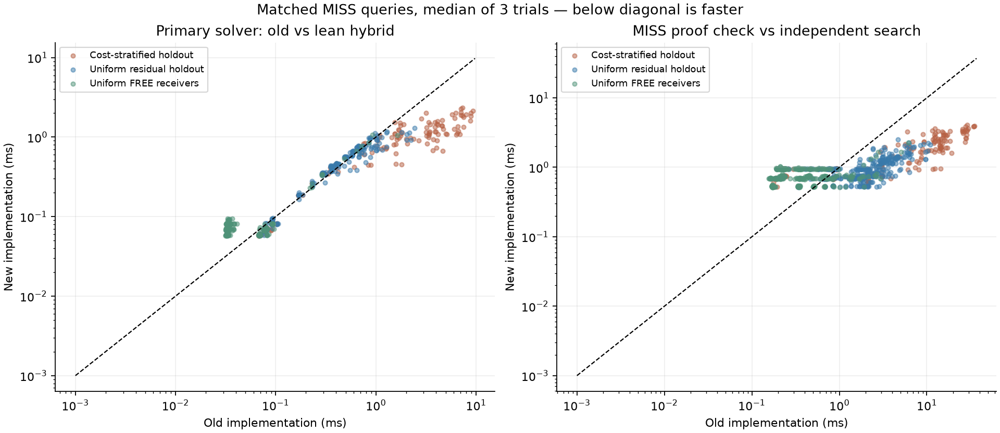
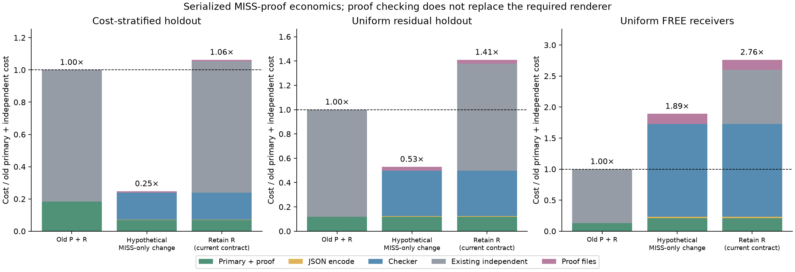
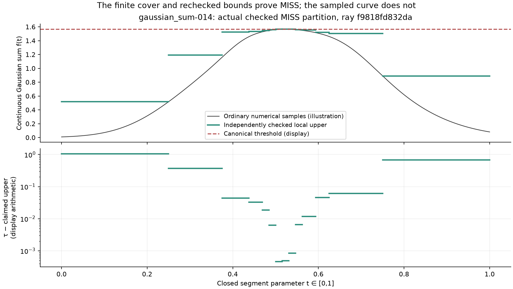
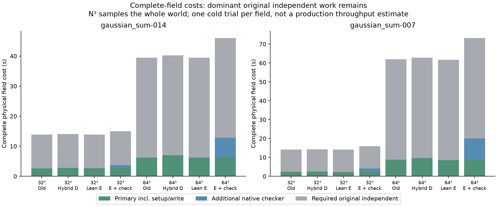

# RIND3D B2: one-dimensional maximum proofs and MISS certificates

Measured 2026-11-06/07 UTC on `yushu/gaussian-b2-native`, starting from
`d67215cce0f6dcfccb504813da5c1e52feb18547`. This is continuous positive
Gaussian-sum **geometry**, with binary closed-segment visibility. Gaussian
values are not light intensity. RIND3D v0.1 remains unchanged.

The main result is conditional. A signed local-curvature/interval-Newton hybrid
is substantially faster on deliberately difficult MISS rays. A separately
implemented checker also verifies those proofs much faster than the old
independent renderer discovers them. Neither advantage generalizes to every
ray. Ordinary queries regress; full fields show no meaningful reduction of the
mandatory primary-plus-independent cost. **Keep the old default and the
independent rendering contract. Do not expand to 128³ in this iteration.**

The [derivation and proof format](GAUSSIAN_B2_MAX_CERT.md),
[build/API/reproduction guide](../experiments/gaussian_geometry/b2_max_cert/README.md),
[measured records](../experiments/gaussian_geometry/results/b2-max-cert-measured-v1.json)
and [acceptance record](../experiments/gaussian_geometry/results/b2-max-cert-acceptance-v1.json)
separate mathematical sufficient conditions, numerical implementations,
independent checking and measured performance.

## What was frozen before optimization

The unchanged reference already uses cached line coordinates, 256-bit directed
MPFR intervals, signed midpoint derivatives and the optimized Taylor test from
depth four. The primary already has cached quadratics, rigorous directed
binary64/MPFR bounds, exact GMP/MPFR fallback and geometry filters. A was never
weakened to make another method win.

The original 374-ray corpus contains 314 MISS and 60 HIT. Selection uses old
trace cost strata plus a numerical near-threshold stratum, before implementing
the new optimizer. Labels come from complete certified fields, not approximate
maximum searches. A hash split gives 126 development and 248 evaluation rays.

| Frozen case | Kernels | Selected query count |
|---|---|---|
| gaussian_sum-014 | 11 | 95 |
| gaussian_sum-007 | 16 | 94 |
| gaussian_sum-000 | 21 | 91 |
| gaussian_sum-021 | 15 | 94 |

Two further controls bring the study to **1,398 distinct exact queries**: 512
uniformly selected FREE receivers, and 512 new uniform residual positions
(384 MISS / 128 HIT), excluding both prior corpora. The latter was frozen
before timing the endpoint-proposal ablation E. It is a fresh query holdout on
the same four known geometries, not unseen-geometry generalization. Every
coordinate is the existing exact binary64 synthetic research coordinate;
no private source from the public 1K dataset was opened or inferred.

Baseline MISS work on the initial corpus is 2.386 s, median 19 visited
intervals, P95 151, maximum 209 and maximum depth 14. It already proves 3,870
intervals with Taylor. A timing-only copy of the same algorithm measures
1.757 s natural bounds, 0.744 s Taylor bounds, 0.098 s exact derivative setup
and 0.038 s line setup over all 374 queries. Instrumentation adds about 3.8%
in separate trials, so actual comparisons use the uninstrumented baseline.

The reference always uses 256 bits here: frequent adaptive precision escalation
is not the measured explanation. A separate 192-bit Arb development-only audit
examines 1,053 natural-inconclusive intervals: 513 exclude stationary points
by derivative sign and 752 are strictly concave. Median local signed curvature
upper / old global absolute curvature is -0.00480. This supports a tighter
local bound. Approximate extrema show multiple peaks on 72/374 rays and two
material kernel contributions on 349/374, with estimated MISS margin down to
1.16e-5. These numerical diagnostics are not certified root counts or exact
distances to tangency.

## Algorithms and fair timing scope

B uses rigorous interval derivative signs and endpoint maxima. C additionally
uses validated stationary localization `m-f'(m)/f''(I)` when curvature excludes
zero; it does not enumerate or assume a fixed number of roots. D tries local
signed full-sum Taylor bounds before that contraction. Every unproved part is
subdivided or remains UNKNOWN. E changes only initial HIT proposals: it omits
the two root endpoint probes. It still proves the complete **closed** interval,
including both endpoints. E is an explicitly post-hoc overhead ablation.

All primary methods have outward binary64 algebra and directed MPFR exp at
53 bits, matching the optimized primary baseline's numerical approach. The
checker uses its own exact cofactor inverse, rational quadratics/completion of
the square and separately implemented MPFR intervals. The main checker and old
independent renderer both use **256 bits**. A 128-bit checker run is separately
reported; its cheaper time does not establish a different scientific policy.

Hardware is AMD Ryzen 7 5800H, Linux x86-64, Python 3.12.14, GCC 16.2.1,
single-thread CPU execution, `-fno-fast-math`, `-ffp-contract=off`, and unchanged
rounding/underflow guards. New B2 experiments use no GPU. Canonical regression
also exercises existing CUDA tests separately. Ray trials reuse immutable
geometry within a case; per-ray coefficient preparation and Python call costs
are included. Geometry/constructor costs and whole-process orchestration are
recorded separately. Three trials rotate method order deterministically.
These are finite laptop measurements, not confidence intervals or production
throughput estimates.

The following totals sum per-query medians of three trials, in seconds.
Strata overlap; they must not be added as independent populations.

| Method | Eval MISS (210) | Expensive MISS subset (65) | Eval HIT (38) | Fresh residual all (512) | Uniform FREE all (512) |
|---|---|---|---|---|---|
| A_primary | 0.3506 | 0.2913 | 0.0324 | 0.1352 | 0.0351 |
| A_independent | 1.5478 | 1.1928 | 0.1381 | 0.9693 | 0.2267 |
| B_derivative | 0.3693 | 0.3071 | 0.0258 | 0.1593 | 0.0469 |
| C_stationary | 0.2052 | 0.1537 | 0.0194 | 0.1496 | 0.0448 |
| D_hybrid | 0.1330 | 0.0892 | 0.0200 | 0.1419 | 0.0443 |
| E_lean | 0.1267 | 0.0854 | 0.0175 | 0.1277 | 0.0441 |

On the 65 expensive holdout MISS queries, E is about **3.41× faster than the
optimized primary**; D is about 3.27×. On all 210 selected holdout MISS queries,
E gains about 2.77×. On the fresh cost-unselected residual corpus, its total
gain is only about 5.5%. On uniform FREE receivers, it is about **26% slower**.
The favorable cost-enriched subset is not the whole physical workload.

Holdout MISS latency and work (210 queries; millisecond percentiles use
per-query medians, maximum single uses all trials; CPU totals are trial means):

| Method | P50 ms | P95 ms | P99 ms | Max single ms | Mean CPU total s | Visited intervals | Exp endpoints |
|---|---|---|---|---|---|---|---|
| A_primary | 0.348 | 7.035 | 8.838 | 9.312 | 0.3513 | 7173 | 373380 |
| A_independent | 3.047 | 27.781 | 33.933 | 35.420 | 1.5492 | 10656 | 539846 |
| B_derivative | 0.453 | 7.710 | 10.985 | 14.831 | 0.3697 | 6502 | 340464 |
| C_stationary | 0.436 | 3.014 | 6.157 | 8.241 | 0.2058 | 3044 | 186062 |
| D_hybrid | 0.416 | 1.902 | 2.190 | 2.379 | 0.1335 | 1910 | 113978 |
| E_lean | 0.368 | 1.865 | 2.142 | 2.397 | 0.1273 | 1910 | 107116 |

D/E reduce visited intervals and exp endpoints markedly on difficult rays.
Derivative-only B loses to the existing Taylor baseline. C helps but spends
more on root analysis; D/E need only 88 stationary tests versus C's 684 on the
holdout MISS set. Cheap local curvature is more useful than attempting root
contraction first everywhere. No ordinary floating-point fitted maximum is
accepted as a physical decision.

## Proof construction versus independent checking

The proof is a lossless closed interval cover with local upper-bound,
monotonicity, Taylor or stationary evidence. The checker reconstructs each
claim, checks its claimed upper and strict threshold inequality, verifies the
expected geometry/query/threshold identity and rejects any gap or unsupported
operation. Valid overlaps are allowed. The two implementations share GMP/MPFR,
canonical inputs and mathematical identities, but do not exchange numerical
geometry bounds or primary HIT/MISS decisions. The original independent
renderer and old Arb remain separate acceptance comparisons.

Below are **MISS-only** mean-total seconds over three trials on identical
supports. `E + proof` already includes solving and constructing the proof;
adding bare E again would double-count it. Checking includes parsing, envelope
validation, numerical preparation and mathematical checking. File writes are
measured optional persistence used by this study.

| MISS support | Queries | Old P+R | E bare | E + proof | JSON | Check (parse incl.) | Proof writes | Hypothetical total | Retain original R total |
|---|---|---|---|---|---|---|---|---|---|
| Selected holdout | 210 | 1.9009 | 0.1274 | 0.1332 | 0.0031 | 0.3166 | 0.0178 | 0.4706 | 2.0201 |
| Fresh residual holdout | 384 | 0.9768 | 0.1078 | 0.1169 | 0.0049 | 0.3639 | 0.0316 | 0.5172 | 1.3772 |
| Uniform FREE receivers | 461 | 0.2311 | 0.0387 | 0.0483 | 0.0051 | 0.3463 | 0.0372 | 0.4370 | 0.6381 |

Removing persistence subtracts only the listed write cost. In the selected
holdout, checking alone is about 4.9× cheaper than old independent discovery;
on the expensive subset it is about 7× cheaper. This does **not** authorize
replacing the independently searching renderer. Keeping it gives 2.020 s
instead of 1.901 s on the selected MISS set. On ordinary queries the checker
alone is about 1.73× slower than independent search. Always computing exact
rational ray coefficients and all Gaussian exp bounds costs more than the
old reference's cheap natural/tail cases.

| MISS support | Median bytes | Max bytes | Median leaves | Max leaves | Checker prep s | Checker native total s |
|---|---|---|---|---|---|---|
| Selected holdout | 916 | 2427 | 4 | 18 | 0.1202 | 0.2989 |
| Fresh residual holdout | 604 | 1768 | 1 | 12 | 0.2185 | 0.3368 |
| Uniform FREE receivers | 605 | 1541 | 1 | 10 | 0.2626 | 0.3177 |

These are compact individual proofs, not a complete-field certificate archive.
For ordinary queries a compact one-leaf proof can still be expensive to check.
The source-independent inverse is reused, but exact ray preparation is included
for each check. The native field experiment uses temporary interval objects,
not JSON/file transport; its checking time cannot be substituted for serialized
pipeline costs. Current MISS-only checks provide no independent HIT witness
checker and no portable proof for all region-filled voxels or solid-mask bits.

At 128 checker bits the selected holdout E checking median-total is 0.2630 s
versus 0.3155 s at 256. The primary proof and physical queries are the same;
all checks pass. The main conclusion uses the matched 256-bit result.

The black samples illustrate the continuous function only. They are not the
proof. The green upper bounds are the independently rechecked cover. The lower
panel uses display arithmetic for margins; the original hex endpoints and
upper bounds are retained in the certificate.

## Complete-field gate and its negative result

N³ means the sampling resolution of the **whole unit world**, not a public
observation-window side. No public window-size contract changes. The first
series changes only the final primary scalar-ray call while retaining old
continuous cover depth seven, region traversal, membership and independent
renderer. Each field runs in a fresh process, with original source clearance.
Cold seconds include engine construction, all cover/certificate/ray work,
array assembly and diagnostic NPZ writing:

| Case | N | Old P | Unchanged R | D | D + native checker |
|---|---|---|---|---|---|
| 14 | 32 | 2.638 | 11.224 | 2.805 | 3.854 |
| 14 | 64 | 6.219 | 33.240 | 7.028 | 13.683 |
| 7 | 32 | 2.278 | 11.853 | 2.421 | 4.289 |
| 7 | 64 | 8.813 | 53.196 | 9.670 | 21.314 |

The endpoint-proposal ablation uses another matched primary baseline:

| Case | N | Fresh old P | Lean E | E + checker | Old P+R | E+R |
|---|---|---|---|---|---|---|
| 14 | 32 | 2.635 | 2.643 | 3.742 | 13.859 | 13.867 |
| 14 | 64 | 6.196 | 6.243 | 12.814 | 39.436 | 39.483 |
| 7 | 32 | 2.300 | 2.265 | 4.066 | 14.152 | 14.118 |
| 7 | 64 | 8.803 | 8.489 | 20.081 | 62.000 | 61.686 |

R is the unchanged independent physical field measured in the first series;
its complete response and solid bits are also compared directly in the
follow-up. Its cost is charged again in every current-contract total, never
treated as free because an artifact is cached. There is one cold trial per
field. Tiny primary differences lack a statistical confidence claim.

Full scalar decomposition shows why difficult-ray gains do not generalize:

| Case / N=64 | Method | MISS count / seconds | HIT count / seconds |
|---|---|---|---|
| 014 | A_primary | 10,093 / 2.352 | 16,321 / 1.155 |
| 014 | D_hybrid | 10,093 / 2.495 | 16,321 / 1.785 |
| 007 | A_primary | 11,528 / 4.850 | 20,740 / 2.052 |
| 007 | D_hybrid | 11,528 / 4.661 | 20,740 / 3.083 |
| 014 | A_primary | 10,093 / 2.343 | 16,321 / 1.148 |
| 014 | E_lean | 10,093 / 2.241 | 16,321 / 1.290 |
| 007 | A_primary | 11,528 / 4.840 | 20,740 / 2.049 |
| 007 | E_lean | 11,528 / 4.300 | 20,740 / 2.260 |

All non-reference variants preserve exactly the original primary scalar
coordinate/status map; no change in spatial selection can claim credit. D
reduces nodes yet makes many extra function/point evaluations. E removes some
of that overhead, but cheap queries, preparation, allocations and derivative
work limit the full population. The old reference remains the dominant cost.

Case 14 / 64³ E is essentially tied/slightly slower. Case 7 / 64³ primary
improves about 3.6%, but mandatory P+R improves only about **0.5%**. Adding the
native checker increases current-contract total cost. This does not justify
another expensive complete 128³ series; that conditional gate stays closed.
Previous 128³ fields are preserved and not reported as newly generated here.

All **28 complete method/backend records** agree on response and solid bits
over **four geometry/grid supports**, with zero unresolved voxels. Four repeated
baseline records are not additional scenes. Peak fresh-process RSS is
**138.46 MiB**, including imported libraries and diagnostic materialization.
Current-driver 8³ smoke separately completes an original independent and lean
field, verifies equality and safely resumes them without rewriting files.
There is no full 1024³ field, RINDPack modification or READY publication.

CPU fields exclude NPZ compression from `CPU_seconds`; that column covers
engine setup and physical evaluation. Cold wall totals include compression.
`fresh_process_end_to_end_seconds` additionally includes imports, source
clearance, frozen-reference reads/comparison, hashing and output records.
Native scalar timers include the additional checker for checked variants;
adding it again would double-count. Native payload bytes are cumulative
temporary proof work, not persistent storage or peak live proof memory.

## Numerical adversaries and independent reference

Thirteen fixed adversaries cover eight separated peaks, thin rotated fused
Gaussians, two-sided near contact, one-ULP threshold margins, a degenerate
quartic stationary maximum, closed source contact, positive underflow tails
and a zero-length segment. These are numerical predicate tests, not new
generator families. Some deliberately use sources outside the dataset domain.
Declared native budgets are 1,024 nodes / 40 depth / 0.1 s, with additional
old fallback time explicitly included when enabled. Arb is separately bounded.

| Method | MISS | HIT | Unresolved | Total seconds |
|---|---|---|---|---|
| A_primary | 7 | 4 | 2 | 0.0117 |
| A_independent | 6 | 4 | 3 | 0.0408 |
| B_derivative | 5 | 2 | 6 | 0.0431 |
| C_stationary | 5 | 2 | 6 | 0.0457 |
| D_hybrid | 5 | 2 | 6 | 0.0533 |
| D_proof | 5 | 2 | 6 | 0.0527 |
| E_lean | 5 | 2 | 6 | 0.0533 |
| E_lean_proof | 5 | 2 | 6 | 0.0531 |
| D_old_fallback | 7 | 4 | 2 | 0.0638 |
| E_old_fallback | 7 | 4 | 2 | 0.0628 |
| Arb_third | 7 | 3 | 3 | 0.3214 |

All **143 method/adversary records have zero opposite physical labels**.
The raw new solvers leave six cases unresolved, including one-ULP margins,
recognized analytic contact and a threshold below their binary64 enclosure
floor. Explicit old fallback reduces that to the two nontrivial exact-contact
cases. Thus numerical completeness can regress without fallback; correctness
does not permit converting those UNKNOWNs to physical labels. The quartic
example has `f'=f''=0` at its exact threshold maximum; no simple-root assumption
is made. Equality remains closed HIT mathematically, even when generic finite
interval code cannot prove it. Budget exhaustion is computational, never
source/geometry rejection.

An additional **24 selected real frozen rays** all resolve through the
unchanged Arb path, with zero disagreement with the new solver and checker.
The full tests also retain the old 6,197-node difficult-MISS witness. Ordinary
numerical plots/peak estimates are separate from this physical evidence.

## Answers and integration decision

**1. Why are existing MISS rays expensive?** They must exclude every parameter
region. Independent per-kernel/natural bounds are loose near overlapping peaks,
and the old positive global curvature forces repeated subdivision despite
signed cancellation. Actual bound evaluation dominates, not orchestration.

**2. Bounds, extrema, tangency or precision?** Local curvature/sign diagnostics
support loose bounds as the main sampled workload issue. Multiple approximate
peaks occur on a minority; no universal root count was proved. Exact/one-ULP
contacts remain a separate numerical-completeness problem.

**3. Does derivative guidance beat existing Taylor?** B alone does not. Its
extra bound work outweighs saved nodes. Signed local Taylor in D/E does help
the difficult subset, without disabling the old baseline's Taylor machinery.

**4. Does stationary isolation help?** Validated localization in C helps over
B, but D/E are faster by trying the local maximum bound first. It certifies
no-root/necessary-root-region statements, not all roots or exact extrema.

**5. Is full-sum cancellation usable?** Yes: signed first/second contributions
are accumulated before absolute bounds. Negative local curvature gives a
rigorous concave quadratic upper bound. No fitted curve replaces an enclosure.

**6. What wins expensive MISS?** E is fastest in this bounded comparison,
about 3.41× the optimized primary on 65 expensive holdout MISS rays. Checking
their proof is about 7× faster than independent discovery, a different role.

**7. What about ordinary rays?** E is about 26% slower on uniform FREE receivers;
ordinary MISS checking also loses. It is not a universal default replacement.

**8. How often is old fallback used?** Zero on the 1,398 matched real queries
and all complete main fields. It is necessary on four of six raw adversarial
UNKNOWNs to retain the old oracle's recognized-contact/tiny-margin capability.

**9. Are proofs compact?** Yes: median four leaves / 916 bytes on selected
holdout MISS, with one-leaf medians on the two less cost-enriched populations.
This is not evidence that every possible ray admits a small finite proof.

**10. Is independent checking cheaper?** On hard selected and uniform residual
MISS, yes; ordinary queries are a counterexample. Check preparation and
transcendentals still cost real work. See matched totals, not only averages.

**11. What is generation overhead?** E+proof includes native leaf retention and
Python construction. Its selected MISS mean-total is 0.1332 s versus 0.1274 s
bare E; JSON encoding adds 0.0031 s. That paired difference is an overhead
estimate, not a separately isolated timer for every allocation.

**12. What is artifact size?** Selected holdout median 916 / max 2,427 bytes;
fresh residual median 604 / max 1,768. Raw proofs/traces remain ignored. No
general proof-distribution or full-field storage system is introduced.

**13. Are continuous semantics preserved?** The checker reconstructs the
canonical rational inverse/quadratic, retains every positive Gaussian term,
uses outward transcendental bounds, requires strict MISS and closed coverage,
and rechecks every numerical claim. Tests supplement the derivation; they are
not a formal verification of GMP, MPFR, the compiler or all possible inputs.

**14. Is independent rendering preserved?** Yes by retaining it. A separately
checking proof is not automatically the existing independently searching
physical renderer. The latter's cost and complete field comparison stay present.

**15. What remains unresolved?** Nontrivial exact transcendental contacts,
degenerate stationary points and margins below the chosen finite enclosure/
node/time budgets. These are measured unresolved cases, not a theorem of
mathematical undecidability or a geometric rejection.

**16. Is specialization preferable?** Evidence favors an explicit hard-ray
research option while keeping the existing cheap path. A reliable cost-aware
dispatch rule has not been validated; future routing must not prune physical
truth or select only favorable benchmark cases.

**17. Does the gain survive complete fields?** No meaningful current-contract
gain. E is tied on case 14 and saves about 0.5% including unchanged R on case 7
at 64³. Additional checking is slower overall. The 128³ expansion stops here.

**18. What bottleneck remains?** Independent certified MISS discovery, cheap-
ray setup/checking cost, and too little benefit from stronger bounds on the
large easy population. Lower node counts alone are not total-cost success.

**19. Make it the B2 default?** No. Keep the implementation opt-in and preserve
the unchanged optimized baseline. No production scientific predicate changes.

**20. Pursue proof-carrying verification?** Only a bounded hard-tail research
track. First test cheap/strict independent preparation and a frozen cost-aware
routing rule on new geometries. An independently implemented direct maximum
optimizer inside R is another hypothesis that could retain the current
contract. Neither improvement is claimed here. A future acceptance-contract
transition requires a separate explicit scientific decision, not this prototype.

## Acceptance, recovery and preservation

- Canonical regression with existing CUDA opt-in: **348 passed, 7 skipped**, four existing fork warnings, 266.76 s.
- Explicit Gaussian suite: **154 passed**, 18.48 s, including all **46 new tests**. Total: **502 passed / 7 skipped** across the two suites.
- Proof coverage/identity/threshold/bound/operation tampering, overlap-with-gap, exact contacts, derivative enclosures, thin geometry, source/receiver degeneracy and original baseline preservation all pass.
- Current CLI checks idempotent resume, method-namespaced proof files, corrupted proof refusal, restored resume and changed-input identity refusal. Completed records/fields are not regenerated.
- **842** pre-existing tracked source files, **877** integration/teacher files and **3,166** historical output files retain SHA256 values. Original dirty worktree status is preserved.
- All **13,013** public RIND3D files are rehashed: **1,000 scenes / 256,000 windows**, manifest SHA256 `6b30efcc88835c53694ce1f065b1c092a6759dfbb5273f66ab48230ea1b5d414`.
- Both existing **633,273,091-byte** public archives retain SHA256 `1f5a2ff2bd9ac4a479a074b33e0d06f160706e4369b199144ee117693913ee1e`.

The seven skips are existing real READY/private-campaign opt-ins. No scientific
threshold is weakened. Main benchmark proof contents used a shared
query/repetition filename for D/E; all paired proofs are byte-identical and
each method hash was checked. The final driver saves them separately and
rejects failed or corrupted checkpoints. Exact measured v2/v3 native and driver
sources are reconstructable using the tracked, independently tested reverse
patches; original binaries and negative records are retained locally.

No old report, production geometry/visibility code, public reader, RINDPack,
private-label policy, Phase 1/2 implementation or teacher experiment is changed.
No sibling project is modified. No complete 1024³ field, READY scene, mass
production, public archive change or remote push is part of this iteration.
