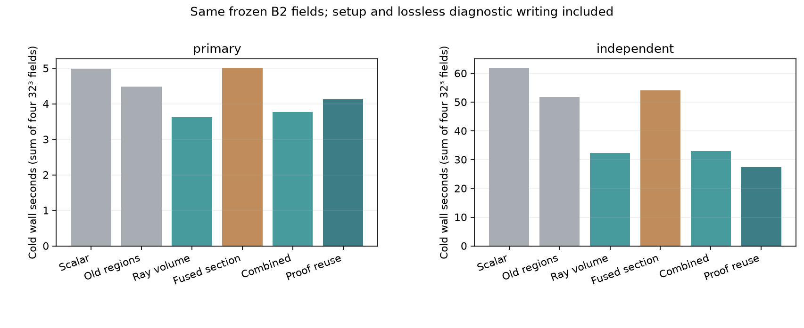
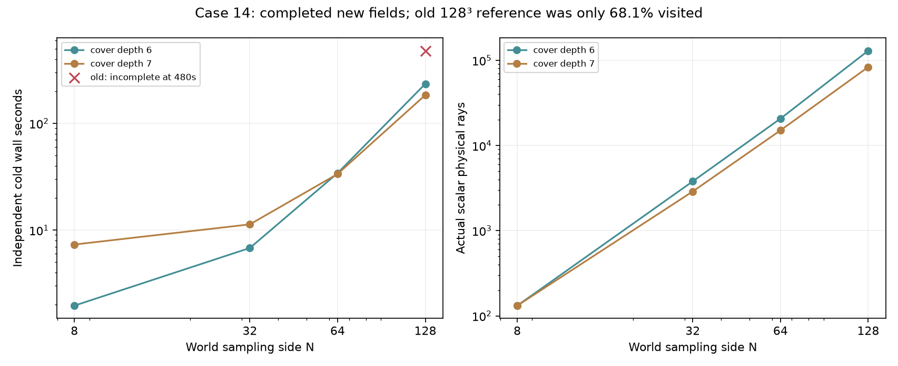
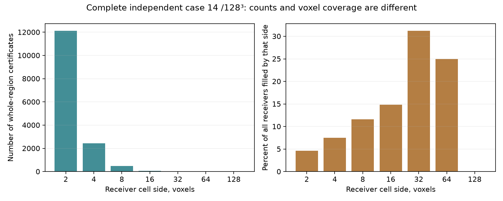
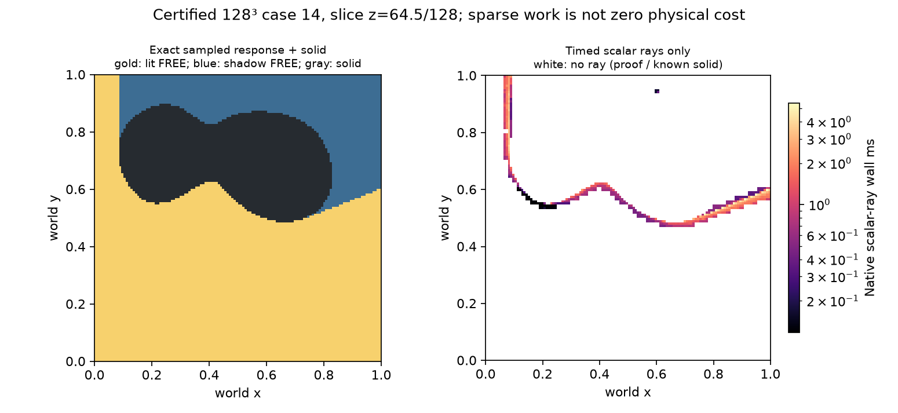

# RIND3D B2: certified receiver-region field generation

Measured 2026-11-06 on `yushu/gaussian-b2-native`, based on
`bd5e0d7956d896eb1a9f4f20334fdb9ad07bc547`. This remains isolated B2 research:
the canonical continuous Gaussian sum, original RIND3D dataset and production
publication authority are unchanged.

**The previous 128³ independent-verification blocker is overcome for two
different frozen geometry/source pairs.** Case 14 completes both fields with
zero unresolved voxels: primary 35.56 s / reference 235.22 s with proof depth 6,
or 33.29 s / 184.41 s with depth 7. The additional, difficult case 7 completes in
57.68 s / 338.18 s at depth 7. All response and solid bits agree. Case 14 also
matches the unchanged prior complete primary 128³ field.

Across four matched 64³ fields, independent cold time falls from 392.64 to
158.61 s in aggregate (**2.48×**); primary time falls from 34.99 to 21.00 s
(**1.67×**). These are complete-field results, including proof-tree construction,
engine setup and diagnostic writing. They are not production 1024³ throughput.
No new READY scene or complete 1024³ field is claimed.

Read the [proofs and protocol](GAUSSIAN_B2_REGIONS.md),
[runnable guide](../experiments/gaussian_geometry/b2_regions/README.md),
[machine-readable measurements](../experiments/gaussian_geometry/results/b2-regions-measured-v1.json)
and [acceptance/preservation record](../experiments/gaussian_geometry/results/b2-regions-acceptance-v1.json).
The [previous native report](GAUSSIAN_B2_RESULTS.md) is preserved as historical
evidence, including its incomplete 128³ attempt.

## Protocol and interpretation

Hardware is the same AMD Ryzen 7 5800H laptop, Linux x86-64, Python 3.12.14,
GCC 16.2.1, system GMP/GMPXX and MPFR. Numerical sources are compiled without
fast-math or contraction, with nearest rounding and gradual underflow checked.
Physical runs are serial, single-threaded CPU jobs. No new GPU renderer is used.
These are mathematically justified experimental predicates with independent
validation, not a formally verified program or a production-family certificate.

All field comparisons use frozen Gaussian geometries 0, 7, 14, 21 and their exact
previous synthetic sources. No source/geometry is resampled for performance.
Both original source-clearance implementations prove the original 2^-26 cube
condition before field evaluation. The 24-scene generation distribution study
is not repeated; its dense 15% regime's 2/6 retention limitation remains.

N denotes the sampling resolution of the **whole unit world**, not an
observation-window side. The public 64/128/256 window contract is unchanged.
Each complete experiment produces response and solid independently for every
voxel center. Region proofs quantify over continuous boxes, not just sampled
voxel corners. They never replace Gaussian truth with voxel or mesh geometry.

The 32³ policy study compares all six strategies on all four cases. The 64³
stage compares old hierarchy and proof reuse on all four. Larger acceptance
uses selected bounded 128³ runs. Method order rotates by case. Full fields have
one cold measurement per configuration; small differences are not statistical
confidence intervals. Effective exponents below are finite-size observations.

`ablation32-v2` and `gates64-v2` retain the untraced measured implementation and
its archived source/binary. Final-v3 adds optional work tracing and diagnostic
environment/domain guards, preserving legal-input field predicates. The 128³
acceptance runs use that final implementation with tracing enabled; all
version/build/driver/API/workload hashes are retained. No running library was
overwritten. Raw artifacts stay in ignored `outputs/gaussian-b2-regions-v1` in
the research worktree; compact results and figures are committed.

## 1. Can a whole ray volume be proved FREE efficiently?

Yes, with sufficient but incomplete predicates. Strategy C subdivides the full
closed parameter interval and bounds all receiver rays in each slab. The primary
uses kernel-local affine coordinates; the reference instead bounds world-space
slabs and invokes its independent 256-bit Gaussian box oracle. Every slab must
be FREE; an unresolved slab cannot be ignored.

This resolves a controlled diagonal ray volume whose much larger source/receiver
AABB contains an obstacle. On four full 32³ fields, reference cold time falls
from 51.86 s for the old hierarchy to 32.30 s with this extra proof. Strategy F
goes further by reusing continuous geometry classifications across the field.

## 2. Do fused sums give useful whole-region SHADOW proofs?

Yes, though a fixed cross-section is incomplete. On 36 dense-overlap test
regions, primary old certificates prove no SHADOW region; additional full-sum
sections prove 13. The independent old method already proves 12, and expanded
section search proves 13. This existing reference capability is explicitly
preserved, not relabeled a new theorem. Fused/thin branches also gain primary
certificates; some other fixtures show no benefit.

A controlled 1024-grid 8³ tile has 512 FREE shadowed receivers. Both full-sum
paths verify them. For each of its seven kernels, a separate continuous-volume
proof establishes that the entire receiver-ray volume misses that individual
shared-threshold solid. Thus the shadow is genuinely due to the sum, rather
than an ellipsoid union. The primary issues 16 reused inner-shadow certificates;
the reference confirms the tile using its own full-sum proofs. This does not
assert that both used the same acceleration route.

Corners obstructed by unrelated bodies are never sufficient. Tests include
that counterexample, exact endpoint contact directed away from an obstacle,
tangencies, unaligned regions, thin/sheared kernels and mixed scales.

## 3. How much receiver work is eliminated?

For the four complete 64³ fields, relative to the old hierarchy:

| Backend | Old scalar rays | New scalar rays | Rays avoided | Old query exp endpoints | New query exp endpoints |
|---|---:|---:|---:|---:|---:|
| Primary |597,805|123,366|79.4%|31,647,842|19,771,972|
| Independent |709,216|98,248|86.1%|106,355,248|46,524,720|

Counts include actual query arithmetic used to build the cache. Constructor
arithmetic is timed separately, not hidden in a claimed zero-cost cache.
Ray reduction exceeds exp reduction because retained rays are harder and
continuous box/cross-section proofs also evaluate Gaussians.

At independent case 14/128, depth 6 fills 92.63% of voxels by whole-region
certificates and calls 129,171 scalar rays. Depth 7 fills 94.82% and calls 83,171
rays. The remaining 6.16% or 3.97% of receiver positions still dominate time.
Avoided rays are actual calls, not merely fewer traversal nodes.

## 4. Is end-to-end field time substantially better?

Yes, especially for independent verification. Cold totals for the matched
complete 64³ stage are:

| Case | Primary old → reuse seconds | Independent old → reuse seconds |
|---|---:|---:|
|0|3.73 → 1.91|80.42 → 19.24|
|7|12.27 → 8.32|134.37 → 59.48|
|14|7.90 → 5.04|82.34 → 33.94|
|21|11.08 → 5.72|95.51 → 45.96|

All compare every response and solid bit against the saved baseline and each
other. The proof tree is built cold for each call. Timings include its cost.

The full four-case 32³ ablation shows where benefits originate:

| Strategy | Primary total seconds | Independent total seconds |
|---|---:|---:|
| A: scalar |4.984|61.959|
| B: old hierarchy |4.493|51.860|
| C: extra ray-volume FREE proof |3.623|32.295|
| D: extra fused cross-sections |5.016|54.179|
| E: C+D |3.770|32.919|
| F: continuous proof reuse |4.126|27.348|

## 5. Does the independent verifier genuinely benefit?

Yes. It constructs its **own** FREE/SOLID/UNKNOWN tree using its original
256-bit natural Gaussian bounds and cofactor inverse. For geometry screening,
it independently eliminates the ray scale using exact rational halfspaces.
The primary instead uses outward parametric clipping and same-body corner
proofs. Neither consumes the other's tree, cached labels, visibility decisions
or field. Shared traversal/storage and numerical primitives are disclosed.

Both native implementations share MPFR/GMP libraries. The unchanged old Arb
path is therefore retained as a third numerical path. Its complete case 14/32³
field again finishes (34.02 s) and matches the new independent field in all
32,768 response and solid entries. Fixed-region sanity checks cover 219 regions
across nine adversarial fixtures with no opposite certified labels. Finite
sampled checks supplement, rather than establish, continuous region proofs.

## 6. Is the fast exponential filter mathematically sound?

The implemented filter has an analytic error enclosure for its stated
nonpositive domain and floating-point environment. It reduces the argument,
uses a positive degree 12 Taylor series with a geometric bound on the entire
remaining tail, inverts the positive interval and repeatedly squares outward.
It never assumes that ordinary `std::exp` is correctly rounded or within a
fixed empirical ULP bound. Full details are in the numerical design.

Finite Gaussian tails retain a positive underflow upper remainder. Positive
exponents/overflow diagnostics use directed MPFR; NaN is invalid. Small-margin
comparisons can fall back to high precision. Tests include subnormals,
underflow, overflow, tiny margins, wrong rounding and unresolved equality.
Separate 256-bit enclosures check 2,059 deterministic numerical inputs.
The independent geometry verifier does not use this polynomial code.

## 7. Does the filter outperform MPFR in practice?

On 65,536 identical synthetic binary 64 exponential arguments, enclosure-only
median batch time is 0.10965 s for MPFR 53 versus 0.03097 s for the polynomial
(3.54×). The wider polynomial enclosure leaves 13,701 comparisons unresolved,
versus 7,169 for MPFR 53. Comparing equal final resolved labels **with** rigorous
fallback gives 0.14214 versus 0.08601 s (**1.65×**), with zero disagreements.
This is an elementary-function workload, not a physical-ray speedup.

In actual primary field C/E ablations, effects are much smaller:

| Workload | MPFR seconds | Filter+fallback seconds |
|---|---:|---:|
| Four 32³ fields, C |3.639|3.454|
| Four 32³ fields, E |3.774|3.558|
| Case 14/64³, C |5.470|5.315|
| Case 14/64³, E |5.091|4.726|

These single cold comparisons suggest roughly 3–7% end-to-end benefit in those
paths, not 1.65× whole-field improvement. Existing scalar and reference
fallbacks remain unchanged. The filter stays optional/default off; F without
extra parameter bounds does not use it. Repeat physical measurements before
choosing a broader default.

## 8. Which optimization gives the largest real gain?

Reusing rigorously classified continuous geometry to exclude whole ray volumes
gives the largest measured independent complete-field gain. The initial cold
256-ray box-cover result from the previous study was negative; this experiment
tests a different, explicit amortization hypothesis across a complete field,
with native hierarchical screening and no 64-component-cap workaround.

The largest gain is not the standalone exponent microbenchmark. Full 64³
physical timing and actual exp/ray counts, rather than node counts, support
the recommendation.

## 9. What adds overhead without enough benefit?

Extra fused-section search increases the four-case reference 32³ total from
51.86 to 54.18 s and primary from 4.49 to 5.02 s. It is mathematically useful in
some fixtures, but not a good blanket default on these four fields. Combining
it with C is slightly slower than C alone.

Deeper global proof construction is costly: case 14 reference setup increases
from about 1.8 to 7.2 s when depth goes 6 → 7. At 32³, total time grows 6.79 → 11.31 s;
at 64³ it is essentially tied (34.18 → 33.57 s), whereas 128³ benefits.
Primary F also loses to simpler C at some small resolutions because of setup.

A valid near-source control has strict clearance but lies in a coarse UNKNOWN
proxy box. F then adds cost without resolving its source neighborhood: the
16³ primary control grows 7.20 → 7.89 ms, reference 13.82 → 15.91 ms, while every bit
remains correct. Do not resample such legal sources to hide the limitation.

## 10. Are Gaussian fusion boundaries still the bottleneck?

Much of the remaining work is near sampled visibility transitions, but it is
incorrect to call all residual work unavoidable. In case 14/128 depth 6,
timed scalar rays spend 92.33 s near sampled lit/shadow transitions, 15.70 s
adjacent to sampled solid, and 110.98 s elsewhere in FREE space. At depth 7,
transition time is almost unchanged (91.03 s), while other-FREE time falls to
59.28 s. Refinement removes many conservative-proxy false positives.

The neighborhood definition is a 26-neighbor one-voxel sampled diagnostic,
not an exact continuous distance or proof of causal necessity. Thin subvoxel
features and unresolved bounds can still be expensive away from that sampled
transition. A cost lower bound has not been proved.

## 11. Does case 7's hard near-boundary MISS remain correct?

Yes. The exact saved 64³ receiver XYZ `(23,38,45)` remains MISS:
old Arb 6,197 nodes /6.79 s; primary 255 nodes /15.13 ms; independent 267 nodes /
54.02 ms. The original Taylor safeguard and numerical budgets are retained.
New complete 64³ fields match the old bit there. The larger case 7/128 field
also completes without unresolved labels. This does not mean every analytic
tangency is decidable.

## 12. Can case 14's complete 128³ field now be independently verified?

Yes, under the declared 480-second limit, with both masks independently
computed. The additional different geometry also passes:

| Case/config | Primary cold seconds | Independent cold seconds | Valid voxels per backend | Bit disagreements |
|---|---:|---:|---:|---:|
|14, depth 6|35.56|235.22|2,097,152|0|
|14, depth 7|33.29|184.41|2,097,152|0|
|7, depth 7|57.68|338.18|2,097,152|0|

Case 14 compares against the old complete primary 128³ array as well. The old
independent attempt is still recorded as only 68.1% complete at 480 s. It is
not used as a fictitious completed baseline to compute a full-field speedup.

## 13. What scaling is actually measured?

For independent case 14, cold 32/64/128³ times are 6.79/34.18/235.22 s at depth 6,
and 11.31/33.57/184.41 s at depth 7. Finite-size time exponents from N doubling
are approximately 2.33 then 2.78 for depth 6, and 1.57 then 2.46 for depth 7. Setup
and certificate effects strongly influence these values; they are not an
asymptotic complexity theorem or evidence that 1024³ is solved.

Keeping a fixed coarse proof cover leaves an uncertainty band that can
eventually cause volume-like fallback growth. Refining the cover reduces that
band at greater setup/memory cost. The evidence favors controlled adaptive
proof reuse over choosing one universally optimal fixed depth.
Cover depth controls proof effort and strength, not canonical geometry accuracy.

## 14. Which regions remain expensive, and what does memory cost?

Case 14 depth 7 spends 168.82 s in remaining leaf work, versus 7.23 s in proof-tree
construction and 7.99 s in region work. Case 7 spends 320.01 s in leaf work.
Of its timed scalar rays, 188.01 s are near sampled shadow transitions,
117.75 s elsewhere in FREE space and 12.08 s adjacent to sampled solid.
Near-threshold MISS proofs and insufficiently tight shadow/outer certificates
still cost much more than cheap interior classifications.

Independent case 14/128 uses 77.49 million query exp endpoints at depth 6,
60.84 million at depth 7; case 7/depth 7 uses 112.52 million. Many remaining
rays are much harder than an ordinary uniform ray sample. Conditional scalar
latency quantiles and worst receiver indices are retained in the work traces.

Case 14 proof nodes increase 22,625 → 92,865. Process peak RSS with full optional
diagnostic traces is about 254–256 MiB; primary peaks about 217–222 MiB. These
are whole-process high-water marks, not isolated cache allocation sizes.
Tracing stores per-voxel timing/path arrays and defaults off. No persistent
index or new public dataset storage overhead is introduced. The complete
traced 128³ NPZ files are roughly 0.53–0.72 MB each for these particular fields;
that is not a RINDPack production compression estimate.

Certificate count and volume coverage differ substantially:

White in the work plot means no scalar ray, not zero computation: continuous
proof construction, mask work and inherited results are separately counted.

## 15. What numerical cases remain unresolved?

The nontrivial exact transcendental tangent still cannot be numerically
resolved by the available general predicates. It remains UNKNOWN, never MISS.
The nearby outside/inside cases retain their correct decisions where proved.
Unsupported/nonfinite inputs and wrong floating-point environment fail
explicitly. Bounded region proofs frequently remain UNKNOWN, then subdivide
or call the unchanged scalar oracle. All completed fields above have zero
unresolved voxels; this is not a universal guarantee for arbitrary B2 inputs.

An early unit harness indexed the old certificate API twice; its three
failures/log are preserved and corrected. A mathematical audit also identified
that finite-lambda projection must separately retain closed t=0 contact.
The guard and regression were added before the four-scene measurements.
Neither issue is concealed as a physical rejection or fixed by a tolerance.

## 16. Is stronger hierarchical proof reuse viable?

Yes, as a bounded accelerator with explicit uncertainty. It builds FREE and
SOLID boxes using continuous bounds; unknown and unprocessed boxes stay in
the outer set. It does not turn a sampled mask into ground truth. Membership
certificates and source-dependent visibility certificates remain distinct.
Each backend owns its proofs. The independent projection preparation is only
about 0.10 s in the depth 6 case 14/128 run, within its region stage; this is not
the dominant remaining cost.

The current cache is cold per field/tile call, not a persistent cross-source
service. The tile primitive uses arbitrary legal integer origins and canonical
voxel centers, with at most 128³ output even in a 1024-grid world. Unaligned
tiles match complete small fields. No dense 1024³ intermediate is required by
these predicates, but RINDPack streaming/resume is not implemented here.

## 17. What is still needed for full 1024³ B2?

Stronger boundary proofs and economical reuse are needed before a full-size
experiment. Remaining options include selective refinement of outer uncertainty,
better full-sum blocking certificates with variable ray parameters, and
source-local refinement when an accepted source lies in an UNKNOWN cover box.
Bounds must remain conservative; sampled homogeneity cannot discard a region.

A production proposal also needs the separately versioned B2 codec/numerical
policy and all original geometry/world-face/regularity/critical-level,
interior/source-clearance, complete dual-field, RINDPack integrity/resume,
window/reference verification, privacy/loader and publication gates. Small
fields and a faster filter do not satisfy those requirements. Existing
`ready_capable=False` restrictions are unchanged. No 5,000/10,000 cost claim or
1024³ production launch follows from this study.

## 18. What should happen next?

Keep the independent proof-reuse path as the leading isolated field prototype.
Depth 6 is a reasonable measured 64³ default; depth 7 is useful at 128³ when its
larger setup budget is acceptable. For small primary fields, direct C is
simpler and often faster. These are workload recommendations, not universal
optimal settings. Extra D is not a blanket default.

Prioritize selective, query-driven continuous proof refinement and stronger
fusion-aware blocking structures around the measured residual work, rather
than uniformly deepening every box. Preserve the full-sum fallback and both
independent paths. Investigate safe reuse of each verifier's own source
coefficients; never reuse primary labels as independent evidence. Keep the
sound fast-exp filter optional until repeated physical workloads justify its
small end-to-end gain. Do not choose easier geometries or resample valid
sources to meet a timing target.

The final complete regression is **432 passed, 7 skipped, 4 warnings in 272.16 s**,
including 22 new region tests and the unchanged original B2 tests. Skips are
existing private/real-production fixture opt-ins; existing fork warnings are
unchanged. Preservation hashes and local integration are recorded separately.
All original RIND3D data and previous studies remain unchanged, and no remote
push is performed.
