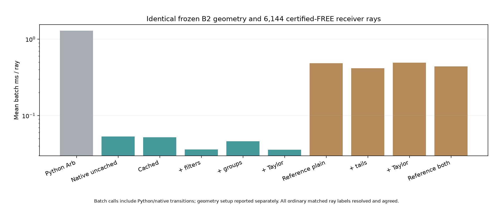
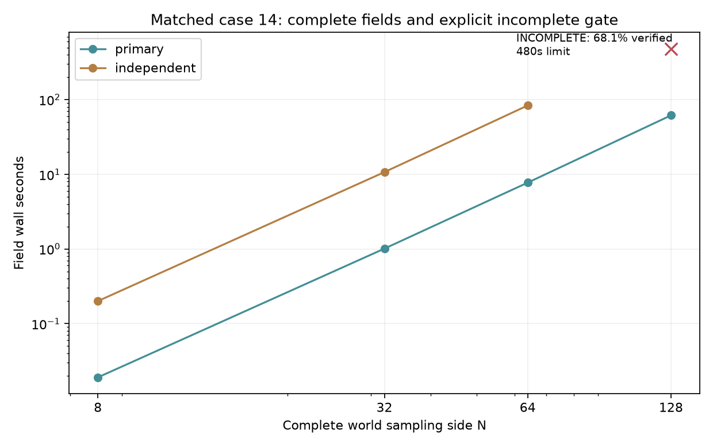
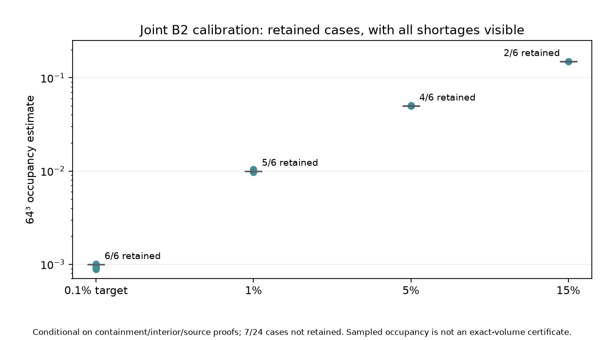
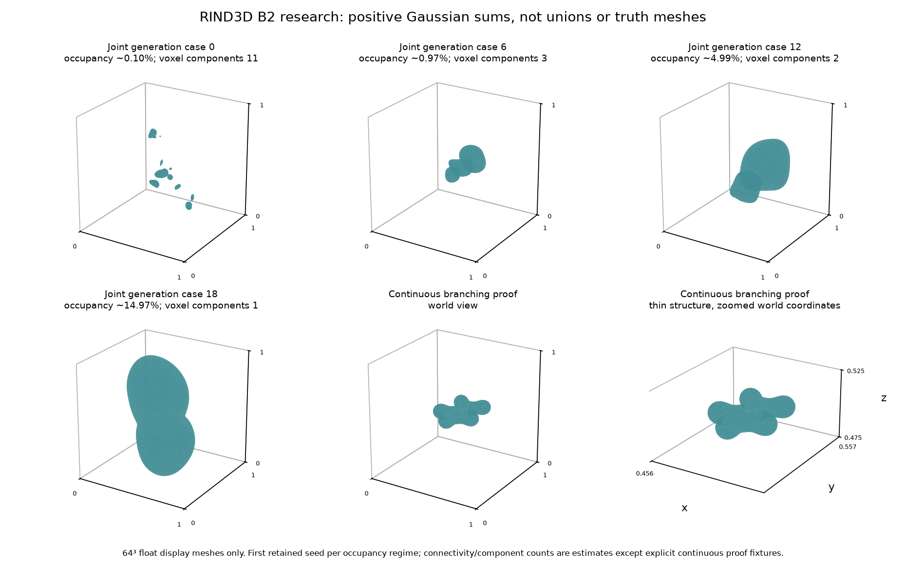

# RIND3D continuous Gaussian-sum geometry: native B2 results

Measured on 2026-11-05–06. Research branch: `yushu/gaussian-b2-native`,
based on `bf4caf1496412c6f1df085cd084d0939f5a31026`.

The native prototype substantially improves certified continuous B2 queries.
On 6,144 identical ordinary rays, its measured batch time is 0.219 s versus
7.979 s for the unchanged Python/Arb implementation: **36.5×**, or **32.0×**
including native geometry setup. Four different complete 64³ fields now agree
voxel by voxel between primary and independent implementations, for both
response and solid mask. The conditional 128³ attempt completed the primary
field in 61.63 s, but independent verification reached only 1,428,012 of
2,097,152 voxels within 480 s. It is **not** a completely verified 128³ field.

This is an experimental numerical engine. No 1024³ B2 field, new READY scene,
production family, public format change or dataset regeneration is claimed.
The permanent dataset name remains **RIND3D**.

The [numerical design](GAUSSIAN_B2_NATIVE.md) records the audit, mathematical
bounds and implementation. The [experiment guide](../experiments/gaussian_geometry/b2_native/README.md)
contains the actual build/API/CLI instructions.
[Machine-readable measurements](../experiments/gaussian_geometry/results/b2-native-measured-v1.json)
retain per-case times, CPU work, unresolved counts, field coverage and artifact
hashes. The [acceptance record](../experiments/gaussian_geometry/results/b2-native-acceptance-v1.json)
records tests and preservation checks.

## Measurement protocol

Hardware: AMD Ryzen 7 5800H, Linux x86-64. Python 3.12.14, GCC 16.2.1,
NumPy 2.5.4, python-flint 0.9.0, gmpy2 2.3.2. Native dependencies are GMP/GMPXX
and MPFR. Fast-math and floating-point contraction are disabled. Runs use one
CPU thread; no GPU is used by the new B2 engine. Existing CUDA regression tests
were enabled separately.

The main matched workload uses all 24 saved `gaussian_sum-000` through `-023`
geometries from the preceding study, their original synthetic sources, 256
baseline-certified FREE receivers and 128 membership points per geometry.
Scrambled Sobol query coordinates are deterministic. Input coordinate equality
with the prior matched run was checked for all 24 cases. Native modes rotate
execution order across cases and use three batch repeats; reported totals sum
the per-case median batch time. Geometry setup is separate. The old Python
baseline is measured on exactly the same inputs, rather than compared with an
earlier study's different query population.

These are finite experimental comparisons, not an exhaustive proof of an
implementation. Soundness depends on the stated enclosures, compiler/runtime
conditions and fail-closed rules, in addition to the independent tests. Old
Python queries use Arb; the primary's fast exponent endpoints use directed
53-bit MPFR and its fallback uses higher precision. Consequently the measured
speedup includes batching and the numerical filter architecture, not just a
change of programming language.

Raw evidence is retained under ignored `outputs/gaussian-b2-native-v1/`.
`matched-v2`, `fields-v3`, `fields-128-v1`, `generation-v2`, `adversarial-v2`,
`field-ablation-v1.json`, `controlled`, `proxy-experiment-v2` and `native-profile`
are the report's measured runs. Earlier, failed and incomplete runs remain
alongside them. Later Python API additions record immutable geometry identity,
reject stale proof inputs and reject implicit rational-coordinate conversion;
the measured native numerical source/binary
hashes remain unchanged. Constructor times below describe the measured run,
not a separate benchmark of that later metadata guard.

## 1. What was the old Python bottleneck?

The initial audit profiled four frozen scenes before choosing the native work.
Exact rational coordinate transforms, coefficient preparation, repeated witness
membership and Python numerical temporaries were substantial. For case 14,
coordinate transformations account for 26.5% cumulative cProfile time,
coefficient preparation 28.3%, and the Gaussian score/summation routine 11.7%.
These categories overlap and must not be added. The old ray implementation
already cached exact quadratic coefficients; it did not recompute all of them
at every subdivision.

Tracemalloc peaks on eight-ray profiles are 11–19 KiB of Python-traced objects.
They exclude Arb/GMP internal allocations and do not establish their cost.
cProfile cannot isolate Arb's internal exponent time. The audit therefore did
not attribute an invented exclusive percentage to exp or allocation.

After native integration, a separate Callgrind experiment changes the diagnosis:
on 128 matched case-14 rays, `mpfr_exp` accounts for 80.18% of primary and 62.16%
of reference **inclusive instruction counts**. Total counts are 44.0 million and
581.7 million instructions respectively. These are same-source standalone O3
instrumented harness results, not wall-time percentages or Python binding
latencies. Exp enclosures and reference arithmetic are now clear targets.

## 2. What moved into native code?

The isolated C++20 module owns immutable binary64 kernel parameters, exact
rational transforms, batched membership and segment queries, ray coefficient
caches, inner/outer bounds, grouped positive remainders, Taylor bounds,
independent high-precision predicates, region certificates and hierarchical
small-field traversal. Python retains experimental orchestration, generation
proposals, reporting and proof-record checking.

Canonical truth is still

`F(x) = sum_i w_i exp(-||M_i^-1(x-c_i)||²/2)`, with `K = {F >= tau}`.

The lossless binary64 matrix `M_i` defines an exact positive-definite quadratic
through its exact rational inverse. No fitted inverse, mesh, voxel mask,
ellipsoid union or discarded tail replaces this definition. Native capability
is currently bounded to 1–1024 kernels, with much smaller measured cases.

## 3. Which numerical decisions are certified?

Primary algebra encloses every operation outward in binary64 under a checked
nearest-rounding/gradual-underflow environment. Directed MPFR endpoints enclose
the exponential. Uncertain decisions can fall back to exact rational quadratic
extrema and directed MPFR, normally 192 bits, with a higher-precision point
retry. Strict `upper < tau` proves FREE/MISS; a proved lower `>= tau` or a
proved point witness establishes SOLID/HIT. The full sum and every positive tail
remain present or enclosed by a nonzero remainder.

The independent implementation separately constructs exact inverses using
cofactors, encloses local linear coordinates at 256 bits, and uses breadth-first
subdivision. Its region-shadow proof uses a whole SOLID cross-section of the
full sum. Primary uses cached ray quadratics and a different shadow proof from
one contained convex ellipsoid. They do not call each other's physical
decisions. Shared traversal/storage is bookkeeping only.

Both native paths depend on MPFR/GMP, so they are not independent elementary
function libraries. The unchanged Arb implementation provides a third numerical
path on matched queries and selected complete fields. This common dependency
and the limited validation domain must be disclosed in any future family
certification. `ready_capable` remains false.

## 4. What happens at tangency and transcendental equality?

The closed segment touching closed `K` remains HIT, including endpoint contact.
Reducible identical-kernel/symbolic-threshold cases have exact rational
quadratic decisions; tests include exact tangencies, nextafter perturbations,
reversed rays, zero-length segments and very thin obstacles.

A genuinely nontrivial fixture has a ray maximum exactly `exp(-1/4)`, equal to
the symbolic threshold. Old Arb exhausts its depth budget and both native paths
return UNKNOWN. Its mathematical label is HIT, but the available general
numerical machinery does not prove that equality. No epsilon or false MISS is
introduced. The adjacent outside/inside cases resolve MISS/HIT with the improved
paths. UNKNOWN, INVALID and physical labels remain distinct.

## 5. What is the measured speedup on identical rays?

All modes below resolve the ordinary 6,144-ray workload with 1,029 HIT and
5,115 MISS results and zero opposite certified labels. A separate label-only
audit confirms all 3,072 frozen membership points resolve and agree among old
Arb, primary and independent defaults.

| Implementation | Sum of median batch seconds | Speedup vs Python | Including native setup |
|---|---:|---:|---:|
| Unchanged Python/Arb | 7.9789 | 1.00× | — |
| Native without coefficient cache or filters | 0.3282 | 24.31× | 22.04× |
| Native cached coefficients | 0.3201 | 24.93× | 22.69× |
| Cached + inner/outer filters | 0.2207 | 36.15× | 31.63× |
| Cached + filters + grouped bounds | 0.2833 | 28.17× | 25.41× |
| Cached + filters + Taylor/exact-depth policy | 0.2188 | 36.47× | 31.99× |
| Independent plain | 2.9744 | 2.68× | 2.66× |
| Independent positive tails | 2.5689 | 3.11× | 3.08× |
| Independent Taylor | 3.0178 | 2.64× | 2.62× |
| Independent tails + Taylor | 2.7164 | 2.94× | 2.91× |

Primary membership batch time is 0.0212 s versus Python's 0.7124 s, about
33.6× on this workload. Ordinary native batch throughput is about 28,100
rays/s; this is not complete-field or production throughput.

Scalar timing used 64 fixed rays per case, separately from batch timing.
The table reports the median **across cases of each case's quantile** in ms;
these are not pooled-ray percentiles. Raw per-case quantiles are retained.

| Mode | Case P50 | Case P95 | Case P99 | Case maximum |
|---|---:|---:|---:|---:|
| Python/Arb | 0.7196 | 2.9746 | 7.2400 | 9.0784 |
| Native cached + filters + Taylor | 0.0326 | 0.0773 | 0.2284 | 0.2937 |
| Independent tails + Taylor | 0.2434 | 1.1106 | 1.9165 | 2.4496 |

The largest observed ordinary scalar latency across those case samples is
106.11 ms for Python, 3.73 ms for improved primary and 18.36 ms for improved
reference. The harder fixtures below have different tails and are reported
separately.

## 6. How much does coefficient precomputation help?

Caching reduces coefficient builds from 107,514 to 83,200 and batch time from
0.3282 to 0.3201 s: only about **2.5%** on this ordinary population. Exp endpoint
counts are unchanged. It avoids repeated polynomial preparation for witnesses
and enables later bounds, but is not the main explanation of the 36× result.

This explicitly rejects the initial suspicion that the old engine rebuilt all
ray coefficients during every subdivision. The native speedup also removes
Python transforms/temporaries and amortizes bindings across a batch.

## 7. How useful are inner/outer bounds?

Adding primary filters reduces time from 0.3201 to 0.2207 s, about **1.45×**.
They directly certify 455 inner HIT and 2,320 outer MISS queries: 2,775/6,144
(45.2%) rays. The other 3,369 proceed to Gaussian evaluation. Filters reduce
Gaussian terms from 146,556 to 98,955 and exp endpoints from 293,112 to 197,910.

The theorem is inclusion, not equality: the union of individual `g_i>=tau`
ellipsoids lies inside the sum solid, while `K` lies inside the union of
`g_i>=tau/M` supports. Fusion regions commonly fall outside every inner
ellipsoid. Filters are auxiliary certificates and never the geometry truth.

## 8. Do hierarchical contribution bounds improve performance?

Not on this matched ordinary population. Grouping costs 0.2833 s versus
0.2207 s without it, about 28% slower. It saves some detailed work using 568
positive remainder bounds, but adds 25,147 group-bound visits and 1,505 retries;
exp endpoint count rises to 283,564. Groups remain available for experiments
and **default off**. No claim is made that this particular grouping is a good
large-M accelerator.

An optional continuous proof-cover experiment also has a negative cold result.
It independently subdivides space into certified inner SOLID boxes and an
outer cover that retains all UNKNOWN/pending regions. Independent convex B
screens only the resulting sound inclusions, then falls back to Gaussian
queries. At depth 4, case 7 rejects 170/256 rays outside the outer cover and
leaves 86 Gaussian fallbacks; case 14 leaves 65 fallbacks. Warm totals improve
from 0.1478 to 0.1009 s and from 0.0873 to 0.0508 s respectively. Including
cover construction and convex setup, totals are 0.2263 and 0.2416 s: slower.
No hybrid complete-field speed is measured. A depth-5 cover exceeded the
unchanged native 64-component capability; that unsupported run is preserved,
and no capability bypass or production integration was added.

## 9. Do region certificates remove substantial voxel work?

Yes in count, but not yet in enough expensive work to change scaling strongly.
At 64³, primary whole-region decisions fill 23.1–57.1% of voxels; reference
fills 21.9–36.0%. The reference still performs 14.6–42.5 million exp endpoint
evaluations per complete field. Many remaining rays lie near complicated
shadow boundaries.

The matched full-32³ case-7 ablation is more informative than node counts:

| Mode | Wall seconds | Physical response + solid agreement |
|---|---:|---|
| Primary scalar | 1.5369 | Exact |
| Primary regions | 1.4877 | Exact |
| Primary regions + inherited certificates | 1.4707 | Exact |
| Reference regions, no tails/Taylor/inheritance | 17.8590 | Exact |
| Reference + inherited certificates | 17.3522 | Exact |
| Reference + positive tails | 16.5672 | Exact |
| Reference + tails + Taylor | 17.5746 | Exact |
| Reference scalar, tails + Taylor | 20.7853 | Exact |

These are ordered, conditional ablations from one case; percentages are not
independent or additive. Hierarchy saves only about 4% primary time here and
15% reference time versus the corresponding scalar path. Ordinary Taylor
overhead can outweigh its pruning. A FREE membership box and a whole receiver
visibility certificate remain different predicates.

## 10. Can complete 32³ fields now be independently verified?

Yes: all four frozen cases 0, 7, 14 and 21 complete 8³ and 32³ under both native
paths, with zero response or solid disagreement and no unresolved voxel.
Each native implementation produces its own arrays. The primary scalar
control also agrees. Selected case 14 is completely cross-checked against the
unchanged old Arb path at 8³ and 32³; the old full-32³ check takes 32.93 s.

| Frozen case | Primary 32³ seconds | Reference 32³ seconds | Primary 64³ seconds | Reference 64³ seconds |
|---|---:|---:|---:|---:|
| 0 | 0.454 | 10.188 | 3.577 | 79.804 |
| 7 | 1.482 | 17.531 | 11.752 | 136.353 |
| 14 | 1.009 | 10.659 | 7.625 | 83.134 |
| 21 | 1.402 | 12.702 | 11.275 | 95.537 |

## 11. Are 64³ and 128³ feasible?

Four complete **64³ dual-field comparisons pass** under the 180-second
per-backend cap. These cover different kernel layouts and original density
regimes. They are completed sampled fields, not a dataset publication gate.

Case 14 then passes fresh 8³/32³/64³ gates before attempting 128³. Its primary
finishes all 2,097,152 voxels in 61.63 s. The reference stops at 480.004 s with
1,428,012 valid voxels (68.1%). Common coverage has zero disagreements; the
remaining 669,140 voxels are unresolved/unvisited, not accepted labels. This is
an incomplete independent 128³ result. No 1024³ experiment was justified.

## 12. What are the worst numerical cases?

The main resolved difficulty is a near-boundary MISS at case 7, 64³ voxel
XYZ `(23,38,45)`. The unchanged old Arb implementation proves MISS in 6,197
nodes and 6.65 s with a larger diagnostic budget. Both initial native paths
exhaust their original 4,096-node budget. The aggregate Taylor certificate
preserves cancellation between signed kernel derivatives, unlike independent
term maxima:

`F(t) <= F(m)_upper + |F'(m)|_upper h + M2_upper h²/2`,
with rigorously justified `M2 = 2 sum_i w_i a_i`.

The improved primary proves MISS in 255 nodes / 14.88 ms; the separately coded
reference in 267 nodes / 52.75 ms, under the same original 4,096-node budget.
This fixes the one unresolved voxel in the earlier case-7 full-64³ run without
changing the physical input, threshold or accepted label. It is a completion
benefit, even though normal-ray medians barely improve.

Unresolved exact transcendental contact remains the harder mathematical case.
Tests also retain uncertainty for extremely subnormal offsets at a threshold,
rather than treating binary64 agreement as equality proof. Ill-conditioned
matrices can make conservative bounds weak; arbitrary such inputs have not
been exhaustively certified for production.

## 13. How often is UNKNOWN returned?

The ordinary matched set has 0/6,144 unresolved rays for every measured mode.
This is a workload observation, not a universal bound.

The adversarial set contains 385 rays across fused/thin branches, 48 overlapping
kernels, 32 dispersed kernels, rotated/sheared thin kernels, strongly different
scales and exact/near tangencies. Improved primary and reference each retain
one UNKNOWN: the exact transcendental tangent. Old Arb has two budget-exhausted
results (the tangent and one dense-overlap ray). The plain native primary also
misses the outside-tangent decision under its budget; improved Taylor resolves
it. Every pair of certified labels agrees. Budget exhaustion is recorded
separately and never counted as a physical rejection.

An early diagnostic failed because its assertion did not recognize the old
`BUDGET_EXHAUSTED` status as unresolved. Its log is preserved; the revised
assertion accepts unresolved statuses, not contradictory physical labels.

## 14. What are the CPU, memory, fallback and storage costs?

CPU and wall time closely track one another. Matched ordinary ray CPU totals
are 7.9782 s for Python, 0.2188 s for improved primary and 2.7162 s for improved
reference. Work is single-threaded native CPU work. Matched-process peak RSS is 116.1 MiB, complete
64³ process peak is at most 118.7 MiB, and the 128³ run reaches 131.2 MiB.
These are whole-process high-water marks including Python/imports/prior work,
not isolated per-query allocations. The arrays are bounded to the diagnostic
resolution; this is not a bounded-memory 1024³ streaming implementation.

Primary fast exp endpoints are themselves rigorous MPFR operations. They are
not classified as arbitrary-precision fallback calls. The ordinary main batch
needs no separately counted primary high-precision fallback; hard/equality
fixtures do. The reference always uses high precision. Its positive-tail rule
reduces ordinary exp endpoint count from 967,302 to 765,114, retaining 101,094
positive remainders. Point queries retry full exponentials when a remainder
alone cannot decide a tiny threshold. Raw counters distinguish these paths.
Per-case maximum depths must be maximized, not interpreted as the sum of
maxima stored in an aggregate work counter.

Saved diagnostic NPZ files include response, solid and validity arrays and use
ordinary lossless compression, not RINDPack. Each complete 64³ backend file is
2,947–5,836 bytes for these particular sparse fields. The complete primary128
file is 23,127 bytes; the partial reference file is 24,202 bytes. These tiny
experimental files do not establish a production compression ratio. Total
local ignored outputs are about 18 MiB, including builds/profiles/failures;
source and compact measurements are separate. No public scientific storage
format was changed.

## 15. Does improved occupancy calibration preserve useful shapes?

Joint center contraction, width scaling and threshold calibration reach all
four requested regimes **among retained geometries**, while preserving a
globally checked inset containment margin of 0.025. The original hierarchical
anchors, correlated centers, rotations, anisotropy, amplitudes and clusters are
retained. Calibration uses a 32³ float estimate; quality uses a separate 64³
estimate. Neither certifies exact occupied volume.

| Target | Retained / attempted | Mean realized occupancy estimate | Median fusion-only solid fraction estimate |
|---|---:|---:|---:|
| 0.1% | 6 / 6 | 0.0950% | 54.2% |
| 1% | 5 / 6 | 1.0019% | 83.5% |
| 5% | 4 / 6 | 5.0047% | 83.2% |
| 15% | 2 / 6 | 14.9740% | 98.5% |

There are 80 parameter proposals across all 24 attempts, taking 8.25 s total
in this generation study, excluding the old input study. Seventeen geometries
pass research containment/recheck/interior/source checks; four stop UNKNOWN
under the containment budget, and three exhaust all 12 proposals with proved
SOLID points outside the inset margin. UNKNOWN stops its case rather than
allowing a convenient replacement. Outside witnesses are independently
rechecked. No face grid is accepted as a containment proof, and the solid is
never clipped to the world.

The dense-regime shortage is real: 2/6 retention at 15% is not a solved
unconditional distribution. Means are conditional on retention, and the
proposal order/center contraction changes shape extent and connectivity.
All proposals and reasons are retained to make that selection visible.

## 16. Can B2 form connected, nonconvex continuous barriers?

Yes for controlled local constructions; not every random case is guaranteed
connected. The seven-kernel branching fixture and its 1/8-scale version have
192 overlapping closed SOLID bridge boxes per fixture, checked by primary,
independent native and old Arb paths. They prove continuous connections along
the chosen branches. Solid endpoints with a rigorously FREE midpoint enclosure
prove nonconvexity. A positive-width SOLID cube lies outside every individual
kernel's shared-threshold solid, directly witnessing genuine sum-only fusion.

A whole FREE passage box, including a 0.000625-world-width thin case (about
0.64 of a 1024-grid voxel), proves a local open passage. A separate fixture has
solid points on opposite sides of an entirely FREE separating plane, proving
at least two components. It does not establish their exact total count.
These are continuous certificates, distinct from visual grid connectivity.

Random retained geometries still range from fragmented sparse shapes to merged
dense structures. Approximate component counts and fusion-only fractions are
recorded, not promoted to global topology. No claim of arbitrary complex
barrier certification or full topology has been established.

The meshes above are 64³ floating-point visualization artifacts only. The
gallery uses the first retained seed in each occupancy regime and two explicit
proof fixtures; it does not select the fastest scenes. No mesh supplies any
physical label.

## 17. What prevents certified 1024³ generation now?

Independent verification remains much slower than primary rendering, and the
current region certificates leave a large costly boundary population. In the
matched case-14 progression, primary 32/64/128 times are approximately
1.01/7.74/61.63 s: nearly cubic sampled-field scaling. A naive unchanged-work
extension from the completed primary128 result gives roughly 8.8 hours at 1024;
the completed independent 64³ result gives roughly 95 hours if its work scaled
cubically. These are explicit, uncertain **conditional scaling warnings**, not
measured 1024³ throughput, a production estimate, or an extrapolation from the
partial reference 128³ scan. Stronger region reuse could change them greatly.

General exact tangency can remain unresolved; global family acceptance is
incomplete; native fields are diagnostic arrays rather than resumable RINDPack
streaming output. Source clearance has a sound sufficient cube proof, but not
a complete distance service. Consequently neither computation nor scientific
publication gates support a 1024³ B2 campaign today.

## 18. Which optimization has the strongest evidence?

The measured native instruction profile points to expensive repeated exp
enclosures, especially in independent verification. A rigorously error-bounded
fast exp filter with MPFR fallback is worth testing next, with subnormal,
overflow and threshold-edge proofs. It is not implemented or presumed faster.
Caching only Python dispatch or increasing worker count will not remove this
work.

For field scaling, the more consequential algorithmic target is stronger
fusion-aware whole-ray-volume/receiver-region certification and reusable
local contribution bounds. Current scalar speed is insufficient by itself.
The measured grouped scheme and cold box-cover proxy are not recommended as
defaults. Taylor remains enabled mainly because it resolves real hard tails.

## 19. What is required before B2 can be a certified RIND3D family?

The experiment supplies sound bounded query prototypes and local proofs, not
the full family contract. Required work includes a versioned lossless
canonical B2 codec and accepted numerical policy; complete generator/family
acceptance including the required global/domain-face, regularity/topology and
interior/clearance conditions; explicit treatment of unresolved threshold
criticalities; robust source acceptance; scalable independently checked
complete 1024³ dual fields; and integration with existing RINDPack streaming,
resume, integrity and fail-closed publication.

The chosen future profile would also need its unchanged window quotas,
informativeness/source-exclusion checks, complete reference-source verification,
private-label isolation, loader tests and READY gates. These must be audited
against the actual acceptance contract when proposing that separately versioned
family. No present convex-only capability is broadened simply because B2
passes small-field numerical tests.

Preservation is checked separately from B2 correctness: all 749 pre-existing
tracked research-checkout files and 637 prior experiment files retain their
recorded hashes; the original integration checkout's 713 tracked files and 35
teacher WIP files remain unchanged. The public RIND3D manifest and all 13,013
listed files are rehashed, covering 1,000 scenes and 256,000 windows. Phase1/2,
the original canonical convex backend, prior Gaussian evidence and Drive
release are not modified. Detailed hashes and test evidence are in the
acceptance record.

## 20. What should be implemented next?

Keep this backend isolated. The recommended research defaults are cached
coefficients, inner/outer filters, sound positive tails in the reference,
conditional Taylor and exact fallback, with grouped bounds off. Maintain old
Arb as a third path and preserve UNKNOWN at undecidable budgets/equalities.

Next, benchmark a certified fast exp filter independently before changing the
ray algorithm; then target stronger independent receiver-region certificates
on the recorded difficult case 7 and the incomplete case 14/128 run. Require
complete dual-field agreement and hard-case regressions before advancing the
size gate. In parallel, improve joint generation proposals with explicit
retention and realized-density statistics, rather than disguising dense
containment shortages. Only after these gates should streaming 1024³ and a
separate B2 family-acceptance proposal be attempted.

The final full regression run reports **410 passed, 7 skipped, 4 warnings in 262.52 s**.
The skips are existing opt-in private/real-production fixtures; warnings are
existing fork-after-thread diagnostic warnings. All 33 new B2 tests pass.
This advances the continuous Gaussian numerical foundation and completes the
bounded experiment; it does not authorize B2 dataset production.
