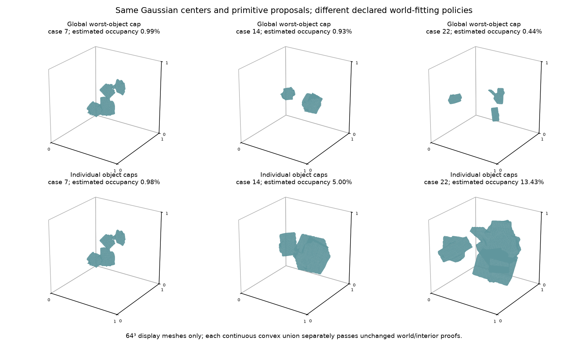
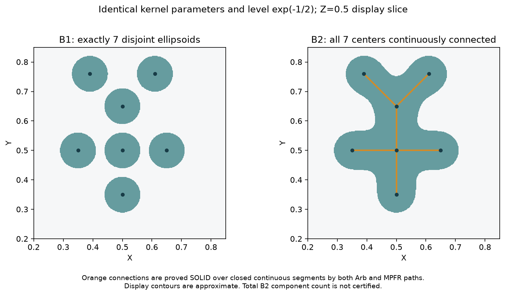
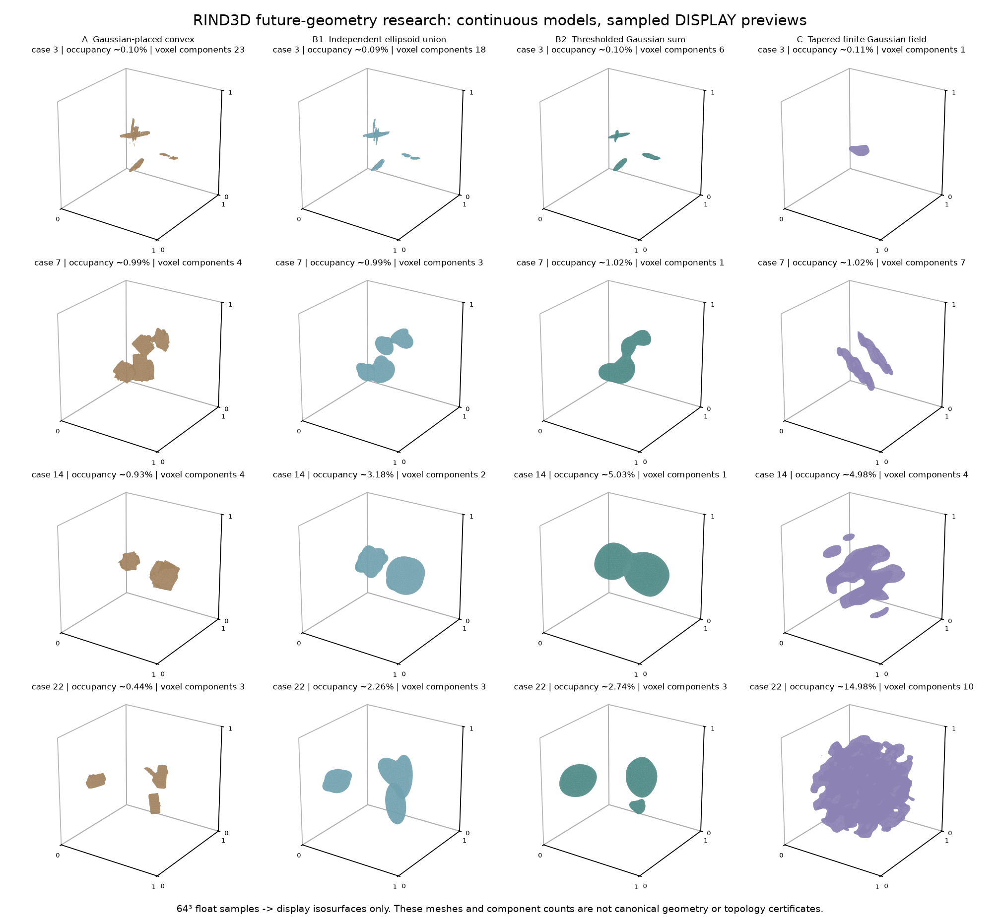
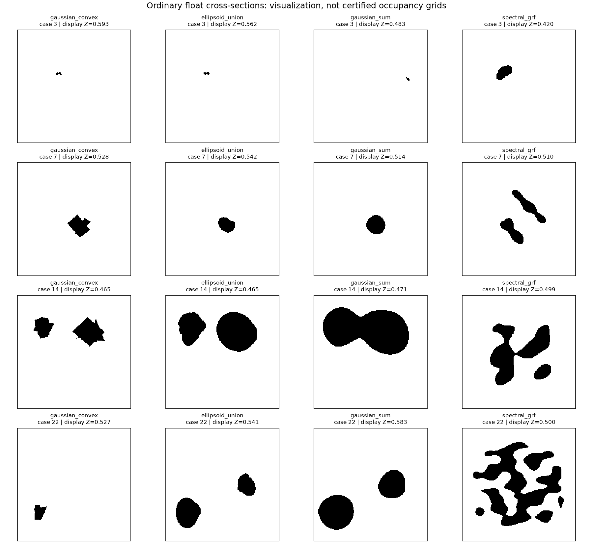
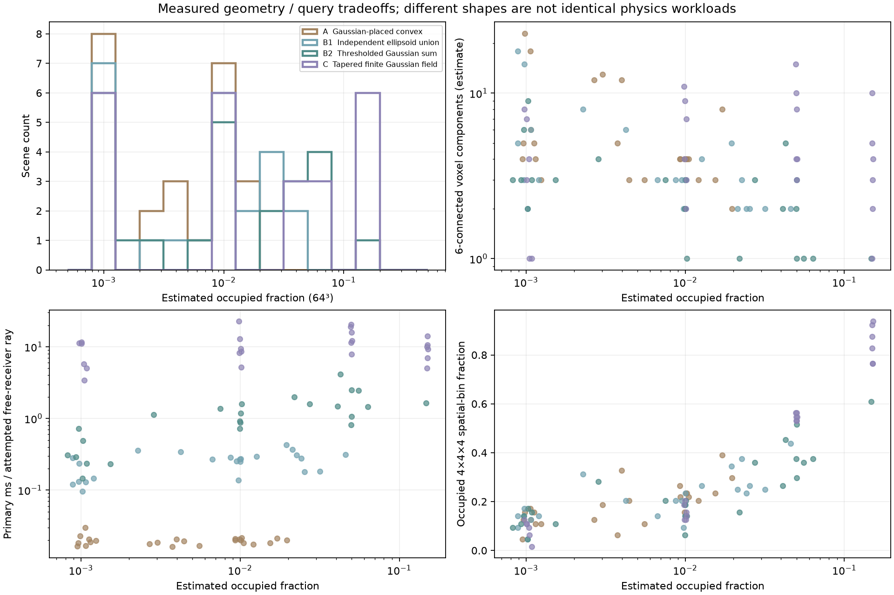
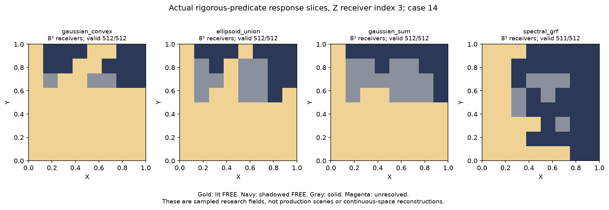

# RIND3D Gaussian geometry: measured decision report

Research run: 2026-11-05. Branch: `yushu/gaussian-geometry`, based on `yushu/3d`
at `59e343a`. All geometries and light sources measured here are **new synthetic
research inputs**. No RIND3D v0.1 scene, private production source, teacher
experiment, scientific backend, production profile or public release was changed.
**New READY scenes: zero. New 1024³ fields: zero.**

The most practical next proposal is **Gaussian-correlated placement of the
existing certified convex primitives**, with per-object world-fitting caps.
The Gaussian-sum solid produces genuinely different connections and is worth
continued research. Its current Python interval implementation and independent
verifier are too expensive for production. The finite Gaussian random field
offers broader spatial spread in this sample, but no demonstrated overall
advantage once physical-query and independent-verification costs are included.

## Evidence and reproduction

- [Mathematical definitions and proof obligations](GAUSSIAN_GEOMETRY.md).
- [Runnable experiment guide](../experiments/gaussian_geometry/README.md).
- [Machine-readable measurements](../experiments/gaussian_geometry/results/measured-v1.json).
- Config: `experiments/gaussian_geometry/configs/study-v1.json`.
- Local raw artifacts: `outputs/gaussian-geometry-v1/` under the generator.
  Large fields, dependencies, source snapshots and logs are ignored by Git.

The main study has 24 cases per representation: six layout recipes at each of
four target occupancies, with deterministic seed streams derived from master
seed `20261105` and ordinal 0–23. A further 24 paired convex cases test world
fitting; 12 newly generated original-family cases provide controls. This is a
bounded distribution study, not a training experiment or a production campaign.
The two main runs, `distribution-v1` and `distribution-v2`, retain identical
geometry IDs in all 96 cases. Historical runs and failed wrapper tests remain
in their own directories.

Hardware: AMD Ryzen 7 5800H, Linux x86-64, Python 3.12.14. NumPy 2.5.4,
SciPy 1.18.1, python-flint 0.9.0, gmpy2 2.3.2; one OpenMP/OpenBLAS thread.
The main study process peaked at **261.03 MiB RSS**, including imported packages
and quality grids. That is a process high-water mark, not isolated memory per
geometry. No new GPU Gaussian predicate was used. The unchanged certified CUDA
backend is exercised by the regression suite, not used to label B1/B2/C fields.

## 1. What “Gaussian” means

| Representation | What is random / Gaussian | Continuous solid |
|---|---|---|
| A | Correlated normal center proposals around dispersed anchors | Union of original canonical boxes, thin boxes, prisms, wedges and convex polyhedra |
| B1 | Same hierarchical centers, scales and orientations | Union of independent ellipsoids `q_i<=1` |
| B2 | Positive anisotropic Gaussian kernels | One superlevel set `sum w_i exp(-q_i/2)>=tau` |
| C | Independent normal coefficients of a finite spectral expansion, conditional on sampled frequencies | Positive-threshold superlevel of a compactly tapered continuous field |

For B1 the individual level is `w_i exp(-1/2)`, so amplitude cancels. B2 has
one shared threshold. Kernel amplitudes describe **obstacle geometry**, not
light-source intensity; visibility remains binary under one unit point light.
C is a finite conditional Gaussian process with a declared nonstationary taper,
not an infinite stationary GRF or interpolated voxel volume.

## 2. Hierarchical placement and density

Centers are not all drawn around the world center. There are 2–4 large-scale
anchors and 3–6 kernels per cluster, anisotropic normal displacements, rotations,
multiple scales and six explicit spatial recipes. Center rejection and world
fitting condition this distribution. It must not be described as unconditioned
independent Gaussian placement.

The first implementation made all objects share the world-fitting limit of the
worst-placed object. This produced a large, measurable density deficit. A paired
ablation keeps centers, primitive choices and orientation proposals unchanged,
but caps each object's size separately. Density is still only a proposal target;
every resulting continuous convex solid passes the unchanged world/interior
proofs. The original global-cap results are preserved.

Mean occupied volume estimated on a separate 64³ grid (percent):

| Target | A, global cap | A, individual caps | B1 | B2 | C |
|---|---:|---:|---:|---:|---:|
| 0.1% | 0.102 | 0.099 | 0.102 | 0.098 | 0.103 |
| 1% | 0.629 | 0.925 | 0.835 | 0.864 | 1.000 |
| 5% | 0.938 | **4.990** | 1.640 | 3.624 | 4.997 |
| 15% | 0.921 | **9.783** | 2.115 | 5.702 | 15.002 |

The dense target remains unattainable in some fixed-center cases. It is recorded
as a deficit, not hidden by scene replacement. B2's containment threshold can
also prevent a requested occupancy. A target label is therefore insufficient
for fair density matching. The sparse group is the closest matched comparison;
all-model medians have different realized density and physical workloads.

Hierarchical placement is useful, but conditioning and world fitting matter as
much as the Gaussian draw. A's median occupied octants rose from 5 to 7 with
individual caps; occupied 4×4×4 spatial-bin coverage rose from 0.180 to 0.258.
23/24 source coordinates remained the same in the paired ablation; one became
inadmissible and was explicitly resampled with the original clearance policy.
Consequently this is a matched geometry-proposal ablation, not a perfectly
matched source workload for every case.

## 3–5. Union, sum and additional shape diversity

Thresholding a sum is demonstrably different from unioning individual levels.
In a controlled seven-kernel example, exact pair distances prove that B1 has
**seven disjoint continuous ellipsoids**. For B2, two independent interval paths
prove all points on six connecting closed segments SOLID, placing all seven
centers in one connected component. The least reported strict lower margin
along those connections exceeds 0.227 above threshold. This is stronger than a
sampled midpoint or voxel connectivity observation. It does **not** establish
B2's total continuous component count.

Across the 24-case distribution study, estimated median 6-connected component
counts are A 4, B1 3, B2 2.5 and C 4. B2 ranges from 1 to 9 components;
B1 from 2 to 18. B2 has median zero tiny (≤8 voxel) components and maximum four,
versus B1 maximum twelve. Median thin-voxel fractions are B1 0.412 and B2 0.360.
This supports fused, elongated and multiscale structures without universal
fragmentation. It does not guarantee a chosen connectivity or minimum thickness.
Very sparse cases still contain under-resolved fragments; calibrated density
and different primitive volumes confound an unqualified model-wide ranking.

The fields are analytic for B2, but a smooth defining function does not prove
that its threshold boundary is everywhere a smooth manifold. Critical levels,
pinches and arbitrarily narrow connections remain possible. Chain/branching
recipe names are intentions; continuous connectivity is certified only in the
explicit controlled example.

A 12-case one-factor control on B2 case 7 separates several effects without
recalibrating density. Multiplying each kernel matrix by 0.75/1/1.25 changes
estimated occupancy to 0.312/1.024/2.253% and components to 3/1/1. Multiplying
the threshold by 0.7/1/1.4 gives 1.745/1.024/0.436% and 1/1/3 components.
Nested, nonduplicated subsets of 5/11/16 kernels give 0.103/0.531/1.024% and
1/2/1 components: adding positive contributions grows the solid but need not
monotonically change its component count. Scaling cluster displacements by
0.5/1/1.5 gives 1.048/1.024/0.955%; all three remain one sampled component.
All 12 pass rigorous containment and their independently checked query subset
has no disagreement or unresolved comparison. These are observations about one
fixed recipe, not universal covariance/topology laws.

## 6–8. What is actually proved

All 96 main cases and 24 capped-convex cases passed their experimental world
containment checks. A reuses the original independently checked convex duals.
B1 uses exact quadratic support bounds. B2 bounds the **entire exterior
halfspace** at each world face using exact quadratic minima and rigorous Arb
exponential upper bounds. C has an explicitly compact continuous taper and a
positive threshold. These are not grid-face checks or approximate clipping.

The inset world margin is 0.025. Each retained implicit geometry additionally
has a proved positive-width SOLID cube, and every source has a strict FREE
clearance proof at the original radius `2^-26`. Main-study source proposals
number 24/24/24/25 for A/B1/B2/C; C rejected one solid proposal. No generated
main case failed containment or nonempty-interior checks. This is not a claim
of zero rejection for arbitrary settings outside this fixed configuration.

Analytic facts include positive definiteness from an invertible canonical
matrix, closed ellipsoids, exact quadratic ray contact, continuity, positive-sum
boundedness at positive threshold, compact taper support and the controlled
connectivity proof. General B2/C membership/rays require sound transcendental
enclosures. Global topology, complete regular-closed acceptance, critical-level
behavior and a complete production source-distance service are **not** proved.
Voxel component counts and display meshes are not topology certificates.

## 9–10. Physical queries and measured overhead

Each main case evaluates 64 point-membership queries and 64 rays to certified
FREE receivers. All **6,144 primary rays resolved**, with no independent
opposite labels. The independent subset checks 16 receivers per case; B1/B2/C
also compare their memberships. There was one unresolved independent C ray.
Independent comparison counts differ because A uses the original A/B response
comparison while the implicit paths check both membership and visibility.

Median milliseconds per query:

| Representation | Point | Ray, all regimes | Ray, very-sparse group | Median JSON bytes |
|---|---:|---:|---:|---:|
| A, global cap | 0.0042 | 0.0196 | 0.0196 | 39,369 |
| A, individual caps | 0.0042 | 0.0192 | 0.0193 | 41,445 |
| B1 | 0.0318 | 0.2681 | 0.1388 | 21,660 |
| B2 | 0.2141 | 1.0981 | 0.2984 | 22,032.5 |
| C | 0.2595 | 10.3330 | 8.4364 | 11,495 |

In the closest density-matched very-sparse group, B1/B2/C are approximately
7×/15×/431× A's scalar ray time. These are implementation/workload comparisons,
not intrinsic lower bounds or a claim that a compiled ellipsoid predicate must
be slow. A calls existing native C++; the implicit prototypes have Python
rational/interval loops. Scene generation medians are only 13–22 ms; physical
verification is the harder problem.

B2's primary ray maximum was 19 interval nodes at depth 8 in this query set.
C required up to 373 nodes at depth 15. Recorded work includes 32,877 B2 exp
enclosures versus 2,560,416 C trig enclosures; C also attempted 16,830 positive
witness checks. Counter snapshots include setup/source/point work before rays;
timed point and ray sections are separate. `max_query_depth` inside the summed
work counter is not a cross-scene maximum; use the explicit per-ray depth field.

Support/proxy ablation on identical inputs, eight cases, 32 rays each, confirms
that sound acceleration helps. B1's total ray time drops from 108.6 to 34.5 ms
(about 3.1×); B2 from 208.9 to 154.2 ms (about 1.35×). At 8³, B1 complete-field
time drops from 1.99 to 0.69 s; B2 from 3.74 to 2.85 s. All compared ray labels
and field bits agree. B2's dense case gains little: conservative bounds are
less discriminative. No tail is discarded; the `tau/N` theorem supplies solid
outer bounds, while contained individual ellipsoids supply shadow certificates.

### Complete small fields: preserve the failures

Fields contain separate response, solid and validity arrays. The original
matched budget is 45 seconds per field, primary 512 nodes/0.5 s per difficult
ray, reference 2,048 nodes/2 s. An extra 8³ gate precedes 32³; larger resolutions
require completed independent agreement at the previous size.

| Representation | 8³, primary + reference complete | 32³ primary complete | 32³ reference complete | 64³ and 128³ |
|---|---:|---:|---:|---|
| A | 4/4 | 4/4 | 4/4 | Both paths complete all four |
| B1 | 4/4 | 4/4 | 0/4 at 45 s | Blocked by reference gate |
| B2 | 3/4 | 2/3 attempted | 0/2 attempted | Blocked |
| C | 0/4 | Not attempted | Not attempted | Blocked |

A 128³ primary times are 0.329–0.684 s, independent B 0.402–0.952 s.
The four capped A cases also complete 32/64/128³ under both native paths.
The 12 original-family controls all complete these resolutions with zero
response/solid mismatches. Their median 128³ A times are 0.178 s (rotated boxes),
0.158 s (corridors), 0.515 s (multiscale unions), with realized median occupancy
3.02%, 0.75%, 7.10%. They are useful regression controls, not matched geometries.

B1 primary 32³ takes 6.23–15.14 s; independent scans cover only
12,559–25,162 of 32,768 voxels before the 45 s limit. B2 primary complete
32³ cases take 18.39 and 33.73 s; another stops at 26,982/32,768 valid voxels.
C's 8³ primary takes 2.47–6.61 s, including one case with 511/512 valid voxels.
None passed the original independent 8³ gate. **Zero mismatches on common
resolved coverage is not complete-field agreement.**

The small-field adapter initially attempted a native 128³ region in one call,
although the native API accepts bricks of at most 64³. Failed `fields-v1/v2`
artifacts remain recorded. The adapter now assembles ≤64³ bricks with the
correct global resolution; a dedicated 128³ regression verifies exact solid
voxel count and A/B agreement. No canonical/native implementation changed.

Primary complete A 128³ compressed diagnostic NPZ files are 19,826–29,536 bytes;
complete B1 32³ files 1,302–1,686 bytes. These include three bool arrays and
use NPZ, **not RINDPack**. The compact parameter JSON is the continuous geometry;
neither diagnostic compression nor its size predicts a 1024³ release size.
The 49 stored primary diagnostic NPZ files across the corrected matrix, capped
convex ablation and extended controls total **318,834 bytes**. A local artifact
checksum index records their sizes/SHA256 separately from the public RIND3D
scientific manifest.

Seven replayed difficult queries identify budget costs rather than contradictory
physics. The B2 reference case 21 ray needs 1,091 nodes / 3.15 s to prove MISS,
exceeding its original 2 s allowance. C reference examples resolve after roughly
2.08–3.43 s. C case 14 primary needs 555 nodes / 0.28 s, exceeding its 512-node
allowance. One C ray changes from timeout to MISS at the same nominal budget
on replay, illustrating wall-time sensitivity. Replaying these individual rays
does not complete their original fields or permit a READY declaration.

A separate **larger-budget control**, stored in `extended-gates`, permits
180 seconds per field and 8,192 nodes / 8 seconds per difficult ray. B1 case 14
then completes the full 32³ comparison: primary **6.54 s**, independent reference
**56.91 s**, 32,768/32,768 voxels, zero response/solid mismatches. C case 7
completes both 8³ fields: primary **5.62 s**, reference **73.87 s**, 512/512
voxels, zero mismatches. These demonstrate sound complete cases beyond the
original time allowance; they do not retroactively complete the frozen budgeted
matrix. C has not completed a 32³ field, and B1 has not completed independent
64/128³ controls in this study. No larger field is launched by this ablation.

## 11–13. Rendering practicality and physical reasoning value

A is the practical 1024³ candidate because its **canonical geometry and renderer
scope already match the existing certified convex-union pipeline**. This study
does not claim measured 1024³ throughput for the new distribution. B1's analytic
solid can already be exported losslessly to the existing `affine_ball_v1` codec,
but the fast native/CUDA convex-polyhedral backend cannot simply accept it.
B2/C need distinct implicit codecs, accelerated interval queries and complete
independent acceptance; an approximate mesh would change truth and is excluded.

For four cases per model, eight uniform-origin proposals per window size and
16 exact voxel probes per window test whether both FREE response classes can
be witnessed. The source is outside every counted window. Results are **proved
informative examples / eligible proposals**, not full-window eligibility rates:
failure to witness a class is inconclusive.

| Representation | 64³ | 128³ | 256³ | Proved external-blocking samples / checked shadow samples |
|---|---:|---:|---:|---:|
| A, global cap | 3/32 | 4/32 | 11/31 | 83/111 |
| A, individual caps | 2/32 | 7/32 | 12/31 | 143/175 |
| B1 | 4/32 | 3/32 | 13/31 | 90/115 |
| B2 | 1/32 | 3/32 | 11/31 | 93/111 |
| C | 5/32 | 8/32 | 16/31 | 210/249 |

One source-containing 256³ proposal per model is excluded. Shadow attribution
is bounded at 32 samples per case/side. Samples with an internal suffix blocker
are retained as “first location unknown,” not evidence that the first blocker
is inside. External proofs require a full closed-ray HIT and exact rational
window-entry-to-receiver suffix MISS. All attribution queries in this corrected
audit resolved; no side exhausted its soft time budget.

The initial audit accidentally used proposal/probe metadata to consume a global
shadow-attribution cap, starving later sizes. Its results are retained but are
not used in this table. The corrected `nonlocal-v2` audit uses independent
per-size caps, records its seeds and passes a synthetic counting regression.

Original-family controls also yield external examples: 128/133 checked shadow
samples for rotated boxes, 145/192 corridors, 93/107 multiscale unions in the
bounded two-case/family control. External dependence therefore is **not new
physics unique to Gaussian geometry**. B2 changes spatial relationships and
occlusion boundaries, but this small, density-confounded sample does not prove
better nonlocal reasoning content or improved learning. Full 256-window
selection, dataset-level class balance and task performance remain untested.

Stored 8³ field labels also provide a deliberately coarse physical-boundary
diagnostic. Across the four cases, opposite lit/shadow FREE-neighbor counts are
348/5,327 eligible adjacent pairs for A, 375/5,272 for B1, 318/5,211 for B2 and
523/4,857 for C. The corresponding resolved FREE fractions are 2,039/2,048,
2,027/2,048, 2,012/2,048 and 1,940/2,047. C has one unresolved voxel excluded.
These are exact counts on a coarse sampled field, not continuous shadow-boundary
complexity, a full 1024³ ratio, or density-matched evidence of superiority.

C has more global sampled spread (median spatial-bin coverage 0.367, versus
B2 0.195) and achieves the requested dense occupancy. Its surface complexity and
query cost also rise. A fixed compact taper suppresses boundary-near geometry
and is a deliberate distribution bias. There is no measured reason to prefer
this GRF as the next production family. Conditional covariance/threshold choices
should be varied in later research before a general GRF conclusion.

## 14. Failure cases and limits

- A global cap shrinks the whole scene because of one boundary-near component.
  Individual caps substantially improve it, but retain density deficits.
- Voxel estimates alias thin structures, especially at 0.1% occupancy. Tiny
  components may be under-resolved; continuous component counts are unknown.
- Conservative B2 halfspace sums overestimate tails near world faces, raising
  the permitted threshold and reducing achievable density.
- Almost tangent or almost-threshold sum/GRF queries may require many
  subdivisions. General exact transcendental equality is not solved. UNKNOWN
  is preserved, including deliberately difficult tangent fixtures.
- C's independent natural interval hulls and exact Fraction arithmetic cause
  severe per-ray and whole-field tails, even at 8³. This is not evidence that
  the geometry or observation is physically invalid.
- The exact FREE cube is a sufficient source-clearance proof, not a complete
  distance classifier. It can leave an otherwise legal source unproved.
- CPU/GPU speed comparisons, full 1024³ implicit fields, independent complete
  topology and learning value have not been established.

## 15–16. Recommendation and certification work remaining

| Criterion | A, individual caps | B1 ellipsoids | B2 positive sum | C finite GRF |
|---|---|---|---|---|
| Expressiveness | Diverse polyhedral primitives and clustering | Curved convex pieces and overlaps | Nonconvex fusion, bridges, multi-scale smooth field | Global anisotropic, irregular threshold structures |
| Spatial diversity | Stronger measured coverage after cap fix | Clustered/dispersed layouts | Same centers plus field interaction | Broad spread, biased by taper |
| Continuous semantics | Existing lossless binary64 codecs | Exact quadratic, existing lossless codec export | Exact finite exp definition | Exact finite trig/taper definition |
| Tractability | Existing convex certificates | Rational quadratic contact | Conservative interval subdivision | Conservative interval subdivision, weak bounds |
| Numerical robustness | Existing exact/native A/B | Exact tangent handling, independent rational path | Sound resolved labels; hard equalities remain UNKNOWN | Sound resolved labels; expensive UNKNOWN/budget tails |
| Query performance | Best measured | Scalar cost higher; compiled work needed | Substantially slower | Slowest |
| Independent evidence | Original A/B complete through 128³ | Complete 8³ at original budget; one complete 32³ at larger budget | Complete 8³ in 3/4 cases only at original budget | One complete dual 8³ at larger budget, no 32³ |
| Production readiness | **Propose a new profile after acceptance pilot** | Research, not native convex-polyhedral READY | Research only | Comparative research only |

The next development step should be a **separately versioned A distribution**
using individual caps, with explicit generator-mixture probabilities and density
shortages. Before accepting that profile, run its unchanged scientific source,
geometry, complete-field, index, 256-window, independent physical evidence and
loader/publication gates on bounded representative scenes. This study has not
performed those end-to-end gates and does not enable any new family.

B1 is the next numerical engineering candidate: port exact quadratic membership,
batch clipping and sound region bounds into a native isolated backend, retain
the independent discriminant reference, then remeasure. B2 should retain its
finite positive-sum truth and investigate reusable exact ray coefficients,
hierarchical aggregate contribution bounds and compiled Arb calls. These are
proposals, not measured speedups. Preserve Gaussian tails with certified
remainders. Do not start by approximating a mesh or increasing dense grids.

Before B2/C publication: define lossless canonical codecs and versioning; finish
relative-domain-face/topology and critical-level acceptance; complete a strict
source-clearance service and independent verifier; test near-tangency failure
behavior; demonstrate complete small/1024³ fields and bounded memory; integrate
only under a new restricted profile; pass all index/window/reference/publication
and private-label gates. Existing `ready_capable=False` restrictions remain.

No choice here proves a Gaussian model is universally superior. The measured
result supports correlated convex placement now, analytic ellipsoids as the
next optimization target, and Gaussian sums as a substantive longer-term shape
extension. It does not support general GRF production at present.

## Regression and preservation audit

Full regression: **377 passed, 7 skipped, 4 warnings in 269.64 s**, including
29 new research tests. Existing certified CUDA tests were enabled. The seven
skips require explicitly opted-in real production/private fixtures; none is a
skipped new Gaussian test. Four existing warnings concern a diagnostic using
`fork()` after thread initialization. Logs and checksums remain in the local
output area; compact evidence is in
[acceptance-v1.json](../experiments/gaussian_geometry/results/acceptance-v1.json).
Tests cover closed tangencies/endpoints/nextafter, thin and
rotated ellipsoids, exact versus interval reductions, tails, deterministic
serialization, world containment, independent query paths, source clearance,
corner-certificate union counterexamples, narrow-ray hits, unresolved budgets,
native brick tiling, per-object fitting and per-size diagnostic accounting.
Private production-fixture tests are intentionally not activated for this study.

Only new experimental code, documentation, aggregate measurements and small
figures are added. No original tracked file is edited. The original worktree's
uncommitted teacher files are preserved separately. Existing production readers,
RINDPack, source/geometry acceptance and all scientific backend files are
untouched; no Google Drive upload or release replacement was performed.

The final read-only preservation audit confirms **713 original tracked files**
and **35 uncommitted teacher files** match their pre-experiment hashes. It also
rechecks all **13,013 manifest-listed public RIND3D files**, totaling
1,015,146,400 bytes, against their existing SHA256 values; every one matches.
The public manifest hash remains
`6b30efcc88835c53694ce1f065b1c092a6759dfbb5273f66ab48230ea1b5d414`.
