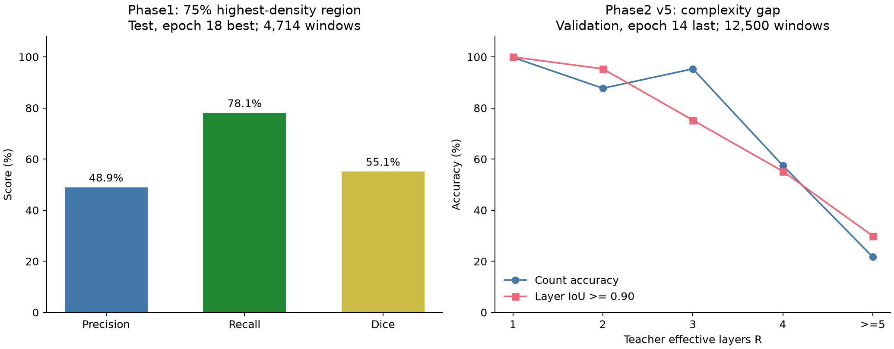

# RIND / G2-02 完整研究链路报告

更新：2026-11-04。依据仓库实现、已回收的服务器评估文件及研究讨论整理。本报告描述实际研究演进，不将新代码的交付视为新实验已经成功。

## 1. 研究目标与当前结论

最终目标是：在不知道全场障碍物几何的情况下，利用有限局部响应观测，恢复场景中的真实驱动源位置；再通过主动选择更多视窗，逐步减少位置不确定性。

目前形成的研究链路是：

```text
RIND 连续遮挡物理与真实响应
    ↓
物理教师：单贡献候选位置 → 局部可见性 → 位置兼容性分布
    ↓
Phase1 学生：单贡献局部响应 → 全场位置概率
    ↓
Phase2 教师：多源总响应 → 残差分层 → 有效贡献掩码集合
    ↓
Phase2 学生：原始多源响应 → 层数 + 无序贡献掩码
    ↓  当前重点：复杂窗口的层数和单层形状
预测层通过守恒检查 → 复用 Phase1 定位 → 各层位置图汇总
    ↓  尚需端到端验证
同场景多视窗历史融合 → 有限新增像素预算下选择下一视窗
```

**已取得的结果：**Phase1 已学到优于均匀基线的位置概率结构；Phase2 已能较好处理简单窗口，分层训练和诊断工具已经建立。**尚未解决的关键问题：**复杂多层窗口的完整支持恢复，以及从学生预测层到真实多源坐标的端到端可靠性。动态选窗目前完成了环境与参考策略，没有正式定位收益结论。

## 2. 物理模型：实际反演的是什么

场景世界范围为 1024×1024，包含旋转矩形、三角形等障碍物。局部响应服从

$$
y(p)=\sum_{j=1}^{K} a_j V(p,s_j),\qquad a_j>0,\quad V(p,s_j)\in\{0,1\}.
$$

没有距离衰减、反射或噪声；各源贡献线性叠加。可见性基于连续几何遮挡和像素中心计算。障碍物内部必须屏蔽，不能当成普通零响应自由空间。

需要始终区分三种对象：

| 对象 | 含义 | 是否相等 |
|---|---|---|
| 物理源数 K | 数据生成器放置的真实光源数量 | 旧多源数据核验为 1–4；位置包含非整数 |
| 有效贡献数 R | 当前视窗经教师残差规则产生的二值层数量 | 不保证等于 K，也不保证不超过 K |
| 模型容量 S | 可预测的最大有效层数量/循环执行上限 | 当前沿用 S=32，不代表实际有 32 个源 |

不能把早期设想中的“整数位置、最多10源”当作已核实数据事实。不同发布的源数、强度和视窗机制，应读取其 manifest 与实际数组。

若多个真实源在整个当前视窗中具有完全相同的可见性掩码，观测只能识别它们的强度和，可将其视为一个有效贡献；合并强度可能大于1。“只在某一个区域同时出现”不满足这一合并条件。当前BFS标签还可能把完整支持拆成片段，因此其R比理想的观测等价贡献数更依赖标签规则。

底层 `render_region` 的多源可见性是 OR；它回答“是否至少看见一个源”，不能直接充当加权总响应。正式响应需要逐源获得二值可见性，再乘强度求和。对应代码在 [Phase2 物理模块](../Phase2_Multi_Source/src/rind_phase2/physics.py) 和 [数据适配器](../Phase2_Multi_Source/dataset_update/dataset_union.py)。

## 3. 数据演进与实验总体

### 3.1 数据发布、窗口和训练记录是不同计量单位

| 数据/实验 | 已确认内容 | 使用限制 |
|---|---|---|
| 原多源 10k 发布 | 10,000 个源配置，367,109 个 source-free 四分树叶窗口；K=1–4 | 同一配置的窗口共享几何与源，不是独立场景 |
| 扩充单源 100k 发布 | 用于 Phase1 单贡献定位实验 | “100k”是发布规模，不是筛选后有效训练记录数 |
| 新多源 100k 发布 | 每配置256个随机无源视窗，原发布强度为1；size 为64/128/256/512 | 不能称为按随机强度重新生成的四分树窗口 |
| 随机强度派生与联合读取 | 固定 seed=20261028 生成 (0,1) 强度，复用逐源可见性重新求总响应；联合110k配置 | 重复障碍几何绑定同一 split；110k配置不等于110k独立几何 |

新发布前10k的障碍数组与旧发布相同，直接重新随机划分 scene_id 会泄漏几何。安装/拼接模块保留旧划分，将相同连续障碍几何绑定在同一集合，新几何组再按固定规则划分。联合目录仅保存索引，不重复复制大体积可见性数组。见 [数据安装与拼接](../Phase2_Multi_Source/dataset_update/README.zh-CN.md)。

已有教师或局部分层缓存可以直接用于训练和评价；只有准备新观测、生成新标签或新增位置教师时才需要相应原始数据。新的源配置不能无条件复用旧位置教师。

### 3.2 筛选机制会改变实验分布

当前静态分层训练保留自由空间内同时存在零响应和正响应的窗口；全暗、没有自由像素、**所有自由像素均为正**的窗口跳过。代码中的 `all_lit` 不仅指响应处处相等，还包括全正但有多个亮度的窗口。

因此当前成绩是该筛选总体上的成绩，不代表任意局部视窗。旧四分树与新随机窗口也不能当作同一采样机制。

Phase1 与 Phase2 的训练/验证/测试按冻结清单隔离；涉及重复几何的联合数据应进一步按几何组隔离。仅检查 scene_id 不相交，不能单独证明几何无泄漏。已回收的部分指标包没有完整几何映射，相关审核保留此限制。

## 4. Phase1：从局部单贡献响应学习全场位置分布

### 4.1 为什么预测分布

一个局部阴影形状可能由多个不同源位置解释。单点坐标回归会把多解压成一个坐标；本项目使用候选位置的条件分布，保留可行区域与多峰结构。

训练时教师读取隐藏场景几何 S，在候选位置 s 重渲染局部响应，并形成物理代价

$$
C(s;O)=\alpha L_{\rm resp}(s)+\beta L_{\rm edge}(s),
\qquad
q(s_i\mid O,S)=\frac{\exp[-C(s_i;O)/\tau]}{\sum_{j\in\mathcal V}\exp[-C(s_j;O)/\tau]}.
$$

这里 $\mathcal V$ 是声明的有效候选集合。响应项可提高观测边界邻域的权重；可选边界项直接比较边界几何距离。温度控制兼容位置之间的软分配。有限代价即使很高也可能获得很小的正概率，因此“q>0”不适合直接定义重要区域。

这是候选集合内部的物理兼容性归一化，不自动成为经过校准的贝叶斯后验。即使所有候选都解释得差，归一化结果仍总和为1，所以还需要最小物理代价与可行候选覆盖等独立检查。

正式可复现实验使用均匀候选网格；原proposal中的 coarse-to-fine 是效率方向，不能把它写成所有正式训练都已采用。固定均匀网格上的目标是离散概率质量；不能给自适应候选额外乘面积，却仍声称监督目标没有改变。跨分辨率显示必须明确采用质量重分配还是密度表示。

### 4.2 学生输入、结构与监督

学生输入是局部响应、窗口世界坐标和 size，以及待查询的候选坐标。主线不输入全场障碍几何。模型输出能量，再在声明的源空间上归一化：

$$
p_\theta(s_i\mid O,W)=\operatorname{softmax}_i[-E_\theta(O,W,s_i)],
\qquad L_{\rm loc}=-\sum_i q_i\log p_{\theta,i}.
$$

当前单贡献定位模型约 **20,030,020 参数**，隐藏维度384。其主要结构为：

1. 从响应构造水平/垂直梯度及原尺度、2倍和4倍降采样边界特征。
2. 分别编码边界、区域和整个视窗的上下文。
3. 八个注意力头按4/2/2读取边界、区域、全局token，再融合。
4. 候选位置使用6级Fourier特征，并编码相对窗口中心、四边距离及候选与token的世界坐标关系。
5. 共享能量头逐候选评分，产生全场位置概率。

降采样用于扩大感受野和减少计算，不与各注意力头一一对应。明确的头分工来自读取不同token分支，不能据此断言每个头已经学会某一种物理规律。

### 4.3 实际样本与测试结果

实验：`phase1_100k_multiscale_h20_memmap`。

| 划分 | 实际记录 |
|---|---:|
| Phase1 基础单源训练 | 37,072 |
| 追加的 Phase2 单贡献残差层 | 43,271 |
| 训练合计 | **80,343** |
| 验证 | 4,530 |
| 测试 | 4,714，来自3,770个 scene_id |

追加残差层只进入训练，验证/测试保持单源观测。训练 CE 高于验证 CE 不足以单独证明异常，因为训练分布包含额外复杂残差层。候选 spacing=16，对应全场64×64=4,096个格点；有效候选支持还受每窗协议约束。

最佳权重为 epoch18。已回收的完整测试汇总如下：

| 指标 | 窗口等权 | scene_id 等权 |
|---|---:|---:|
| 交叉熵 CE | 7.351593 | **7.316051** |
| 教师熵 H(q) | 6.635004 | 6.635110 |
| Forward KL | 0.716589 | **0.680941** |
| 均匀基线 CE | 8.306134 | 8.305306 |
| 75%核心区 Dice | **0.551211** | 0.561752 |
| 75%核心区 Recall | **0.780678** | 0.788837 |
| 75%核心区 Precision | **0.489333** | 0.498070 |
| 无效候选上的概率质量 | 0.053896 | 0.052088 |

这些数值来自同一份综合评估的相应字段，不混用窗口均值与场景均值。`log(4096)=8.317766`是完整4096点均匀分布的理论值；逐窗口有效支持不同，所以实际均匀基线的均值略低。

关系为

$$
\operatorname{CE}(q,p)=H(q)+D_{\rm KL}(q\Vert p).
$$

按场景均值先汇总再求比的信息恢复率为

$$
\frac{8.305306-7.316051}{8.305306-6.635110}=59.23\%.
$$

它表示相对均匀基线，学生追回了教师可提供信息增益的一部分，**不是59.23%的坐标准确率**。逐窗先求信息恢复率再平均是另一个统计量；同份报告中该值窗口均值为48.35%、场景均值为50.69%，不能和59.23%互换。

75%核心区先对教师、学生各自保留累计质量达到75%的高密度区域，包含阈值并列点，再比较集合形状。Recall较高而Precision较低，说明学生通常覆盖主要可行区域，但仍铺得较宽。评价时剔除各自低概率尾部不修改权重或原概率，也不能用于把原始CE结果替换成更好看的数字。

**结论：**单贡献学生已学习到有效位置约束，但仍有明显分布差距；“像老师”与“准确找到唯一真源”是不同目标。原始局部观测的不可辨识性本身也会限制定位。

### 4.4 全场几何输入消融与可达到的目标

历史较早的 layer-student 实验中，local-only 与 full-geometry 的测试CE分别为8.813449和8.827647，Dice@90为0.437550和0.431409。该版本加入几何没有改善主要结果；它与上面的20M单贡献实验不是同一个模型/候选协议，CE不能直接横向排名。

这不证明几何无价值：信息可用不等于特定结构与训练已学会利用它，也不能仅凭结果就断定输入一定有bug。正确检查需要坐标/尺度/障碍方向核对、打乱几何及屏蔽几何诊断，并控制训练步数与模型容量。

未知几何还有一个结构限制。若同一输入 (O,W) 对应不同隐藏场景的教师目标，在共同候选空间上最小化期望交叉熵时，最优学生为

$$
p^*(s\mid O,W)=\mathbb E[q_S(s\mid O,W)\mid O,W].
$$

理由是期望交叉熵可写成 $-\sum_s\bar q_s\log p_s$，其最小值在 $p=\bar q$ 取得。因此未观察几何的学生一般不能对每个隐藏场景都精确复现几何已知教师；这个结论也不能替代模型实现审计，或说明当前模型已经达到最优。

## 5. 为什么研究残差解耦

直接处理多源位置组合，每源 n 个候选、固定K且位置不可重复时，需要考虑 $\binom nK$ 个无序组合。每组合优化强度得到的是最佳解释代价，即 profile score；连续强度没有被积分，因此不能称为完整贝叶斯后验。

分层路线希望将多源总响应拆成有效贡献，再复用已经可训练的Phase1单贡献定位器。它减少重复位置渲染与组合评分，但收益依赖层支持质量；不能仅凭每层n个候选就宣称完整流程必然O(nR)。区域构图、传播冲突、分层、逐层评分、可行性验收和跨层关联都有成本。

### 5.1 真实边界统计提供了什么依据

对原10k发布按K=1/2/3/4各取100个配置，共400配置、14,706个实际窗口，使用每源可见性真值检查相邻响应区域。

| 统计口径 | 结果 |
|---|---:|
| 有边界窗口 | 6,544；无边界窗口8,162另列 |
| 合法响应跃迁像素边 | 3,536,351 |
| 同时有源进入和源退出的像素边 | 3,470，**0.09812%** |
| 像素边符合源集合嵌套 | **99.90188%** |
| 连续共享边界段 | 62,764 |
| 全段嵌套 | 60,595，**96.54420%** |
| 部分位置混合 | 本样本0段，不表示一般不可能 |
| 全段混合 | 2,169，**3.45580%** |
| 有边界窗口至少一条混合边 | **15.66320%** |

样本按K等量分层，不是整个发布按自然K比例加权的精确总体率。区间以场景为聚类单位：像素混合率95%区间约0.09059%–0.10582%，全段嵌套比例约96.299%–96.792%。统计排除了跨障碍的伪邻接；交点/近障碍类别使用像素代理，不能当作精确连续几何标注。

混合段中96.73%的长度≤4；长度≥17的25,871段中只观察到1段混合。该阈值来自开发性观察，尚无独立留出验证。少量长段错误仍足以影响完整窗口。

这些证据支持“优先尝试嵌套叠加”，但**不证明局部嵌套能推出全局正确分解**，也不证明每次只切换一个源。数据规模为1024不能用来直接推出1/1024的错误率。

原始可复现分析在 [边界切换研究模块](../Phase1_Single_Source_Single_Intensity/research/boundary_switches/README.zh-CN.md)。本报告使用的是该真实数据结果，不是早期人工场景固定像素对的0.18%/1.87%。

## 6. 教师链路：逐层搜索、一次共享候选渲染、分别评分

### 6.1 当前局部分层教师实际规则

初始化残差r=y。每轮只处理一个整体有效贡献：

1. 屏蔽障碍，按当前残差响应分割四连通区域，构造不跨障碍的邻接图。
2. 取最低**正**残差a；零响应不成为贡献。多个不相邻最低区域不因值相同直接合并，按像素顺序选一个确定性种子。
3. BFS追踪本轮贡献：升高或等值优先继续；下降幅度等于a，或目标区域低于a时，认为本层退出；其他下降暂按别的贡献退出解释，继续。
4. 路径冲突、未知和未访问区域记录下来；当轮采用无歧义的BFS正支持作为局部有效层，其余区域留给后续残差轮次。
5. 只减去a乘本层二值掩码。显著负残差、空层、超出容量或残差不清零时返回未完成。
6. 重新分割残差，继续下一轮。

代码在 [layered_residual.py](../Phase2_Multi_Source/research/layered_residual/layered_residual.py) 与 [mask_only_data.py](../Phase2_Multi_Source/research/implicit_slots/mask_only_data.py)。

该规则满足目标示例：

```text
0.3 → 0.8 → 0.5：先得 M1=(1,1,0)，再得 M2=(0,1,1)。
0.3 → 0.8 → 0.3：下降0.5按其他贡献退出解释，本轮可继续得到(1,1,1)。
```

但一般情形中“下降不等于a”不充分证明本层没退出；复合跳变、混合边界和不连通支持均可能使规则失效。当前实现是明确的教师标签规则，不是一般正确性定理。

**尤其需要明确：**局部mask-only标签制备不做单源物理位置可实现性检查，返回字段为 `physical_single_source_checked=False`。它验证算术闭合，但不证明每层是完整真实源掩码。这也解释了为什么K≤4的数据里，有效层R仍可能达到32：当前规则可以产生多个局部贡献片段。不能把这些32层理解成32个物理光源。

### 6.2 两种成本不同的教师答案

| 教师产物 | 给什么答案 | 需要全场候选位置渲染吗 |
|---|---|---|
| 局部分层标签 | R、每层二值掩码、有效强度与闭合状态 | **不需要**，候选渲染数为0 |
| 单层位置教师 | 每层在全场候选位置上的归一化概率 | **需要**；可在同窗共享一次候选可见性计算 |

这两者不是同一个准备阶段。当前v6只训练前者，不需要重新渲染大规模位置教师。

位置教师的效率改进是：同一窗口、同一候选池先渲染一次候选×像素可见性矩阵，再分别对各二值层计算Phase1一致性代价和归一化分布。多层评分仍有成本，但避免重复R次几何射线渲染。

自由像素y=0在无噪声正强度模型下意味着每个源在该处都不可见，因此可排除会照亮任意此类像素的候选。这是该物理模型下的必要条件筛选，不是找到源的充分条件；障碍内部保存的0不能用于此筛选。

### 6.3 每层位置图与最后展示图

每层输出在对齐候选空间上的 $P_t(s)$，各自总质量为1。当前历史定位代码采用

$$
P_{\rm display}(s)=\frac{\max_tP_t(s)}{\sum_u\max_tP_t(u)}.
$$

这张归一化最大值图强调任意一层的强位置假设，属于展示汇总；它不保证每层贡献相同的总质量。若需要严格表达“等概率抽取一个有效贡献的位置”，应另用 $R^{-1}\sum_tP_t(s)$。两种语义不同，不能因为各层独立就推出一定应取最大值。

不同层不能无条件相乘，因为它们可以位于不同位置。无论最大值图还是平均图，都不是完整多源联合后验，也不是“该位置至少存在一个源”的概率。当前v6训练不使用这张汇总图作为监督。

## 7. 学生训练路线为什么发生变化

| 阶段 | 输入 → 目标 | 已知结果或推动下一步的原因 |
|---|---|---|
| 直接蒸馏多源整合位置场 | 多源局部总响应 → 一张全场概率图 | 多层信息被汇总，难确认学生是否真的学会分层 |
| 复用Phase1单贡献训练 | 教师单层二值响应 → 单贡献位置分布 | 定位有效；但推断若仍靠教师分层，学生未解决多源解耦 |
| 隐式概率槽位 | 原始总响应 → 多个位置分布/存在性 | 已回收实验count约67.85%；位置槽没有显式单层形状保证 |
| 显式mask-only槽位 | 原始总响应 → 无序掩码、强度、存在性 | 低成本制备标签；先隔离解耦问题 |
| v2边界与同步细化 | 多尺度特征、专门注意力、反复槽间细化 | 在固定2000窗测试上改善总体结果，但复杂R仍弱 |
| v3均衡微调 | 同10万标签，训练按R分组重采样；评估各扩至12,500 | 计数改善信号未转化为按旧总loss选出的新best |
| v5独立目标与复杂窗扩充 | 分开计数、形状、强度和重建；追加唯一R≥3窗 | 建立大训练缓存与失败诊断，继续暴露复杂层瓶颈 |
| **当前v6自主残差模型** | 原始总响应 → 自主逐层掩码；只监督最终无序集合 | 将逐层减法放进学生内部，层数/单层形状等权；新实验未得到最终评估 |

这里的v4/v5等名称只在相应子实验系列内有意义，不能把早期定位实验v5和后来的解耦模型v5当作同一网络。

### 7.1 数据分布说明了什么

已核对的10万mask训练窗中：R1=60,900，R2=23,548，R3=9,290，R4=3,763，R≥5=2,499。1–2层占84.448%，16/32小窗合计只有144条，主要训练窗口为64/128。

总准确率容易被简单窗口支配；把同一复杂窗口重复抽取也不增加独立信息。后续扩充通过冻结训练池中的唯一(scene_id,view_id)采集真实复杂窗，并控制配置/几何的集中度，不能靠重复采样凑“新样本”。

当前v6完整复用服务器上一轮大缓存及其追加复杂窗，不退回10万、不重新挑窗。**本地尚无该轮完整大缓存清单，最终训练数量以启动日志与 `mask_records.json` 为准，不从 `complex245746` 目录名推断。**

### 7.2 已回收的历史结果

| 实验 | 评估集合 | 主要结果 | 结论限制 |
|---|---|---|---|
| 2万mask-only | 2000测试窗 | count=79.95%，软Dice=89.02% | 软Dice不是IoU≥0.9的单层通过率 |
| v2边界细化 | 同一2000测试窗 | count由87.75%升至92.25%；历史严格整窗成功81.65% | R≥3严格整窗仅8.51%；不是90%多层可用 |
| v3均衡微调 | 12,500自然分布测试窗 | 所选权重count=90.94%；历史严格成功78.46% | best仍为epoch0旧权重，不能称为新微调模型的测试提升 |
| v5失败诊断 | epoch14 **last验证集**，12,500窗、8,415个scene_id | count=92.616%；按旧部署匹配重算单层IoU通过率82.544% | 不是最终best测试结果，匹配协议也不是新v6统一shape-only协议 |

历史strict同时要求数量/匹配、每层形状、强度和重建过阈值；它保留用于解释旧结果，不再是当前主要选模指标。

v5诊断按实际启用层、原部署匹配统计：

| 教师R | 窗口数 | 层数准确率 | 教师层数 | 活跃匹配层IoU≥0.90 |
|---|---:|---:|---:|---:|
| 1 | 7,447 | 99.825% | 7,447 | 100.000% |
| 2 | 3,008 | 87.733% | 6,016 | 95.346% |
| 3 | 1,203 | 95.345% | 3,609 | 75.256% |
| 4 | 487 | 57.495% | 1,948 | 55.236% |
| ≥5 | 355 | 21.690% | 2,423 | 29.922% |
| 合计 | 12,500 | **92.616%** | 21,443 | **82.544%** |

这组数据表明：R3计数可以很高，层形状仍明显不足；更复杂时计数与形状同时退化。不能把所有失败归因于层数，也不能由平均Dice很高就宣布每层准确。



图左为Phase1窗口等权的75%核心区形状指标；图右为v5验证诊断。两部分任务、分母和评估协议不同，仅分别解释现有瓶颈，不进行横向性能排名。

## 8. 当前v6：学生自主执行减法，只学习最终答案

### 8.1 学生看到什么，教师提供什么

| 数据 | 进入模型前向吗 | 用途 |
|---|---|---|
| 原始局部总响应y、窗口位置与size | 是 | 唯一观测输入 |
| 模型自己的中间残差与循环记忆 | 是，内部产生 | 支持下一层预测 |
| 教师最终R与无序二值掩码集合 | 否，只进入loss/评价 | 两项监督 |
| 教师强度、种子、BFS路径、剥离顺序、中间残差 | 否 | 不指导模型执行 |
| 真实源编号/位置/每源真值或全场障碍几何 | 否 | 真值仅可用于独立评估；当前主线不用全场几何 |

模型继承v5多尺度编码和计数结构，共 **12,614,860参数**，其中12,514,763可训练。分层隐藏维度256、4级共享解码块、8头按4/2/2读取边界/区域/全局特征，mask特征维度128。原强度头冻结，仅保留在继承的计数特征细化路径中，不提供实际层强度。

### 8.2 自主前向执行

```text
features = Encode(original_response, window)
R_hat = Count(features)
residual = original_response
memory = zero

for t in range(R_hat):
    mask_logits, memory = SharedExtractor(features, residual, memory)
    M_t = threshold(mask_logits, 0.5)
    force M_t = 0 where original_response = 0
    a_t = minimum residual on the predicted support  # empty support → 0
    residual = residual - a_t * M_t

keep predicted masks/count fixed
fit positive scalar strengths against original_response
accept only if per-pixel conservation and nonnegativity hold
```

掩码由网络先预测；支持上的最小残差只是强度预算，不是教师“找最低区域再BFS”的输入过程。模型执行步数来自自己预测的R，不用教师R控制循环；训练也没有teacher forcing。

只要当前残差非负，且 $0\le a_t\le\min_{p:M_t(p)=1}r_t(p)$，则 $r_{t+1}=r_t-a_tM_t\ge0$。这可以逐步归纳证明，但不保证所有输入最终残差归零或得到正确掩码。空层/零强度不能冒充有效贡献。

最后固定掩码，再用已知y求正标量强度。数学上要求 $y=\sum_ta_tM_t$；代码采用float64计算，考虑float32缓存逐像素仅允许 `8*eps_float32*window_max` 的舍入误差，最大响应1时约9.54e-7。这是舍入容差，不是允许5%响应误差。

可行性求解是有限迭代算法，找不到解不等于证明无解。掩码不变、层数不变，不额外补层、不截断负值、不逐像素缩放层来凑守恒；无法通过则返回未完成。**保证接受的输出满足约束，不保证每个输入都会成功输出。**

### 8.3 只有两项监督，重要性相同

$$
L=0.5L_{\rm count}+0.5L_{\rm shape}.
$$

计数任务包含融合、全局、槽诱导三种计数CE，内部权重1/0.5/0.25，按权重和与 $\log(S+1)$ 归一化。形状任务对无序最终层做Hungarian匹配，使用

$$
\ell_{\rm shape}=0.5\frac{\operatorname{BCE}}{\log2}+0.5(1-\operatorname{Dice}).
$$

缺少的教师层按失败处理；多报由计数监督惩罚。没有强度loss、重建loss、残差轨迹loss或位置loss。原始完整响应作为已知约束参与自主减法和最终可行性验收。

前向仍是硬二值减法；训练反向使用straight-through代理梯度，使后续层监督可通过残差传回早期掩码，暂定强度预算停止梯度。它是近似优化方法，不是对离散分解精确求导，也没有已验证的新精度增益。

训练权重仅由原训练集R=1/2/3/4/≥5频率计算，平方根逆频率并限制范围；所有原记录保留。整个优化步先跨微批/跨GPU统计加权窗口数与教师层数，再分别归一化，避免卡数、累计步数和各卡R分布改变两项任务的相对权重。

### 8.4 当前真正关心的两个指标

1. **层数准确率**：预测R完全正确的窗口数 / 全部评价窗口数。
2. **单层形状准确率**：实际启用层按硬IoU匹配后，IoU≥0.90的教师层数 / 全部教师层数。漏层失败；不使用教师强度参与新评价匹配。

两个指标同时报告总体、R分组与size。约束失败窗口保留在分母，守恒验收单独作为合法性审计，不靠筛掉失败样本提高分数。单层准确率不等于平均IoU，也不等于一窗全部层同时正确。

best按R=1/2/3/4/≥5的count/shape宏平均等权选择，并设置总体及R1计数的退化保护；测试集不参与选模。目标至少90%应对这两项分别提出，并同时检查复杂R子集，不能只用总体超过90%验收。

## 9. 计算、缓存、训练与结果追溯

工程优化包括DDP单卡单进程、共享候选可见性、memmap连续缓存、按size分桶、分块注意力、梯度累积、异步预取、自适应GPU选择与微批探测。Phase1历史稳定方案使用FP32安全注意力；当前v6默认BF16，两者不能混写成同一配置。

GPU自动选择读取实际空闲显存和多次利用率采样，微批按所有rank可容纳的共同配置探测。v6原始响应只编码一次，每一步只处理仍有待预测层的窗口。重计算在GPU，文件读取、任务调度等轻量工作仍在CPU；不能承诺“CPU完全不计算”或“96G显存必须占满才高效”。本机CPU回归测试不能代替H20/NCCL实测。

所有正式长任务通过tmux启动，日志、命令和退出码落盘。SSH/VPN断开本身不终止tmux，但进程异常、系统重启或调度终止仍可能停止作业。

当前v6断点在epoch结束保存；中途退出不能声称精确恢复到最后一个batch。此前回收的v6进度只有epoch1训练前缀，没有最终评价和完整stderr，退出原因尚未确认；不能宣布已训练完成或臆断为OOM。

新旧比较保存checkpoint角色、epoch、SHA与样本名单指纹；旧训练完成后再冻结其最终best/last模型副本，对相同完整验证/测试名单重评两个指标。使用配对scene_id聚类bootstrap；若同一几何有多个配置，后续最好按更上层几何组聚类。旧结果没有对应几何信息时必须保留限制。

## 10. 下一阶段：多视窗融合与动态扩张

单窗可能无法唯一定位，所以终极应用需要累计观测。同场景集合训练旨在让模型理解不同视窗在世界坐标上的互补约束，而不是把窗口当作无关图像。

已确认预算为新增观测像素数：

$$
c(W)=|W\setminus U|,\qquad U\leftarrow U\cup W.
$$

动作包括相邻移动、扩大视窗与停止。重叠像素只计一次；免费重复观测不能被当成新证据。当前环境已有随机、优先扩窗、已观测边界延伸三种参考策略；真实旧数据上3场景×2预算×3策略的18条路径完成预算与覆盖核对，**没有定位精度或强化学习收益结论**。

推荐顺序：

1. 先建立去重的响应历史/覆盖掩码，固定路径验证“多看这些像素是否改善定位”。
2. 连接学生分层与Phase1定位，检查错误层是否会污染历史；保留原始响应历史，不让解耦成为不可逆瓶颈。
3. 在同预算、同初始窗、同动作集合下比较基线，再学习动作收益预测。
4. 若必须先经过低收益位置才能获得后续高收益，再考虑RL价值函数或多步规划。

未知区域与已观测0响应必须区分；部署策略不得先读取候选新窗口响应或隐藏几何。静态训练跳过全暗/全正窗、限制源在窗外等先验，也不能直接移植到主动扩窗：这些窗口可能是路径必经观测，必须正常计费并适配训练分布。

不同物理贡献的位置图不能相乘；同一源跨窗证据也需要关联与重叠去重。等权平均图的熵不是完整多源配置熵，只奖励“图变尖”会鼓励自信地预测错。未来策略应同时检查真源覆盖、匹配距离、漏报与预算曲线，而非仅看集中度。

细节见 [动态观测设计](../Phase2_Multi_Source/docs/ACTIVE_OBSERVATION.zh-CN.md)。

## 11. 已证明、实测支持与待解决的边界

| 状态 | 可以陈述什么 | 不能扩大成什么 |
|---|---|---|
| 数学恒等式/条件性结论 | CE=H+KL；正叠加下零响应排除可见源；保守二值减法不产生负残差；未知几何下期望CE最优为教师条件平均 | 全场唯一可辨识、教师贪心全局正确 |
| 真实实验支持 | Phase1优于均匀；开发样本多数边界嵌套；v2简单窗表现改善；v5复杂层明显较弱 | 任何场景都嵌套、任何R都达90%、某一结构改动单独造成提升 |
| 已实现、待正式比较 | v6自主减法、两项等权监督、最终守恒验收、完整旧缓存复用、新旧配对评价 | v6已经优于v5、已达到H20峰值吞吐 |
| 尚未解决 | 有效层的物理单源完整性；学生层→Phase1端到端多源定位；跨窗身份与去重融合；最优选窗；不可辨识性 | 不能因算术闭合或概率图好看就认定完成 |

## 12. 下一轮实验的具体交付

| 顺序 | 实验 | 主要验收 |
|---|---|---|
| A | 回收旧v5最终best与新v6运行日志，确认训练完整性 | checkpoint/样本协议可追溯；不把epoch14 last当最终best |
| B | 相同大缓存训练与配对评价v5/v6 | count与单层准确率，总体及R分组；失败窗口不删；场景聚类区间 |
| C | 对教师/学生层分别做物理实现审计 | 区分算术标签复现和完整可定位贡献；统计不完整/歧义覆盖率 |
| D | 学生层与oracle层分别接Phase1 | 量化解耦误差传递、每源位置距离/覆盖/漏报；不只比较整合图形貌 |
| E | 固定路径下的多视窗历史融合 | 同新增像素预算下，定位误差与真源覆盖是否改善 |
| F | 学习选窗，必要时RL | 相同预算下优于随机/扩窗/边界基线；不靠错误尖峰降低熵 |

这些实验应依次隔离问题；在前一环仍未验证时，不把所有模块一起放大训练来替代诊断。

## 13. 代码与报告复现入口

| 目的 | 主要文件/目录 |
|---|---|
| Phase1模型与物理教师 | `Phase1_Single_Source_Single_Intensity/src/rind_phase1/` |
| Phase1正式综合评价 | `Phase1_Single_Source_Single_Intensity/scripts/comprehensive_phase1_evaluation.py` |
| 边界嵌套实证 | `Phase1_Single_Source_Single_Intensity/research/boundary_switches/` |
| 局部教师标签与连续缓存 | `Phase2_Multi_Source/research/implicit_slots/mask_only_data.py` |
| 历史逐层位置教师/可视化 | `Phase2_Multi_Source/research/layered_residual/` |
| 当前自主残差模型 | `Phase2_Multi_Source/research/implicit_slots/sequential_count_shape.py` |
| 两项监督/无序匹配 | `Phase2_Multi_Source/research/implicit_slots/sequential_objective.py` |
| 跨卡优化步归一化 | `Phase2_Multi_Source/research/implicit_slots/optimization_batches.py` |
| 完整缓存绑定/冻结warm-start | `Phase2_Multi_Source/research/implicit_slots/configure_sequential.py` |
| 正式评价与旧权重配对 | `evaluate_sequential.py`、`model_comparison.py`、`evaluation_snapshot.py` |
| 自适应GPU与batch探测 | `Phase2_Multi_Source/research/implicit_slots/gpu_runtime.py` |
| 主动观测环境/参考策略 | `Phase2_Multi_Source/research/active_observation/` |
| 源码检查/固定名更新包 | `tools/check_repo.py`、`tools/package_update.py` |

已有原大缓存和v5 best时，在仓库或服务器包根目录运行：

```bash
unset RIND_MASKS_CONFIG RIND_DECOMPOSITION_CONFIG RIND_TMUX_SESSION
./run_implicit_masks_tmux.sh start all \
  --source-root outputs/masks_disentangled_v5_complex245746 \
  --gpus auto --auto-batch
./run_implicit_masks_tmux.sh status
```

示例源目录需要与实际缓存一致。输出默认在 `Phase2_Multi_Source/outputs/<源实验名>_implicit_v6/`；`models/seed_0/best.pt`用于正式评价，`last.pt`用于epoch级恢复。训练结束后生成 `evaluation/seed_0/primary_metrics.json`，旧训练已完成时生成 `reference_comparison.zh-CN.md`；否则写pending记录。

只补评价、不重训：

```bash
./run_implicit_masks_tmux.sh start evaluate --gpus auto --auto-batch
```

新安装需要环境；复用已有完整缓存不要求额外安装原始数据。源码包不带数据、缓存或权重，固定名为 `RIND_Phase2_Update.tar.gz`。历史训练/可视化入口保留，但应使用对应实验的产物，不假定旧位置浏览器自动展示当前解耦模型。

## 14. 数值来源与版本说明

紧凑证据保存在 [research_chain_evidence.json](results/research_chain_evidence.json)，包含本报告使用的原文件SHA、样本口径、关键原始计数与派生指标。大体积逐窗统计、数据和checkpoint留在本地/服务器，不上传Git。

主要来源：

- Phase1：回收的 `current_evaluation.json`、`comprehensive_metrics.json`，同为epoch18；两者聚合定义需要明确区分。结构和训练数据见 [Phase1历史训练报告](../Phase1_Single_Source_Single_Intensity/docs/PHASE1_100K_MODEL_OPTIMIZATION_REPORT.zh-CN.md)。
- 边界统计：`research/boundary_switches/run_400/summary.json`、样本清单与分层聚类bootstrap；完整运行产物不进入Git。
- 历史解耦：已回收v1/v2/v3评估与审核；v5来自 `failure_analysis.json`、`layers.csv.gz`、`checkpoint_metadata.json`，明确是epoch14验证last。
- 当前实现：[v6方法与运行说明](../Phase2_Multi_Source/docs/SEQUENTIAL_COUNT_SHAPE.zh-CN.md)及对应源代码；正式v6最终测试结果尚未回收。

后续新增结果应附实验名、checkpoint角色/epoch/SHA、样本名单、候选网格或掩码阈值、聚合方式及失败分母，再更新本报告；不覆盖历史原始指标，也不把开发集反复诊断结果当作新的独立泛化确认。
